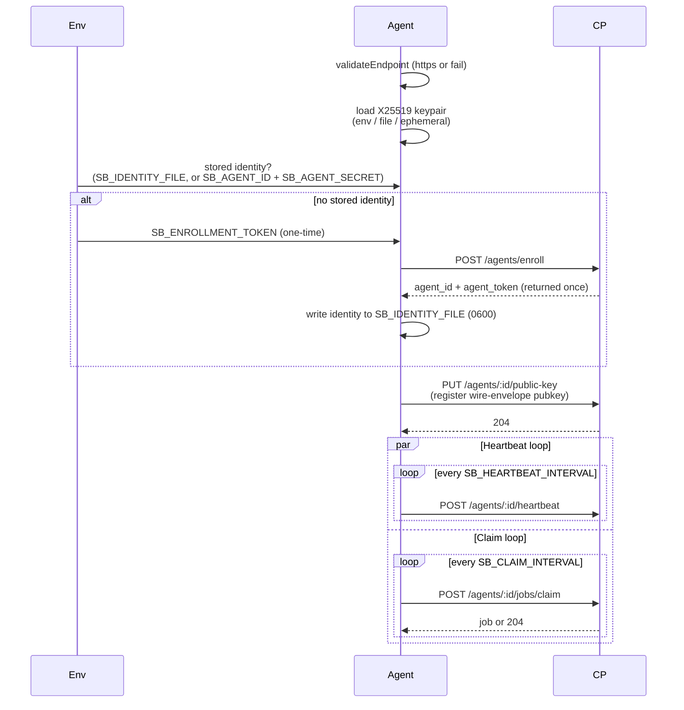

# Agent

Repo: [`secrets-bridge/agent`](https://github.com/secrets-bridge/agent)
· Stack: Go 1.25 stdlib `net/http` (no Fiber) +
[hashicorp/vault/api](https://github.com/hashicorp/vault) +
[aws-sdk-go-v2/service/secretsmanager](https://github.com/aws/aws-sdk-go-v2)
· Container: `golang:1.25-alpine` → `distroless/static:nonroot`

The execution tier. Runs inside the target account / cluster.
Holds provider credentials for its own boundary only; the Control
Plane never sees them.

## Hard rules enforced by CI

| Rule | How |
|---|---|
| No database driver | CI greps `go.sum` for `pgx`, `lib/pq`, `mysql`, `mongo-driver`; fails on hit |
| No Redis client | CI greps `go.sum` for `redis/go-redis`, `gomodule/redigo`; fails on hit |
| No inbound listener except probes | The only listener serves `/healthz`, `/readyz` and `/metrics` on `SB_LOCAL_ADDR`. The binary defaults to `127.0.0.1:8090`. The `agent` Helm chart binds `0.0.0.0:8090` because kubelet probes come from the node, creates no Service for it, and its default NetworkPolicy denies all ingress to the pod. |
| Identity file mode 0600 | `TestSaveToFile_AtomicNoPartialOnFailure` asserts the perm bits |
| TLS required to the CP | `validateEndpoint` refuses `http://` unless `SB_INSECURE_TRANSPORT=true` |
| Plaintext zeroed after one use | `client.Zero([]byte)` is called via `defer` on every value-bearing slice |

## Boot sequence

!!! note "Heartbeat response shape"
    A **bodyless** heartbeat returns an empty **204**, the shape existing
    agents rely on. A heartbeat with an optional JSON body
    (`status` / `agent_version` / `capabilities`) returns **200**
    `{status, server_time, next_heartbeat_seconds}` and records the reported
    fields; the first heartbeat also transitions an `enrolled` agent to
    `active`. Agents are onboarded via the enrollment-token flow
    (`POST /provider-connections/:id/agent-enrollment-token` →
    `POST /agents/enroll`); see the [HTTP API reference](../reference/api-endpoints.md#agents).

## Configuration

| Env var | Required | Default | Notes |
|---|---|---|---|
| `SB_CP_ENDPOINT` | yes | - | `https://api.secrets-bridge.example` |
| `SB_ENROLLMENT_TOKEN` | first boot | - | One-time token from `POST /provider-connections/:id/agent-enrollment-token`; spent once at `POST /agents/enroll` |
| `SB_ENROLLMENT_ENABLED` | no | `true` | Enroll on first boot when no identity is stored and a token is set |
| `SB_IDENTITY_FILE` | no | `/etc/secrets-bridge/identity.json` | Written after enrollment, read on every restart; must be writable and persistent |
| `SB_PROVIDER_TYPE` | no | `aws-sm` | Reported at enrollment; must match the provider connection's `type` |
| `SB_CLUSTER_NAME` | yes for discovery jobs | - | Stamped on every discovered secret |
| `SB_AGENT_ID` / `SB_AGENT_SECRET` | no | - | Pre-provisioned credential; overrides the identity file and skips enrollment |
| `SB_HEARTBEAT_INTERVAL` | no | `30s` | Bounded by api's stale-after window |
| `SB_CLAIM_INTERVAL` | no | `5s` | Claim cadence |
| `SB_CLAIM_CONCURRENCY` | no | `4` | Worker pool size; non-blocking semaphore |
| `SB_INSECURE_TRANSPORT` | no | `false` | Dev only: allows `http://` to the CP ([insecure switches](../operations/config.md#insecure-switches-dev-only)) |
| `SB_CP_CA_FILE` | no | - | Pin a private CA (replaces system roots) |
| `SB_AGENT_PRIVATE_KEY_FILE` | no | ephemeral | X25519 keypair persistence |
| **Provider creds** (per resolver) | yes | - | See [Providers supported](../reference/providers.md) |

The full list, including `SB_AGENT_NAME`, `SB_REGION` and the provider
settings, is in the [configuration reference](../operations/config.md#agent).

!!! warning "Direct mint is a dev-only break-glass"
    `SB_AGENT_ID` / `SB_AGENT_SECRET` only come from the legacy direct mint
    (`POST /api/v1/agents`), which the api refuses with
    `403 direct_agent_mint_disabled` unless `SB_ALLOW_DIRECT_AGENT_MINT=true`.
    Onboard agents with an enrollment token instead; see
    [Agent onboarding](../operations/agent-onboarding.md).

## Executors that ship today

| Job type | Executor | What it does |
|---|---|---|
| `patch` | `PatchExecutor` | Fetches wraps → `GetValue` (existing bundle) → merge → `PutValue` → mark consumed. Idempotent re-runs (untouched keys survive). |
| `read` | `ReadExecutor` | Fetches one bundle → selective `target_keys` split → `POST /agents/:id/wraps` per key → zero plaintext after each post |
| `discover` | `DiscoverExecutor` | `ListMetadata(scope)` → preserve native tags verbatim into the CP's `labels` jsonb (Vault `custom_metadata`, AWS Tags, etc.) |

## Provider resolvers

The agent dispatches by `payload.target_provider_type` via
`ResolverByType`. Today:

| Type | Status | Auth |
|---|---|---|
| `vault` | ✅ ships | Token (`SB_VAULT_TOKEN`) or Kubernetes (`SB_VAULT_KUBERNETES_ROLE`) |
| `aws-sm` | ✅ ships | Standard AWS SDK chain (IRSA / instance role / `AWS_*` env) |
| `gcp-sm` | placeholder | Stub returns `NotConfiguredResolver` |
| `azure-kv` | placeholder | Stub returns `NotConfiguredResolver` |

Every resolver refuses credential-shaped keys in the
`target_provider_config` (e.g. `awsSecretAccessKey`, `token`,
`sessionToken`) so a future api bug can't accidentally ship a
credential to the agent over the wire.
