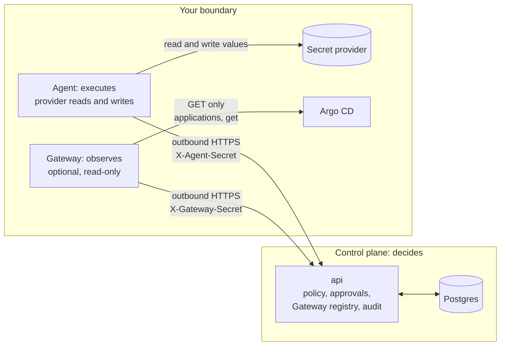

# Gateway

Repo: [`secrets-bridge/gateway`](https://github.com/secrets-bridge/gateway)
· Stack: Go 1.26, stdlib `net/http`, `log/slog`, Prometheus client
· Container: `golang:1.26-alpine` → `distroless/static:nonroot`, published as
`ghcr.io/secrets-bridge/gateway`, signed with cosign and shipped with an SBOM and
build provenance ([verifying releases](../operations/verifying-releases.md))
· Chart: `oci://ghcr.io/secrets-bridge/charts/secrets-bridge-gateway`

The control plane decides, the agent executes, and the Gateway observes. A
Gateway runs inside your security boundary, reads the state of the Argo CD
Applications you list in its local configuration, and reports that state to the
control plane as metadata. It never changes anything, and it is optional.

!!! warning "Release 1 is in progress"
    The Gateway binary, its Helm chart and the control-plane registry
    (enrollment, heartbeat, catalog, connector approval, bindings, revoke)
    are merged. Observation tasks, results and evidence are not:
    [api#294](https://github.com/secrets-bridge/api/issues/294),
    [worker#38](https://github.com/secrets-bridge/worker/issues/38) and
    [ui#163](https://github.com/secrets-bridge/ui/issues/163) are still open.

    Until they land, a Gateway enrolls, heartbeats and reports its catalog of
    connectors and targets, but it receives no observation tasks and nothing
    it reads shows up on a request. Argo CD state on a request still comes
    from the control plane's own poller (`SB_GITOPS_ENABLED` on the api and
    `SB_WORKER_GITOPS_ENABLED` on the worker, see
    [GitOps observation](../overview/architecture.md#the-four-request-lifecycles)).
    Making the Gateway the only Secrets Bridge component that talks to Argo CD
    is tracked in [gateway#13](https://github.com/secrets-bridge/gateway/issues/13).

## Where it sits

The agent and the Gateway each open their own outbound HTTPS connection to the
control plane. There is no connection between them in either direction, and the
agent does not depend on the Gateway. The control plane never connects into
your network on the Gateway path.

## What it is

| Property | What it means in the code |
|---|---|
| Optional | Governance and execution work without a Gateway. By design, a request with no Gateway observing it shows as unverified, never as failed. |
| Outbound only | The only listener is `/healthz`, `/readyz` and `/metrics` on a loopback address (`127.0.0.1:8091` by default). A non-loopback address, including `localhost`, is refused at boot. |
| Read-only | Argo CD is read through a GET-only transport. The control-plane client can reach only the Gateway endpoints. No sync, rollback, refresh or patch is possible. |
| Metadata only | It reports sync status and revision, health, the last operation phase and the reconcile time. It never decodes Helm values, condition messages or health messages, and it reads no Kubernetes Secrets. |
| Bound connectors only | Connectors and targets come from a local file. The control plane names only a connector id and a target id. It cannot point the Gateway at a new host, project or Application. |
| Stateless | No database, no Redis, no volume. Several replicas share one Gateway identity. |

## What it is not

Argo CD `Healthy` and `Synced`, or a finished sync, are operational state. They
are not proof that a new secret value reached a running workload: a secret
change does not change Git, so an Application can be healthy and synced while
its pods still hold the old value. The Argo CD connector reports at most
`observed` with confidence `low`, attaches the caveat `argocd_health_not_proof`
to every observation that is not an error, and never counts toward a verdict.

A Gateway that is offline, not deployed or not yet bound means the observation
is pending, and later unverified. It never means the deployment is healthy, and
it never fails the request. Execution and approvals do not wait for it.

The Gateway is not an execution path. It does not call the agent, receive
values or wraps, or hold provider credentials.

## Release 1 scope

Release 1 is Argo CD rollout-state observation only
([gateway#12](https://github.com/secrets-bridge/gateway/issues/12)).

- The supported connector kind is `argocd`. It reads one Application by name
  with `GET /api/v1/applications/{name}` (with `?appNamespace=` when the
  target sets one) and checks its token at boot with
  `GET /api/v1/session/userinfo`. Nothing else.
- With only `argocd` connectors, the Gateway reads no Kubernetes API. It builds
  no Kubernetes client, needs no service-account token and no RBAC, and runs
  no Kubernetes self-check.
- The `eso` (External Secrets Operator) and `rollout` (Deployment rollout)
  connectors are Release 2. Their code is in the repo, but the Gateway refuses
  a connectors file that names them unless `SB_GATEWAY_ENABLE_R2_CONNECTORS=true`
  is set. That switch is not supported for production, and the Gateway logs a
  WARN at boot while it is on. The Helm chart does not render these kinds and
  never sets the switch.

What the Argo CD connector proposes for the stage `argocd_context` (the
control plane recomputes every outcome from the reported facts):

| Outcome | When |
|---|---|
| `observed`, confidence `low` | The Application is `Healthy` and `Synced`, with no operation or a `Succeeded` one, and was reconciled after the change |
| `not_observed` | Anything else, including `Progressing`, `Degraded`, `OutOfSync`, a failed operation, or state reconciled at or before the change. `Degraded` is context, not a failure of the secret change |
| `unverifiable` | The Application is outside the AppProjects allowed in the local configuration. No status is reported |
| `error` | Argo CD cannot be read. A fixed error code, never a message |

## Security model

The Gateway fails closed. Where it cannot prove a rule holds, it refuses to
start, stops claiming, or stays not ready.

| Rule | How it holds |
|---|---|
| GET only to Argo CD | Each Argo CD client is pinned to the scheme and host of its `base_url` and allows GET to two paths. Every other method, path and query key is refused before the request leaves the process. `resource-tree`, `managed-resources`, `manifests` and the application list are blocked even though Argo CD's `applications, get` permission allows them, and so is `?refresh=`, which would make Argo CD patch the Application. Redirects are refused, proxy variables are ignored, and responses are capped at 2 MiB. |
| Least-privilege Argo CD account | The token needs `applications, get` and nothing else. It is mounted as a file and re-read when it rotates. |
| No Secrets access, ever | Release 1 has no Kubernetes access at all. For the Release 2 Kubernetes connectors, a boot self-check refuses to start if the service account can use any verb on `secrets`, or any write verb on a resource a connector reads. A failed review call also refuses the boot. There is no override. The check repeats every 5 minutes and stops the Gateway if a grant appears. |
| Writes only to the control plane | The control-plane client refuses any method or path other than the Gateway endpoints, uses no proxy and never follows redirects. Enrollment refuses any URL that is not `https`. |
| Credential at rest | The control plane stores a SHA-256 hash of the Gateway secret and compares it in constant time. On the Gateway side the identity is a read-only file. A file that other users can read, or that its group can write, is refused at boot. |
| Revocation | After a revoke, the next heartbeat or catalog upload gets `401`. The Gateway stops claiming and stays up and not ready, with the reason in its log, so the pod does not restart-loop. |
| Separate identity | Gateways have their own tables, header and middleware. An agent credential cannot authenticate as a Gateway, and a Gateway credential cannot reach agent routes. |

Gateway evidence is customer-side attestation: whoever controls a Gateway can
report false state for their own requests. The design accepts that for Release 1
by labelling evidence "observed by Gateway X". Signed evidence
([gateway#7](https://github.com/secrets-bridge/gateway/issues/7)) must ship
before Gateway evidence is presented as compliance evidence.

## Runtime behaviour

- A replica is ready when the control plane has accepted a recent heartbeat
  and the catalog, and every connector self-check passes.
- Claiming pauses while no heartbeat has been accepted within
  `SB_GATEWAY_CP_UNREACHABLE_AFTER` (default `2m`), the catalog is not
  accepted, or a connector is unverified. It resumes once all three hold again.
- A `401` or an unsupported contract version stops claiming and leaves the
  process up and not ready.
- `gateway healthcheck` is the client for the exec probes, since the image has
  no shell or curl and the local server listens on loopback only. It sends one
  GET to `/readyz` (or `/healthz` with `--live`) and exits 0 on a 200.

## Further reading

- [Install and enroll a Gateway](../operations/gateway.md)
- [Gateway configuration](../operations/config.md#gateway)
- [ADR 0001: Gateway as an outbound-only observation plane](https://github.com/secrets-bridge/gateway/blob/main/docs/adr/0001-gateway-observation-plane.md)
- [Gateway threat model](https://github.com/secrets-bridge/gateway/blob/main/docs/design/threat-model.md)
- [Chart README](https://github.com/secrets-bridge/charts/blob/main/gateway/README.md)
