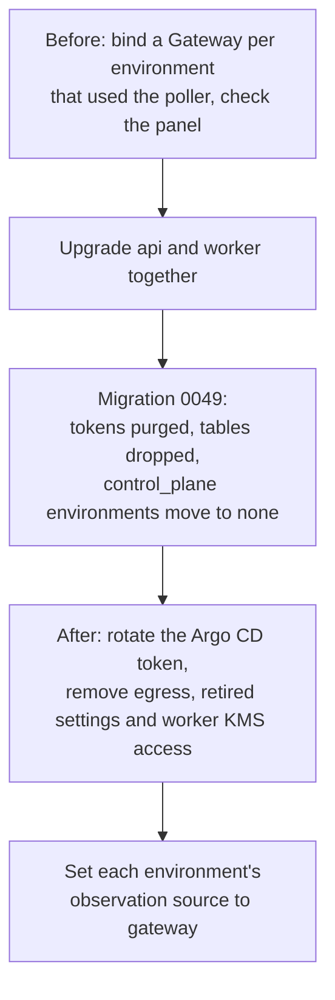

# Gateway cutover

The control plane no longer talks to Argo CD. A [Gateway](gateway.md) inside
your boundary is the only Secrets Bridge component that reads Argo CD. The api
has no Argo CD client and no Argo CD endpoint or app-mapping routes, the worker
has no poller, and the control plane stores no Argo CD token.

This page is for installs that used the old control-plane poller
(`SB_GITOPS_ENABLED` on the api and `SB_WORKER_GITOPS_ENABLED` on the worker)
and are upgrading to an api that includes migration `0049`. If you never turned
the poller on, the upgrade only changes the default observation source to
`none`. Skip to [After upgrading](#after-upgrading), steps 3 to 5.

!!! danger "Action required: rotate the Argo CD account token"
    The token you gave the control plane sat in its Postgres as a KMS
    envelope. The upgrade deletes it, but database backups taken before the
    upgrade still hold the ciphertext until they age out, and it stays
    decryptable while the KMS key exists. Rotate or delete that token on the
    Argo CD side ([step 1 after upgrading](#after-upgrading)).



## Before upgrading

On the version you run today, the poller and the Gateway can both be
configured, and each environment uses one of them at a time. Use that to move
every environment to a Gateway before the poller goes away.

1. **List what the poller observes.** Each environment with the source
   `control_plane` and at least one Argo CD app mapping is observed by the
   poller. Note the Argo CD instance and the applications mapped to each
   secret. After the upgrade these records are gone, so write them down now.
2. **Install and enroll a Gateway** in each boundary that can reach those Argo
   CD instances, with a read-only Argo CD account of its own. Follow
   [Gateway](gateway.md), steps 1 to 6. Do not reuse the token you gave the
   control plane.
3. **Approve the connector and bind each application** that had a mapping to
   the same secret scope, in the same environment
   ([step 7](gateway.md#7-approve-the-connector-and-bind-a-target)).
4. **Turn on the worker's Gateway sweepers** with
   `SB_WORKER_GATEWAY_SWEEPERS_ENABLED=true`
   ([step 9](gateway.md#9-turn-on-the-worker-sweepers)).
5. **Check parity on one environment.** Switch it to `gateway`
   ([step 8](gateway.md#8-switch-the-environment-to-gateway-observation)),
   submit and approve a change to a bound secret, and open the request page.
   The **Argo CD (observed by Gateway …)** panel shows, for each bound
   application, the facts the poller used to store: **Sync**, **Health**,
   **Last operation** and **Revision**. Each one is labelled observed
   operational state and carries the caveat that Argo CD health is not proof
   the new value reached the app. The api's parity test checks the same thing.
6. Repeat step 5 for every environment that used the poller, or move them in
   one go after the upgrade (step 5 after upgrading).

An environment that has no Gateway when you upgrade still works. Its requests
run as before and show no Argo CD state until a Gateway observes them.

## What the upgrade does

Upgrade the api and the worker in the same release. The api applies migration
`0049` when it starts. An older worker with the poller still on would read
tables that the migration drops.

Migration `0049`:

- Writes one `argocd_endpoint.token_purged` audit row for each
  `argocd_endpoints` row, soft-deleted rows included. The actor is
  `system:migration`, the resource is `argocd_endpoint:<id>`, and the metadata
  holds only `environment_id`, `changed_keys` (the four token column names) and
  `reason: gateway_cutover`.
- Drops `argocd_endpoints`, and with it every token envelope
  (`token_ciphertext`, `token_data_key_ciphertext`, `token_nonce`,
  `token_kms_key_id`). It also drops `gitops_app_mappings`.
- Moves every environment whose observation source is `control_plane` to
  `none`, with one `environment.observation_source.update` audit row each
  (`observation_source_before: control_plane`, `observation_source_after:
  none`).
- Makes `none` the default source and refuses `control_plane` from then on.
  `PUT /admin/environments/:id/observation-source` with `control_plane`
  answers `400 source_retired`.
- Keeps `gitops_observations`. The poller's old rows are not rewritten and stay
  readable to the requester at `GET /api/v1/requests/:id/gitops`, each labelled
  `history_context_only` with a `history_status`
  ([API reference](../reference/api-endpoints.md#requests-access-requests)). The console shows
  them in the read-only **GitOps observations** card on the request page.

The migration is idempotent: a second run drops nothing, moves nothing and
writes no audit row.

To confirm it ran, read the audit log (needs `audit.read`, using the session
from [Gateway, step 2](gateway.md#2-sign-in-and-step-up)):

```bash
curl -fsS -b "$JAR" "$CP/api/v1/audit-events?actor=system:migration&action=argocd_endpoint.token_purged" \
  | jq 'map({resource, metadata})'
curl -fsS -b "$JAR" "$CP/api/v1/audit-events?actor=system:migration&action=environment.observation_source.update" \
  | jq 'map({resource, metadata})'
```

## After upgrading

1. **Rotate or delete the Argo CD account token on the Argo CD side.** Revoke
   the token of the Argo CD account you gave the control plane, or delete the
   account if only the control plane used it. For a local account:

    ```bash
    argocd account get --account <cp-account>           # lists token ids
    argocd account delete-token --account <cp-account> <token-id>
    ```

    Backups taken before the upgrade keep the old ciphertext until they age
    out. Rotating the token makes it worthless.

2. **Remove Argo CD egress from the api and the worker.** If you added
   NetworkPolicy rules (in the `secrets-bridge` chart,
   `api.networkPolicy.egress.extraRules` and
   `worker.networkPolicy.egress.extraRules`) or
   firewall rules so the control plane could reach Argo CD, delete them. Only
   the Gateway's egress needs to reach Argo CD.

3. **Remove the retired settings.** `SB_GITOPS_ENABLED`,
   `SB_ALLOW_INSECURE_ARGOCD_ADDR` and `SB_WORKER_GITOPS_*` switch nothing. If
   one is still set, the api or worker logs its name at startup, never its
   value. Remove them from your environment Secret and chart values
   (`api.config.gitopsEnabled`, `worker.config.gitopsEnabled` and the
   `worker.config.gitops*` intervals). The chart may still render
   `SB_GITOPS_ENABLED` and `SB_WORKER_GITOPS_ENABLED` from those values; the
   startup notice is then expected and harmless. See
   [Retired settings](config.md#retired-settings).

4. **Remove the worker's KMS access.** The worker opened the KMS backend only
   to unwrap stored Argo CD tokens, and it no longer reads `SB_KMS_*`. Take the
   worker's identity out of the KMS key policy or IAM role (`aws-kms`) or the
   Vault transit policy (`vault-transit`). If the worker shares the api's
   environment Secret, it still receives the KMS credentials there. Give the
   worker its own Secret without them when your deployment allows it, and drop
   any worker egress rule that exists only for the KMS endpoint. The api still
   needs KMS for wraps and its other envelopes.

5. **Set each environment's observation source to `gateway`** once a Gateway
   is bound for it
   ([step 8](gateway.md#8-switch-the-environment-to-gateway-observation)).
   Environments the migration moved to `none` stay unobserved until you do.
   The source is read when a request reaches `executed`, so requests executed
   before the switch get no tasks.

6. **Ignore the leftover Argo CD integration page** in the console
   (Admin → Integrations). The api no longer serves its routes, so it shows a
   feature-off banner. Its advice to set `SB_GITOPS_ENABLED` does not apply.
   The Observation dialog may still list **Control plane**; saving it answers
   `source_retired`.

## Rollback

Redeploying an older api does not restore the control-plane path. The Argo CD
tokens and the endpoint and mapping tables are gone, and the down migration
restores the schema only: no token comes back and no environment returns to
`control_plane`. There is no setting that turns the poller back on.

Until a Gateway runs and its environment is set to `gateway`, observation shows
as unavailable or unverified: requests carry no Argo CD state, or their tasks
end `timed_out` (`gateway_unavailable`) at the deadline. Neither fails the
request. Both clear once a bound Gateway is running.
