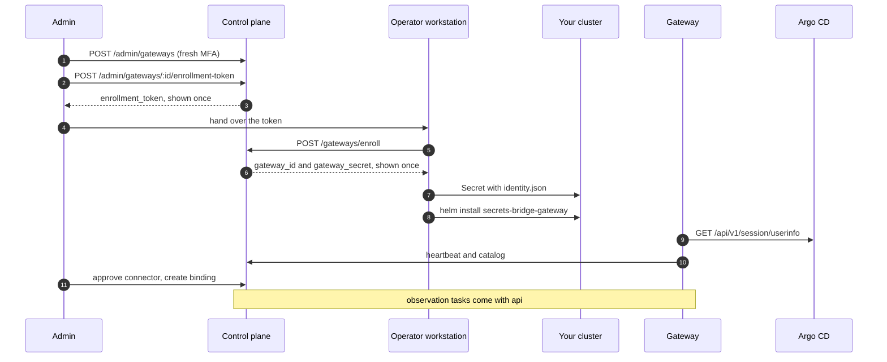

# Gateway

This page installs a [Gateway](../components/gateway.md) for Release 1, which
observes Argo CD only. You create a read-only Argo CD account, create the
Gateway in the control plane, enroll it once from your workstation, install the
chart, and then approve its connector and bind an Argo CD Application to a
secret.

!!! warning "Observation is not live yet"
    Everything on this page works against the api on `main`. The last step,
    where the Gateway claims observation tasks and its results appear on a
    request, comes with the next release
    ([api#294](https://github.com/secrets-bridge/api/issues/294),
    [worker#38](https://github.com/secrets-bridge/worker/issues/38),
    [ui#163](https://github.com/secrets-bridge/ui/issues/163)). Until then the
    Gateway enrolls, heartbeats and reports its catalog, and Argo CD state on a
    request still comes from the control plane's poller (`SB_GITOPS_ENABLED`).



## Before you start

- The api from `main`, with migrations `0046` and `0047` applied. Migration
  `0047` adds `gateway.mint`, `gateway.revoke`, `gateway.list` and
  `gateway.bind` to the seed `admin` role.
- An account that holds those permissions and has a TOTP factor enrolled at
  `/me/mfa`. Every admin write on a Gateway needs a fresh second factor. The
  console page for Gateways is coming in
  [ui#163](https://github.com/secrets-bridge/ui/issues/163), so this page uses
  `curl`, and the TOTP path is the one you can complete from a shell.
- `kubectl`, `helm`, `jq`, `curl` and the `argocd` CLI.
- A namespace for the Gateway. The examples use `tenant-a-uat`.

## 1. Create a read-only Argo CD account

Add a local account with API key access and no login:

```yaml
# argocd-cm
data:
  accounts.sb-gateway: apiKey
```

Give it `applications, get` on the AppProjects the Gateway may read, and
nothing else:

```csv
# argocd-rbac-cm, one line per allowed AppProject
p, role:sb-gateway-read, applications, get, tenant-a-uat/*, allow
g, sb-gateway, role:sb-gateway-read
```

Do not add `sync`, `override`, `action/*`, `update`, `delete`, `exec` or `logs`,
or anything on clusters, repositories, projects or accounts. The Gateway's
transport already refuses every request except the two GETs it needs, but the
token should not carry more than that either.

Generate a token and store it in a Secret without printing it:

```bash
argocd account generate-token --account sb-gateway --expires-in 2160h \
  | kubectl -n tenant-a-uat create secret generic sb-gateway-argocd-main \
      --from-file=token=/dev/stdin
```

The chart mounts the token as a file, and the Gateway re-reads it when it
changes, so you can rotate it by updating the Secret.

## 2. Sign in and step up

The api uses a session cookie, so keep it in a private cookie jar. The password
and the TOTP code are read from the terminal and passed to `jq` on stdin, so
they never appear on a command line or in the process list.

```bash
CP=https://cp.example.com

JAR=$(mktemp) && chmod 600 "$JAR"
read -rp 'Admin email: ' SB_ADMIN_EMAIL
IFS= read -rsp 'Admin password: ' SB_ADMIN_PASSWORD; echo
printf '%s\n%s\n' "$SB_ADMIN_EMAIL" "$SB_ADMIN_PASSWORD" | jq -Rn '{email: input, password: input}' \
  | curl -fsS -c "$JAR" -o /dev/null -X POST "$CP/api/v1/auth/login" \
      -H 'Content-Type: application/json' --data-binary @-
unset SB_ADMIN_PASSWORD

# Step up with your TOTP factor. The session stays MFA-fresh for 15 minutes.
FACTOR_ID=$(curl -fsS -b "$JAR" "$CP/api/v1/users/me/mfa/factors" \
  | jq -r 'map(select(.kind == "totp"))[0].id')
CHALLENGE_ID=$(curl -fsS -b "$JAR" -X POST "$CP/api/v1/auth/mfa/challenge" \
  -H 'Content-Type: application/json' -d '{"kind":"totp"}' | jq -r .challenge_id)
IFS= read -rsp 'TOTP code: ' SB_TOTP_CODE; echo
printf '%s\n%s\n%s\n' "$CHALLENGE_ID" "$FACTOR_ID" "$SB_TOTP_CODE" \
  | jq -Rn '{challenge_id: input, factor_id: input, code: input}' \
  | curl -fsS -b "$JAR" -o /dev/null -X POST "$CP/api/v1/auth/mfa/verify" \
      -H 'Content-Type: application/json' --data-binary @-
unset SB_TOTP_CODE
```

If a later write answers `401` with `WWW-Authenticate: step-up`, the 15 minutes
have passed. Run the step-up block again. See
[Authentication](authentication.md#step-up-ceremony) for the model.

## 3. Create the Gateway and mint an enrollment token

Create the Gateway record. `name` is a lower-case DNS-style label of up to 63
characters. `boundary` is a free label of up to 128 characters that says where
the Gateway runs. `environment_id` is optional; when it is set, every binding
for this Gateway must use that environment.

```bash
GW_ID=$(curl -fsS -b "$JAR" -X POST "$CP/api/v1/admin/gateways" \
  -H 'Content-Type: application/json' \
  -d '{"name":"tenant-a-uat","boundary":"tenant-a-uat cluster"}' | jq -r .id)
```

The Gateway starts in status `pending`, with no credential. `max_replicas`
(default 200) and `max_inflight_tasks` (default 20) can also be set here.

Mint a one-time enrollment token for it. The response carries the token once,
so keep it out of your terminal output and your shell history:

```bash
SB_GATEWAY_ENROLL_TOKEN=$(curl -fsS -b "$JAR" -X POST \
    "$CP/api/v1/admin/gateways/$GW_ID/enrollment-token" \
    -H 'Content-Type: application/json' \
    -d '{"expected_cluster_name":"tenant-a-uat","expires_in_seconds":900}' \
  | jq -r .enrollment_token)
```

Both fields are optional. `expires_in_seconds` defaults to 900 (15 minutes) and
is clamped to 60 to 86400. When `expected_cluster_name` is set, enrollment must
send the same `cluster_name` or it is refused. You can mint a token only while
the Gateway is `pending`, and you can revoke an unused one with
`POST /api/v1/admin/gateway-enrollment-tokens/:id/revoke`.

If someone else enrolls the Gateway, give them the token over a channel you
would trust with a password. They read it at a silent prompt in step 4.

## 4. Enroll and store the identity

The pod never enrolls. You exchange the token for the Gateway credential once,
from your workstation, and write the result straight into a Secret. The token
and the secret never appear on a command line, in shell history or on disk.

```bash
# Skip this read if you minted the token in this shell in step 3.
IFS= read -rsp 'Enrollment token: ' SB_GATEWAY_ENROLL_TOKEN; echo

printf '%s' "$SB_GATEWAY_ENROLL_TOKEN" \
  | jq -Rs '{enrollment_token: ., cluster_name: "tenant-a-uat"}' \
  | curl -fsS -X POST "$CP/api/v1/gateways/enroll" \
      -H 'Content-Type: application/json' --data-binary @- \
  | jq -ce '{gateway_id, gateway_secret}' \
  | kubectl -n tenant-a-uat create secret generic sb-gateway-identity \
      --from-file=identity.json=/dev/stdin
unset SB_GATEWAY_ENROLL_TOKEN
```

`printf` is a shell builtin, so the token does not show up in the process list.
The enrollment endpoint answers `201` with `gateway_id` and `gateway_secret`,
and the Gateway turns `active`.

The token is single use. If any step of the pipeline fails after the control
plane answered, the credential is lost: revoke the Gateway and create a new one.
Enrollment errors are closed codes:

| Status | Code | Meaning |
|---|---|---|
| `401` | `enrollment_token_invalid`, `enrollment_token_expired` | Unknown or expired token. Mint a new one |
| `403` | `enrollment_token_revoked` | The token was revoked |
| `403` | `https_required` | The request did not reach the api over TLS. Enrollment is refused over plain `http` outside `SB_ENV=dev` |
| `409` | `enrollment_token_already_consumed`, `gateway_already_enrolled` | The token or the Gateway was used already |
| `400` | `cluster_name_mismatch` | `cluster_name` differs from the token's `expected_cluster_name` |

If your Secrets come from a vault through External Secrets Operator, store the
same JSON in the vault and render it into a Secret under the key
`identity.json`.

## 5. Install the chart

Pin the image by digest. Check its signature first, as described in
[Verifying images and charts](verifying-releases.md). NetworkPolicy cannot match
hostnames, so list the CIDRs that the control plane and Argo CD resolve to.

```yaml
# gateway-values.yaml
image:
  digest: sha256:<gateway-digest>
cp:
  endpoint: https://cp.example.com
  egress:
    cidrs: [192.0.2.10/32]
identity:
  existingSecret: sb-gateway-identity
connectors:
  argocd:
    - name: argocd-main               # the connector id the control plane sees
      baseURL: https://argocd.example.com
      tokenSecret:
        name: sb-gateway-argocd-main
        key: token
      allowedProjects: [tenant-a-uat]
      applications:
        - id: payments-api            # the target id you bind in step 7
          name: payments-api          # the Argo CD Application
      egress:
        cidrs: [198.51.100.20/32]
        port: 443
```

```bash
helm install secrets-bridge-gateway \
  oci://ghcr.io/secrets-bridge/charts/secrets-bridge-gateway \
  --version <chart-version> \
  --namespace tenant-a-uat -f gateway-values.yaml
```

The chart renders a Deployment (2 replicas sharing one identity), a ConfigMap
with the connectors file, a ServiceAccount with no Role and no mounted token, a
NetworkPolicy with no ingress and egress only to DNS, the control plane and each
Argo CD endpoint, and a PodDisruptionBudget. It renders no Secret, Role,
Service, Ingress or volume claim. `helm install` fails with a message naming the
value when the image is not pinned, `cp.endpoint` is not `https://`, the
identity Secret is not named, a connector is incomplete, or a NetworkPolicy peer
is missing.

For an Argo CD in the same cluster, use selectors instead of CIDRs, and the
full list of values, see the
[chart README](https://github.com/secrets-bridge/charts/blob/main/gateway/README.md).

## 6. Verify

Wait for the pods to turn ready. Readiness runs `gateway healthcheck` inside the
container, and it passes only after the control plane has accepted a heartbeat
and the catalog and the Argo CD token check has passed.

```bash
kubectl -n tenant-a-uat rollout status deploy/secrets-bridge-gateway
kubectl -n tenant-a-uat exec deploy/secrets-bridge-gateway -- \
  /usr/local/bin/gateway healthcheck
kubectl -n tenant-a-uat logs deploy/secrets-bridge-gateway
```

In the log, look for `identity loaded` and `connectors bound`.

Then check the control plane. `GET /api/v1/admin/gateways` needs
`gateway.list` and no step-up:

```bash
curl -fsS -b "$JAR" "$CP/api/v1/admin/gateways" \
  | jq '.items[] | {id, name, status, last_seen_at, replicas_seen, catalog_version}'

curl -fsS -b "$JAR" "$CP/api/v1/admin/gateways/$GW_ID" \
  | jq '{replicas: [.replicas[] | {replica_id, status, last_seen_at}],
         connectors: [.connectors[] | {id, connector_id, kind, status, targets}]}'
```

The Gateway shows `status: "active"`, each replica appears with a recent
`last_seen_at`, and the connector `argocd-main` is listed with status
`advertised` and the target `payments-api`.

!!! note "Expected log line until the next release"
    The Gateway already polls for observation tasks, and the api does not
    serve that route yet. Each poll logs `claim failed` at WARN level with a
    not-found error, backing off to once every 30 seconds
    (`SB_GATEWAY_CLAIM_IDLE_MAX`). It does not affect readiness.

## 7. Approve the connector and bind a target

Advertising a connector approves nothing. An admin with `gateway.bind` approves
it, using the connector's `id` (a UUID) from the detail call above:

```bash
CONNECTOR_ID=$(curl -fsS -b "$JAR" "$CP/api/v1/admin/gateways/$GW_ID" \
  | jq -r '.connectors[] | select(.connector_id == "argocd-main") | .id')

curl -fsS -b "$JAR" -X POST \
  "$CP/api/v1/admin/gateways/$GW_ID/connectors/$CONNECTOR_ID/approve" | jq '{connector_id, status}'
```

Then bind one advertised Argo CD target to a secret scope in an environment. A
binding names the Gateway, the environment, either a `secret_id` (a secret
bound to the environment's project) or a `provider_connection_id` with a
`secret_ref`, and the Argo CD connector and target:

```bash
curl -fsS -b "$JAR" -X POST "$CP/api/v1/admin/gateway-bindings" \
  -H 'Content-Type: application/json' \
  -d "{\"gateway_id\":\"$GW_ID\",
       \"environment_id\":\"<environment-id>\",
       \"secret_id\":\"<secret-id>\",
       \"argocd_connector_id\":\"$CONNECTOR_ID\",
       \"argocd_target_id\":\"payments-api\",
       \"observation_timeout_seconds\":1800}" | jq
```

`observation_timeout_seconds` defaults to 1800 and must be 60 to 86400. Release 1
bindings expect the single stage `argocd_context`. The api refuses a binding
with a closed code, for example `connector_not_approved`,
`target_not_advertised`, `target_stale` (the Gateway no longer advertises it),
`environment_outside_gateway`, `secret_not_in_project` or `binding_exists`.
`GET /api/v1/admin/gateway-bindings?gateway_id=<id>` lists bindings and
`DELETE /api/v1/admin/gateway-bindings/:id` removes one.

## 8. Observation (next release)

With [api#294](https://github.com/secrets-bridge/api/issues/294) the control
plane creates an observation task for each binding when a request reaches
`executed`, and an environment setting chooses its observation source: the
control plane's poller, the Gateway, or none. The Gateway claims those tasks,
reads the bound Application and posts metadata-only evidence.
[ui#163](https://github.com/secrets-bridge/ui/issues/163) shows it on the request
page as observed operational state, labelled with the Gateway that observed it.
This page will cover that step once it is merged.

## Revoke a Gateway

```bash
# Needs gateway.revoke and a fresh second factor.
curl -fsS -b "$JAR" -X POST "$CP/api/v1/admin/gateways/$GW_ID/revoke" \
  -H 'Content-Type: application/json' -d '{"reason":"decommissioned"}' | jq '{status, revoked_at}'
```

`reason` is optional, a lower-case code of up to 64 characters. The next
heartbeat or catalog upload gets `401`. The pods stay up and not ready with the
reason in their logs. There is no credential rotation in Release 1: to replace a
credential, revoke the Gateway, create a new one, enroll it and update the
identity Secret.

See [Troubleshooting](troubleshooting.md#gateway) when something does not turn
ready.
