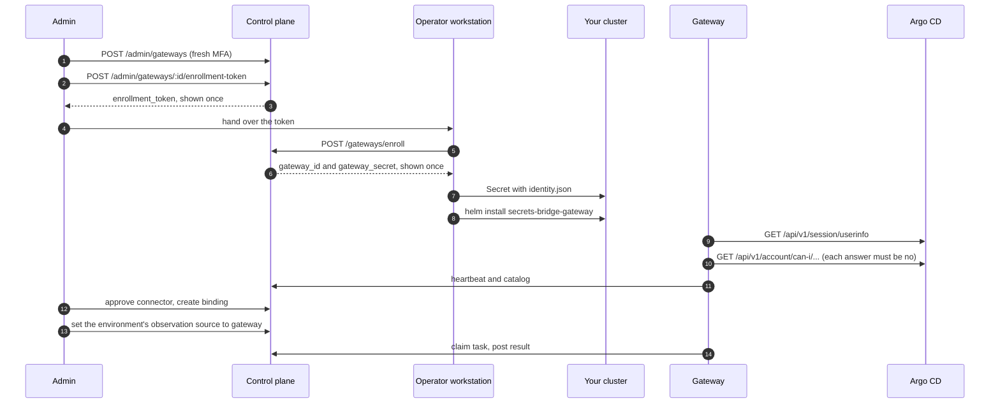

# Gateway

This page installs a [Gateway](../components/gateway.md) for Release 1, which
observes Argo CD only. You create a read-only Argo CD account, create the
Gateway in the control plane, enroll it once from your workstation, install the
chart, approve its connector, bind an Argo CD Application to a secret, and
switch the environment's observation source to the Gateway.

Each control-plane step can be done in the console (Admin → Gateways) or with
`curl`. Enrollment always runs from a shell, because the credential goes
straight into a Kubernetes Secret.

!!! warning "Release 1 is in progress"
    Everything on this page is merged and has not passed QA. The Gateway is
    the only component that reads Argo CD: the control plane has no Argo CD
    client and stores no Argo CD token. If you are upgrading an install that
    used the old control-plane poller, follow
    [Gateway cutover](gateway-cutover.md) first.



## Before you start

- The api from `main`, with migrations `0046` to `0049` applied. Migration
  `0047` adds `gateway.mint`, `gateway.revoke`, `gateway.list` and
  `gateway.bind` to the seed `admin` role. Migration `0048` adds the
  observation tables and each environment's observation source. Migration
  `0049` removes the control-plane Argo CD integration; see
  [Gateway cutover](gateway-cutover.md).
- The worker from `main`, so the Gateway sweepers can be turned on (step 9).
- An account that holds those permissions and has a second factor enrolled at
  `/me/mfa`. Every admin write on a Gateway needs a fresh second factor. The
  console asks for it when needed. For the `curl` path, the TOTP factor is the
  one you can complete from a shell.
- `kubectl`, `helm`, `jq`, `curl` and the `argocd` CLI.
- A namespace for the Gateway. The examples use `tenant-a-uat`.

## 1. Create a read-only Argo CD account

Add a local account with API key access and no login:

```yaml
# argocd-cm
data:
  accounts.sb-gateway: apiKey
```

### The minimal policy

The account needs exactly one permission: `applications, get` on each
AppProject the Gateway may read. Write one line per allowed AppProject, with
the AppProject name in place of `<project>`, and nothing else:

```csv
# argocd-rbac-cm, policy.csv
p, role:sb-gateway-read, applications, get, <project>/*, allow
g, sb-gateway, role:sb-gateway-read
```

For the examples on this page, with one allowed AppProject `tenant-a-uat`:

```csv
p, role:sb-gateway-read, applications, get, tenant-a-uat/*, allow
g, sb-gateway, role:sb-gateway-read
```

`policy.default` in `argocd-rbac-cm` applies to this account too. Leave it
unset, or point it at a role that grants nothing beyond the lines above. The
built-in `role:readonly` includes `logs, get, */*`, so with
`policy.default: role:readonly` the Gateway refuses to start (see
[Argo CD privilege checks](#argo-cd-privilege-checks)).

### Argo CD 2.x: turn on logs RBAC

On Argo CD 2.x, set this in `argocd-cm`:

```yaml
# argocd-cm, Argo CD 2.x only
data:
  server.rbac.log.enforce.enable: "true"
```

Without it, Argo CD 2.x does not enforce the `logs` resource, and
`applications, get` also lets the token read the pod logs of every
Application it can read. Pod logs often hold secrets. The Gateway's
`logs, get` probe cannot see this: Argo CD answers `no` to the question while
the logs are still readable. This setting is required for a Gateway on 2.x.
From Argo CD 3.0 logs RBAC is always enforced and the setting is removed.

### Rights the account must not have

Do not grant any of the following, on any object. The Gateway asks Argo CD
about each one that has a probe and refuses to start if the answer is yes.

| Resource | Actions | Why | Probed |
|---|---|---|---|
| `applications` | `sync`, `update`, `delete`, `create`, `override`, `action/*`, `rollback`, `invoke` | Changes the Application or what it deploys | Yes, but an `action/...` grant is not visible (see below) |
| `exec` | `create` | A shell in the Application's pods | Yes |
| `logs` | `get` | Pod logs often hold secrets | Yes. On 2.x the answer means something only with logs RBAC turned on |
| `applicationsets` | `create`, `update`, `delete` | ApplicationSets create Applications | Yes |
| `projects` | `update`, `delete` | Would let the token widen its own AppProject | Yes |
| `clusters`, `repositories`, `accounts`, `certificates`, `gpgkeys`, `extensions` | any | Not needed | No |

!!! warning "Resource-action grants are your review"
    No can-i question can detect a grant on a resource action, such as
    `p, role:x, applications, action/*, <project>/*, allow` or
    `applications, action/apps/Deployment/restart`. Argo CD's can-i takes the
    action as one segment from a fixed list, and its matcher does not match
    the question `action` against a policy action `action/...`. The probe
    finds such a grant only when the policy action is the wildcard `*`.
    Your review of the Argo CD policy must check that no line grants the
    Gateway's account or role anything beyond the minimal policy above,
    resource actions included.

Generate a token and store it in a Secret without printing it:

```bash
argocd account generate-token --account sb-gateway --expires-in 2160h \
  | kubectl -n tenant-a-uat create secret generic sb-gateway-argocd-main \
      --from-file=token=/dev/stdin
```

The chart mounts the token as a file, and the Gateway re-reads it when it
changes, so you can rotate it by updating the Secret.

## 2. Sign in and step up

The api uses a session cookie, so keep it in a private cookie jar. The password
and the TOTP code are read from the terminal and passed to `jq` on stdin, so
they never appear on a command line or in the process list.

```bash
CP=https://cp.example.com

JAR=$(mktemp) && chmod 600 "$JAR"
read -rp 'Admin email: ' SB_ADMIN_EMAIL
IFS= read -rsp 'Admin password: ' SB_ADMIN_PASSWORD; echo
printf '%s\n%s\n' "$SB_ADMIN_EMAIL" "$SB_ADMIN_PASSWORD" | jq -Rn '{email: input, password: input}' \
  | curl -fsS -c "$JAR" -o /dev/null -X POST "$CP/api/v1/auth/login" \
      -H 'Content-Type: application/json' --data-binary @-
unset SB_ADMIN_PASSWORD

# Step up with your TOTP factor. The session stays MFA-fresh for 15 minutes.
FACTOR_ID=$(curl -fsS -b "$JAR" "$CP/api/v1/users/me/mfa/factors" \
  | jq -r 'map(select(.kind == "totp"))[0].id')
CHALLENGE_ID=$(curl -fsS -b "$JAR" -X POST "$CP/api/v1/auth/mfa/challenge" \
  -H 'Content-Type: application/json' -d '{"kind":"totp"}' | jq -r .challenge_id)
IFS= read -rsp 'TOTP code: ' SB_TOTP_CODE; echo
printf '%s\n%s\n%s\n' "$CHALLENGE_ID" "$FACTOR_ID" "$SB_TOTP_CODE" \
  | jq -Rn '{challenge_id: input, factor_id: input, code: input}' \
  | curl -fsS -b "$JAR" -o /dev/null -X POST "$CP/api/v1/auth/mfa/verify" \
      -H 'Content-Type: application/json' --data-binary @-
unset SB_TOTP_CODE
```

If a later write answers `401` with `WWW-Authenticate: step-up`, the 15 minutes
have passed. Run the step-up block again. See
[Authentication](authentication.md#step-up-ceremony) for the model.

In the console you skip this step: sign in, and the console runs the step-up
dialog on the first write that needs it.

## 3. Create the Gateway and mint an enrollment token

In the console:

1. Open **Admin → Gateways** (needs `gateway.list`) and select
   **Create gateway**.
2. Fill in **Name**, **Boundary** and, if you want, **Environment
   (optional)**, **Max replicas** and **Max tasks in flight**. Select
   **Create gateway**.
3. The **Create enrollment token** panel opens next. Pick a **Token
   lifetime** (15 minutes, 1 hour or 24 hours) and, if you want, a **Cluster
   name (optional)**, then select **Create token**. For a Gateway that is
   still pending you can also open it from the list and select **Create
   enrollment token**.
4. The token is masked and shown once. Use **Copy token**, paste it at the
   silent prompt in step 4, and close the panel. The console keeps the token
   in memory only, and closing the panel clears the clipboard if it still
   holds the token.

With `curl`, create the Gateway record. `name` is a lower-case DNS-style label of up to 63
characters. `boundary` is a free label of up to 128 characters that says where
the Gateway runs. `environment_id` is optional; when it is set, every binding
for this Gateway must use that environment.

```bash
GW_ID=$(curl -fsS -b "$JAR" -X POST "$CP/api/v1/admin/gateways" \
  -H 'Content-Type: application/json' \
  -d '{"name":"tenant-a-uat","boundary":"tenant-a-uat cluster"}' | jq -r .id)
```

The Gateway starts in status `pending`, with no credential. `max_replicas`
(default 200) and `max_inflight_tasks` (default 20) can also be set here.

Mint a one-time enrollment token for it. The response carries the token once,
so keep it out of your terminal output and your shell history:

```bash
SB_GATEWAY_ENROLL_TOKEN=$(curl -fsS -b "$JAR" -X POST \
    "$CP/api/v1/admin/gateways/$GW_ID/enrollment-token" \
    -H 'Content-Type: application/json' \
    -d '{"expected_cluster_name":"tenant-a-uat","expires_in_seconds":900}' \
  | jq -r .enrollment_token)
```

Both fields are optional. `expires_in_seconds` defaults to 900 (15 minutes) and
is clamped to 60 to 86400. When `expected_cluster_name` is set, enrollment must
send the same `cluster_name` or it is refused. You can mint a token only while
the Gateway is `pending`, and you can revoke an unused one with
`POST /api/v1/admin/gateway-enrollment-tokens/:id/revoke`.

If someone else enrolls the Gateway, give them the token over a channel you
would trust with a password. They read it at a silent prompt in step 4.
Revoke an unused token from the Gateway's **Enrollment tokens** list in the
console, or with the route above.

## 4. Enroll and store the identity

The pod never enrolls. You exchange the token for the Gateway credential once,
from your workstation, and write the result straight into a Secret. The token
and the secret never appear on a command line, in shell history or on disk.

```bash
# Skip this read if you minted the token in this shell in step 3.
IFS= read -rsp 'Enrollment token: ' SB_GATEWAY_ENROLL_TOKEN; echo

printf '%s' "$SB_GATEWAY_ENROLL_TOKEN" \
  | jq -Rs '{enrollment_token: ., cluster_name: "tenant-a-uat"}' \
  | curl -fsS -X POST "$CP/api/v1/gateways/enroll" \
      -H 'Content-Type: application/json' --data-binary @- \
  | jq -ce '{gateway_id, gateway_secret}' \
  | kubectl -n tenant-a-uat create secret generic sb-gateway-identity \
      --from-file=identity.json=/dev/stdin
unset SB_GATEWAY_ENROLL_TOKEN
```

`printf` is a shell builtin, so the token does not show up in the process list.
The enrollment endpoint answers `201` with `gateway_id` and `gateway_secret`,
and the Gateway turns `active`.

The token is single use. If any step of the pipeline fails after the control
plane answered, the credential is lost: revoke the Gateway and create a new one.
Enrollment errors are closed codes:

| Status | Code | Meaning |
|---|---|---|
| `401` | `enrollment_token_invalid`, `enrollment_token_expired` | Unknown or expired token. Mint a new one |
| `403` | `enrollment_token_revoked` | The token was revoked |
| `403` | `https_required` | The request did not reach the api over TLS. Enrollment is refused over plain `http` outside `SB_ENV=dev` |
| `409` | `enrollment_token_already_consumed`, `gateway_already_enrolled` | The token or the Gateway was used already |
| `400` | `cluster_name_mismatch` | `cluster_name` differs from the token's `expected_cluster_name` |

If your Secrets come from a vault through External Secrets Operator, store the
same JSON in the vault and render it into a Secret under the key
`identity.json`.

## 5. Install the chart

Pin the image by digest. Check its signature first, as described in
[Verifying images and charts](verifying-releases.md). NetworkPolicy cannot match
hostnames, so list the CIDRs that the control plane and Argo CD resolve to.

```yaml
# gateway-values.yaml
image:
  digest: sha256:<gateway-digest>
cp:
  endpoint: https://cp.example.com
  egress:
    cidrs: [192.0.2.10/32]
identity:
  existingSecret: sb-gateway-identity
connectors:
  argocd:
    - name: argocd-main               # the connector id the control plane sees
      baseURL: https://argocd.example.com
      tokenSecret:
        name: sb-gateway-argocd-main
        key: token
      allowedProjects: [tenant-a-uat]
      applications:
        - id: payments-api            # the target id you bind in step 7
          name: payments-api          # the Argo CD Application
          uid: 6f1c2c1e-0000-4000-8000-0000000000a1   # optional, its metadata.uid
      egress:
        cidrs: [198.51.100.20/32]
        port: 443
```

```bash
helm install secrets-bridge-gateway \
  oci://ghcr.io/secrets-bridge/charts/secrets-bridge-gateway \
  --version <chart-version> \
  --namespace tenant-a-uat -f gateway-values.yaml
```

The chart renders a Deployment (2 replicas sharing one identity), a ConfigMap
with the connectors file, a ServiceAccount with no Role and no mounted token, a
NetworkPolicy with no ingress and egress only to DNS, the control plane and each
Argo CD endpoint, and a PodDisruptionBudget. It renders no Secret, Role,
Service, Ingress or volume claim. `helm install` fails with a message naming the
value when the image is not pinned, `cp.endpoint` is not `https://`, the
identity Secret is not named, a connector is incomplete, or a NetworkPolicy peer
is missing.

`uid` is optional. Set it to the Application's `metadata.uid` so that a
deleted and recreated Application is refused on every replica, across
restarts. See [Application identity](#application-identity) for why and how to
read it. The chart accepts `uid` from the release that includes
[charts#56](https://github.com/secrets-bridge/charts/pull/56); with an older
chart, leave it out.

For an Argo CD in the same cluster, use selectors instead of CIDRs, and the
full list of values, see the
[chart README](https://github.com/secrets-bridge/charts/blob/main/gateway/README.md).

## 6. Verify

Wait for the pods to turn ready. Readiness runs `gateway healthcheck` inside the
container, and it passes only after the control plane has accepted a heartbeat
and the catalog, and the Argo CD token check and the
[privilege checks](#argo-cd-privilege-checks) have passed. If Argo CD cannot be
reached at boot, refuses the token, or a privilege check does not pass, the pod
does not become ready: it exits and restarts (`CrashLoopBackOff`).

```bash
kubectl -n tenant-a-uat rollout status deploy/secrets-bridge-gateway
kubectl -n tenant-a-uat exec deploy/secrets-bridge-gateway -- \
  /usr/local/bin/gateway healthcheck
kubectl -n tenant-a-uat logs deploy/secrets-bridge-gateway
```

In the log, look for `identity loaded` and `connectors bound`.

Then check the control plane. In the console, **Admin → Gateways** shows the
status, replicas and last heartbeat in UTC. Select the Gateway's name to see its
replicas and **Advertised connectors**. With `curl`,
`GET /api/v1/admin/gateways` needs `gateway.list` and no step-up:

```bash
curl -fsS -b "$JAR" "$CP/api/v1/admin/gateways" \
  | jq '.items[] | {id, name, status, last_seen_at, replicas_seen, catalog_version}'

curl -fsS -b "$JAR" "$CP/api/v1/admin/gateways/$GW_ID" \
  | jq '{replicas: [.replicas[] | {replica_id, status, last_seen_at}],
         connectors: [.connectors[] | {id, connector_id, kind, status, targets}]}'
```

The Gateway shows `status: "active"`, each replica appears with a recent
`last_seen_at`, and the connector `argocd-main` is listed with status
`advertised` and the target `payments-api`.

Until a task is queued for it, each claim answers `204` and the Gateway backs
off up to once every 30 seconds (`SB_GATEWAY_CLAIM_IDLE_MAX`). That is normal
and does not affect readiness.

## 7. Approve the connector and bind a target

Advertising a connector approves nothing. An admin with `gateway.bind` approves
it and binds a target.

In the console, open the Gateway from **Admin → Gateways**:

1. Under **Advertised connectors**, select **Approve…** next to
   `argocd-main`, then **Approve connector**. Approving grants the Gateway
   nothing in Argo CD.
2. Select **Bind a target**. Choose the **Argo CD target**, the **Project**
   and **Environment**, and a **Secret scope**: either **A catalog secret
   bound to the project** (then **Secret**) or **A provider connection and a
   secret path** (then **Provider connection** and **Secret path**).
3. Pick an **Observation deadline** (15 minutes to 6 hours, 30 minutes by
   default) and select **Create binding**.

The binding appears under **Bindings**, where **Delete…** removes it.

With `curl`, approve the connector using its `id` (a UUID) from the detail call
above:

```bash
CONNECTOR_ID=$(curl -fsS -b "$JAR" "$CP/api/v1/admin/gateways/$GW_ID" \
  | jq -r '.connectors[] | select(.connector_id == "argocd-main") | .id')

curl -fsS -b "$JAR" -X POST \
  "$CP/api/v1/admin/gateways/$GW_ID/connectors/$CONNECTOR_ID/approve" | jq '{connector_id, status}'
```

Then bind one advertised Argo CD target to a secret scope in an environment. A
binding names the Gateway, the environment, either a `secret_id` (a secret
bound to the environment's project) or a `provider_connection_id` with a
`secret_ref`, and the Argo CD connector and target:

```bash
curl -fsS -b "$JAR" -X POST "$CP/api/v1/admin/gateway-bindings" \
  -H 'Content-Type: application/json' \
  -d "{\"gateway_id\":\"$GW_ID\",
       \"environment_id\":\"<environment-id>\",
       \"secret_id\":\"<secret-id>\",
       \"argocd_connector_id\":\"$CONNECTOR_ID\",
       \"argocd_target_id\":\"payments-api\",
       \"observation_timeout_seconds\":1800}" | jq
```

`observation_timeout_seconds` defaults to 1800 and must be 60 to 86400. Release 1
bindings expect the single stage `argocd_context`. The api refuses a binding
with a closed code, for example `connector_not_approved`,
`target_not_advertised`, `target_stale` (the Gateway no longer advertises it),
`environment_outside_gateway`, `secret_not_in_project` or `binding_exists`.
`GET /api/v1/admin/gateway-bindings?gateway_id=<id>` lists bindings and
`DELETE /api/v1/admin/gateway-bindings/:id` removes one, and cancels its open
tasks with the reason `binding_removed`.

## 8. Switch the environment to Gateway observation

A binding alone creates no tasks. Each environment has an observation source,
and only an environment set to `gateway` gets Gateway tasks:

| Source | What observes a change executed in the environment |
|---|---|
| `gateway` | The Gateways bound to the environment |
| `none` (default) | Nothing. The request page shows no Argo CD state |

The source is read once when a request reaches `executed`. There is no other
observer to fall back to. Switching away from `gateway` cancels the
environment's open Gateway tasks with the reason `source_changed`. The requests
themselves are not affected.

In the console, open **Admin → Projects**, select the project, and find the
environment on the **Environments** tab. The **Observation** column shows the
current source, **Gateway** or **None**, to anyone with `gateway.list`. With
`gateway.bind`, select **Change…**, choose **Gateway** in the
**Observation for** dialog, and select **Save**. The dialog offers only
**Gateway** and **None**.

With `curl`, the route needs `gateway.bind` and a fresh second factor (step 2).
The body holds no secret, so it can go on the command line:

```bash
ENV_ID=<environment-id>

curl -fsS -b "$JAR" "$CP/api/v1/admin/environments/$ENV_ID/observation-source" | jq

curl -fsS -b "$JAR" -X PUT "$CP/api/v1/admin/environments/$ENV_ID/observation-source" \
  -H 'Content-Type: application/json' -d '{"observation_source":"gateway"}' \
  | jq '{observation_source, previous_observation_source, tasks_cancelled}'
```

`control_plane`, the source of the retired control-plane poller, answers
`400 source_retired`. Any other value besides `gateway` and `none` answers
`400 invalid_observation_source`, and an unknown environment
`404 environment_not_found`. The change is audited as
`environment.observation_source.update`.

## 9. Turn on the worker sweepers

The worker runs four Gateway sweepers when `SB_WORKER_GATEWAY_SWEEPERS_ENABLED`
is `true` (default `false`). With the `secrets-bridge` chart, set
`worker.config.gatewaySweepers.enabled=true`. The chart always renders the
variable, so a value in the env Secret is overridden; the intervals are under
`worker.config.gatewaySweepers` too:

- `observation-leases` puts tasks whose lease ran out back in the queue.
- `observation-deadlines` closes open tasks past their deadline as
  `timed_out`, with the reason `gateway_unavailable` or `deadline_reached`.
- `gateways-stale` moves a Gateway from `active` to `stale` after
  `SB_WORKER_GATEWAYS_STALE_AFTER` (default `2m`) without a heartbeat. The
  next accepted heartbeat moves it back to `active`.
- `gateway-replicas-prune` deletes replica rows not seen within
  `SB_WORKER_GATEWAY_REPLICAS_RETENTION` (default `24h`).

The intervals and floors are in the
[configuration reference](config.md#worker). Without the sweepers, a claim
still takes over an expired lease, and a request's observations show an
overdue task as timed out (`timed_out_at_read`) without closing it. The task
row stays open past its deadline, and Gateways never turn `stale`.

## 10. Check a request

Submit and approve a change to the bound secret in that environment. When the
agent has written it and the request is `executed`, the request page shows a
panel titled **Argo CD (observed by Gateway tenant-a-uat)**, marked
**Observed operational state · times in UTC**. It shows:

- The rollup: **Pending**, **Unverified**, **Timed out** or, when no binding
  covers the change, **No observation configured**. None of these is a failure
  of the request. The panel refreshes every 20 seconds while the rollup is
  pending, and when the window regains focus.
- For each task, the Gateway, the verdict, the task state and its deadline or
  closing time ("deadline passed" when the deadline is over but the sweeper
  has not closed the task yet), and the reason in words, for example "Only Argo CD context was
  observed. Argo CD health and sync are operational state, never proof that
  the new value reached the app."
- For the Argo CD stage, the outcome (**Observed** or **Not observed**), the
  observed time, the **Sync**, **Health**, **Last operation**, **Revision**,
  **Operation finished** and **Reconciled** facts, and the caveat "Argo CD
  reports Healthy and Synced. This is the operational state, not proof the new
  value reached the app." **Evidence details** lists the connector, target,
  confidence, linkage, Gateway, replica and attempt ids.

The same data comes from `GET /api/v1/requests/<id>/observations`, behind the
same read check as the request itself:

```bash
curl -fsS -b "$JAR" "$CP/api/v1/requests/<request-id>/observations" \
  | jq '{observation_source, rollup, label,
         tasks: [.tasks[] | {gateway_name, state, verdict, verdict_reason,
                             stages: [.stages[] | {stage, outcome, observed_at, caveats, facts}]}]}'
```

On the Gateway's detail panel, **Recent tasks** lists the latest 25 tasks with
their state, verdict and attempts. With `curl`,
`GET /api/v1/admin/gateways/$GW_ID/tasks` (needs `gateway.list`) takes
`?state=` and `?limit=` (1 to 500, default 100).

## Argo CD privilege checks

The Gateway does not trust the policy to be minimal. It asks Argo CD's can-i
API whether its own token holds the rights listed in
[Rights the account must not have](#rights-the-account-must-not-have), and
every answer must be `no`. Each question is
`GET /api/v1/account/can-i/<resource>/<action>/<object>`. The transport admits
only these exact paths, built from the fixed lists below and the allowed
AppProjects and configured Applications.

| Resource | Actions | Project-wide object | Per-target object |
|---|---|---|---|
| `applications` | `sync`, `update`, `delete`, `create`, `override`, `action`, `rollback`, `invoke` | `<project>/*` | `<project>/<app>` |
| `exec` | `create` | `<project>/*` | `<project>/<app>` |
| `logs` | `get` | `<project>/*` | `<project>/<app>` |
| `applicationsets` | `create`, `update`, `delete` | `<project>/*` | none |
| `projects` | `update`, `delete` | `<project>` | none |

When a target sets `appNamespace`, the per-target questions are also asked on
`<project>/<app-namespace>/<app>`, because only Argo CD 3.4 and later
normalize that object form.

When they run:

- **Project-wide**, for every allowed AppProject: at boot, before any
  Application is read, and again at every recheck.
- **Per static target**: after the first read of the target that passes the
  uid check, before that observation is returned, and again at every recheck.
  A grant on one Application or on a narrow glob, such as
  `tenant-a-uat/payments-*`, does not match the project-wide object
  `tenant-a-uat/*`, so only the per-target question finds it.
- **Recheck**: every 5 minutes, together with the rest of the self-check.

How answers are read:

- **`yes`** on any question means the token is over-privileged. There is no
  override. At boot the Gateway refuses to start and logs
  `refusing to start: connectors: credential is over-privileged: connector
  "<name>"; ...`. The line names the connector, not the AppProject or the
  question. After boot, the replica marks the connector `over_privileged`, turns not ready, stops claiming,
  reports `over_privileged` in its heartbeat, and stops at its next recheck.
  The control plane records a `gateway.over_privileged` audit event. A
  per-target `yes` returns no observation of the target. The pod keeps
  restarting until you remove the grant; the next restart after that passes.
- **HTTP 400 on `applications rollback`.** Before Argo CD 3.6, `rollback` is
  not an RBAC action: can-i answers 400 for it, and the rollback endpoint
  enforces `sync` instead. The Gateway asks `sync` on the same object first,
  and accepts the 400 on `rollback` only after `sync` answered `no`. A 400 on
  any other question fails closed.
- **A question that cannot complete** (an error, a timeout, any answer other
  than `yes` or `no`) fails closed. At boot the Gateway refuses to start.
  After boot the connector stays unverified: nothing is claimed or observed
  through it, and the replica is not ready, until a later recheck passes.

Known limits, which no can-i question closes:

- **Resource actions.** A grant on `action/*` or `action/<group>/<kind>/<name>`
  is not visible, as the warning in step 1 says. Your policy review covers it.
- **`invoke`** is enforced on the `extensions` resource, not on
  `applications`, so `applications invoke` only catches a wildcard grant.
- **`logs` on Argo CD 2.x.** Without `server.rbac.log.enforce.enable: "true"`,
  logs follow `applications get` and the `logs get` question answers `no`.
  That is why the setting is required on 2.x.

Not asked yet: whether the token can read Applications outside the allowed
AppProjects (`applications get` on `*/*`). The local allowlist still limits
what the Gateway reads. That question is planned in
[gateway#30](https://github.com/secrets-bridge/gateway/issues/30).

### Release 1: an Argo CD outage at boot is a crash loop

The Gateway refuses to start when, at boot, Argo CD cannot be reached, refuses
the token, or a can-i question does not complete. The log line is
`refusing to start: connectors: self-check could not prove the credential
cannot read secrets: connector "<name>"; ...`. It names the connector, not the
AppProject, and it does not say which of the three failed, so check Argo CD's
reachability from the pod, the token and the can-i answers in that order. The
process exits and Kubernetes restarts it with its usual back-off
(`CrashLoopBackOff`). Nothing is claimed or observed while it is down.

Recovery needs no change to the Gateway. Once Argo CD answers and the token
works, the next restart passes the checks and the replica turns ready. To start
sooner after you fix the cause, delete the pod or run
`kubectl -n tenant-a-uat rollout restart deploy/secrets-bridge-gateway`.

An outage that starts after boot does not restart the pod. The replica turns
not ready, stops claiming, and recovers on a later recheck.

## Application identity

The Gateway treats an Application's `metadata.uid` as its identity. An
Application deleted and recreated under the same name is a different object,
and the Gateway does not report its state under the old target.

- **Per process.** Without a `uid` in the values, each replica pins the uid it
  reads first for each target and keeps it in memory. A later read that
  returns another uid is answered with an `error` observation, code
  `target_identity_changed`, and carries nothing from the new object. A
  restart forgets the pin, so a replica that starts after the Application was
  recreated pins the new object without noticing.
- **Pinned in the values.** With `applications[].uid` set (chart) or `uid` in
  the connectors file, every replica checks it from its first read, across
  restarts. This is the recommended setting.
- **No raw uid leaves your boundary.** Evidence sent to the control plane
  carries a scoped identity digest (`identity_digest`, `d-` and 26 base32
  characters) derived from the connector id and the uid, never the uid
  itself.

Read the uid read-only, from the namespace the Application lives in:

```bash
kubectl get application -n argocd payments-api -o jsonpath='{.metadata.uid}'
```

In the Argo CD UI, open the Application's details and read `metadata.uid` from
its live manifest.

When you recreate an Application on purpose, read the new uid, update
`applications[].uid` and upgrade the release. The chart rolls the pods when the
connectors file changes. Without a `uid` in the values, restart the Gateway to
clear the per-process pin.

!!! note "Control-plane identity pin: coming with api#312"
    The control plane does not yet pin target identities. Today it checks only
    the format of `identity_digest` and accepts `target_identity_changed` as an
    error code. With [api#312](https://github.com/secrets-bridge/api/issues/312)
    (and the Gateway sending each static target's digest in its catalog,
    [gateway#30](https://github.com/secrets-bridge/gateway/issues/30)), the
    control plane will pin the first identity digest it accepts for each
    static target. A different digest will mark the target
    `identity_changed`, suspend its bindings (no dispatch, no evidence
    accepted) and be audited as `gateway.target.identity_changed`. You
    confirm the new object locally, by setting its uid in
    `applications[].uid` or by giving the target a new id. A platform admin
    (global `gateway.bind`, fresh second factor) then re-confirms each
    suspended binding, audited as `gateway.binding.identity_confirmed`. None
    of this is live yet.

## Disable, enable or revoke a Gateway

Disabling is reversible. A disabled Gateway's calls are refused with `401`, its
leased tasks go back to the queue, and their old attempts can no longer post a
result. It keeps its credential, and enabling it returns it to `active` (or
`pending` if it never enrolled). In the console, open the Gateway and select
**Disable…** or **Enable…**. With `curl` (needs `gateway.revoke` and a fresh
second factor):

```bash
curl -fsS -b "$JAR" -X PUT "$CP/api/v1/admin/gateways/$GW_ID/enabled" \
  -H 'Content-Type: application/json' -d '{"enabled":false}' | jq '{status}'
```

A revoked Gateway answers `409 gateway_revoked`.

Revoking is final. In the console, select **Revoke…**, or:

```bash
# Needs gateway.revoke and a fresh second factor.
curl -fsS -b "$JAR" -X POST "$CP/api/v1/admin/gateways/$GW_ID/revoke" \
  -H 'Content-Type: application/json' -d '{"reason":"decommissioned"}' | jq '{status, revoked_at}'
```

`reason` is optional, a lower-case code of up to 64 characters. The next
heartbeat, catalog upload or task call gets `401`, and leased tasks go back to
the queue. A task belongs to one Gateway, so its open tasks end `timed_out`
with the reason `gateway_unavailable` at their deadline. The pods stay up and not ready with the
reason in their logs. There is no credential rotation in Release 1: to replace a
credential, revoke the Gateway, create a new one, enroll it and update the
identity Secret.

A disable, enable or revoke that answers `503` is already saved: the Gateway is
disabled, enabled or revoked, but Redis was unreachable, so the api could not
update its auth cache yet. It keeps trying in the background for up to two
minutes, and the audit log has a `gateway.revoke.cache_unconfirmed`,
`gateway.disable.cache_unconfirmed` or `gateway.enable.cache_unconfirmed` row.
After `503 revoked_cache_unconfirmed` the Gateway may still get through for a
moment, and after `503 enabled_cache_unconfirmed` it may still be refused. Send
the same call again once Redis is back; repeating it is safe, and a repeated
revoke answers `409 gateway_already_revoked` once the cache is in line. Agent
revokes answer the same way.

See [Troubleshooting](troubleshooting.md#gateway) when something does not turn
ready.
