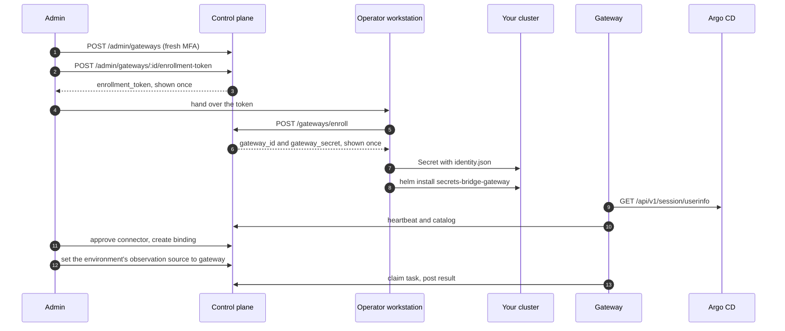

# Gateway

This page installs a [Gateway](../components/gateway.md) for Release 1, which
observes Argo CD only. You create a read-only Argo CD account, create the
Gateway in the control plane, enroll it once from your workstation, install the
chart, approve its connector, bind an Argo CD Application to a secret, and
switch the environment's observation source to the Gateway.

Each control-plane step can be done in the console (Admin → Gateways) or with
`curl`. Enrollment always runs from a shell, because the credential goes
straight into a Kubernetes Secret.

!!! warning "Release 1 is in progress"
    Everything on this page is merged and has not passed QA. The Gateway is
    the only component that reads Argo CD: the control plane has no Argo CD
    client and stores no Argo CD token. If you are upgrading an install that
    used the old control-plane poller, follow
    [Gateway cutover](gateway-cutover.md) first.



## Before you start

- The api from `main`, with migrations `0046` to `0049` applied. Migration
  `0047` adds `gateway.mint`, `gateway.revoke`, `gateway.list` and
  `gateway.bind` to the seed `admin` role. Migration `0048` adds the
  observation tables and each environment's observation source. Migration
  `0049` removes the control-plane Argo CD integration; see
  [Gateway cutover](gateway-cutover.md).
- The worker from `main`, so the Gateway sweepers can be turned on (step 9).
- An account that holds those permissions and has a second factor enrolled at
  `/me/mfa`. Every admin write on a Gateway needs a fresh second factor. The
  console asks for it when needed. For the `curl` path, the TOTP factor is the
  one you can complete from a shell.
- `kubectl`, `helm`, `jq`, `curl` and the `argocd` CLI.
- A namespace for the Gateway. The examples use `tenant-a-uat`.

## 1. Create a read-only Argo CD account

Add a local account with API key access and no login:

```yaml
# argocd-cm
data:
  accounts.sb-gateway: apiKey
```

Give it `applications, get` on the AppProjects the Gateway may read, and
nothing else:

```csv
# argocd-rbac-cm, one line per allowed AppProject
p, role:sb-gateway-read, applications, get, tenant-a-uat/*, allow
g, sb-gateway, role:sb-gateway-read
```

Do not add `sync`, `override`, `action/*`, `update`, `delete`, `exec` or `logs`,
or anything on clusters, repositories, projects or accounts. The Gateway's
transport already refuses every request except the two GETs it needs, but the
token should not carry more than that either.

Generate a token and store it in a Secret without printing it:

```bash
argocd account generate-token --account sb-gateway --expires-in 2160h \
  | kubectl -n tenant-a-uat create secret generic sb-gateway-argocd-main \
      --from-file=token=/dev/stdin
```

The chart mounts the token as a file, and the Gateway re-reads it when it
changes, so you can rotate it by updating the Secret.

## 2. Sign in and step up

The api uses a session cookie, so keep it in a private cookie jar. The password
and the TOTP code are read from the terminal and passed to `jq` on stdin, so
they never appear on a command line or in the process list.

```bash
CP=https://cp.example.com

JAR=$(mktemp) && chmod 600 "$JAR"
read -rp 'Admin email: ' SB_ADMIN_EMAIL
IFS= read -rsp 'Admin password: ' SB_ADMIN_PASSWORD; echo
printf '%s\n%s\n' "$SB_ADMIN_EMAIL" "$SB_ADMIN_PASSWORD" | jq -Rn '{email: input, password: input}' \
  | curl -fsS -c "$JAR" -o /dev/null -X POST "$CP/api/v1/auth/login" \
      -H 'Content-Type: application/json' --data-binary @-
unset SB_ADMIN_PASSWORD

# Step up with your TOTP factor. The session stays MFA-fresh for 15 minutes.
FACTOR_ID=$(curl -fsS -b "$JAR" "$CP/api/v1/users/me/mfa/factors" \
  | jq -r 'map(select(.kind == "totp"))[0].id')
CHALLENGE_ID=$(curl -fsS -b "$JAR" -X POST "$CP/api/v1/auth/mfa/challenge" \
  -H 'Content-Type: application/json' -d '{"kind":"totp"}' | jq -r .challenge_id)
IFS= read -rsp 'TOTP code: ' SB_TOTP_CODE; echo
printf '%s\n%s\n%s\n' "$CHALLENGE_ID" "$FACTOR_ID" "$SB_TOTP_CODE" \
  | jq -Rn '{challenge_id: input, factor_id: input, code: input}' \
  | curl -fsS -b "$JAR" -o /dev/null -X POST "$CP/api/v1/auth/mfa/verify" \
      -H 'Content-Type: application/json' --data-binary @-
unset SB_TOTP_CODE
```

If a later write answers `401` with `WWW-Authenticate: step-up`, the 15 minutes
have passed. Run the step-up block again. See
[Authentication](authentication.md#step-up-ceremony) for the model.

In the console you skip this step: sign in, and the console runs the step-up
dialog on the first write that needs it.

## 3. Create the Gateway and mint an enrollment token

In the console:

1. Open **Admin → Gateways** (needs `gateway.list`) and select
   **Create gateway**.
2. Fill in **Name**, **Boundary** and, if you want, **Environment
   (optional)**, **Max replicas** and **Max tasks in flight**. Select
   **Create gateway**.
3. The **Create enrollment token** panel opens next. Pick a **Token
   lifetime** (15 minutes, 1 hour or 24 hours) and, if you want, a **Cluster
   name (optional)**, then select **Create token**. For a Gateway that is
   still pending you can also open it from the list and select **Create
   enrollment token**.
4. The token is masked and shown once. Use **Copy token**, paste it at the
   silent prompt in step 4, and close the panel. The console keeps the token
   in memory only, and closing the panel clears the clipboard if it still
   holds the token.

With `curl`, create the Gateway record. `name` is a lower-case DNS-style label of up to 63
characters. `boundary` is a free label of up to 128 characters that says where
the Gateway runs. `environment_id` is optional; when it is set, every binding
for this Gateway must use that environment.

```bash
GW_ID=$(curl -fsS -b "$JAR" -X POST "$CP/api/v1/admin/gateways" \
  -H 'Content-Type: application/json' \
  -d '{"name":"tenant-a-uat","boundary":"tenant-a-uat cluster"}' | jq -r .id)
```

The Gateway starts in status `pending`, with no credential. `max_replicas`
(default 200) and `max_inflight_tasks` (default 20) can also be set here.

Mint a one-time enrollment token for it. The response carries the token once,
so keep it out of your terminal output and your shell history:

```bash
SB_GATEWAY_ENROLL_TOKEN=$(curl -fsS -b "$JAR" -X POST \
    "$CP/api/v1/admin/gateways/$GW_ID/enrollment-token" \
    -H 'Content-Type: application/json' \
    -d '{"expected_cluster_name":"tenant-a-uat","expires_in_seconds":900}' \
  | jq -r .enrollment_token)
```

Both fields are optional. `expires_in_seconds` defaults to 900 (15 minutes) and
is clamped to 60 to 86400. When `expected_cluster_name` is set, enrollment must
send the same `cluster_name` or it is refused. You can mint a token only while
the Gateway is `pending`, and you can revoke an unused one with
`POST /api/v1/admin/gateway-enrollment-tokens/:id/revoke`.

If someone else enrolls the Gateway, give them the token over a channel you
would trust with a password. They read it at a silent prompt in step 4.
Revoke an unused token from the Gateway's **Enrollment tokens** list in the
console, or with the route above.

## 4. Enroll and store the identity

The pod never enrolls. You exchange the token for the Gateway credential once,
from your workstation, and write the result straight into a Secret. The token
and the secret never appear on a command line, in shell history or on disk.

```bash
# Skip this read if you minted the token in this shell in step 3.
IFS= read -rsp 'Enrollment token: ' SB_GATEWAY_ENROLL_TOKEN; echo

printf '%s' "$SB_GATEWAY_ENROLL_TOKEN" \
  | jq -Rs '{enrollment_token: ., cluster_name: "tenant-a-uat"}' \
  | curl -fsS -X POST "$CP/api/v1/gateways/enroll" \
      -H 'Content-Type: application/json' --data-binary @- \
  | jq -ce '{gateway_id, gateway_secret}' \
  | kubectl -n tenant-a-uat create secret generic sb-gateway-identity \
      --from-file=identity.json=/dev/stdin
unset SB_GATEWAY_ENROLL_TOKEN
```

`printf` is a shell builtin, so the token does not show up in the process list.
The enrollment endpoint answers `201` with `gateway_id` and `gateway_secret`,
and the Gateway turns `active`.

The token is single use. If any step of the pipeline fails after the control
plane answered, the credential is lost: revoke the Gateway and create a new one.
Enrollment errors are closed codes:

| Status | Code | Meaning |
|---|---|---|
| `401` | `enrollment_token_invalid`, `enrollment_token_expired` | Unknown or expired token. Mint a new one |
| `403` | `enrollment_token_revoked` | The token was revoked |
| `403` | `https_required` | The request did not reach the api over TLS. Enrollment is refused over plain `http` outside `SB_ENV=dev` |
| `409` | `enrollment_token_already_consumed`, `gateway_already_enrolled` | The token or the Gateway was used already |
| `400` | `cluster_name_mismatch` | `cluster_name` differs from the token's `expected_cluster_name` |

If your Secrets come from a vault through External Secrets Operator, store the
same JSON in the vault and render it into a Secret under the key
`identity.json`.

## 5. Install the chart

Pin the image by digest. Check its signature first, as described in
[Verifying images and charts](verifying-releases.md). NetworkPolicy cannot match
hostnames, so list the CIDRs that the control plane and Argo CD resolve to.

```yaml
# gateway-values.yaml
image:
  digest: sha256:<gateway-digest>
cp:
  endpoint: https://cp.example.com
  egress:
    cidrs: [192.0.2.10/32]
identity:
  existingSecret: sb-gateway-identity
connectors:
  argocd:
    - name: argocd-main               # the connector id the control plane sees
      baseURL: https://argocd.example.com
      tokenSecret:
        name: sb-gateway-argocd-main
        key: token
      allowedProjects: [tenant-a-uat]
      applications:
        - id: payments-api            # the target id you bind in step 7
          name: payments-api          # the Argo CD Application
      egress:
        cidrs: [198.51.100.20/32]
        port: 443
```

```bash
helm install secrets-bridge-gateway \
  oci://ghcr.io/secrets-bridge/charts/secrets-bridge-gateway \
  --version <chart-version> \
  --namespace tenant-a-uat -f gateway-values.yaml
```

The chart renders a Deployment (2 replicas sharing one identity), a ConfigMap
with the connectors file, a ServiceAccount with no Role and no mounted token, a
NetworkPolicy with no ingress and egress only to DNS, the control plane and each
Argo CD endpoint, and a PodDisruptionBudget. It renders no Secret, Role,
Service, Ingress or volume claim. `helm install` fails with a message naming the
value when the image is not pinned, `cp.endpoint` is not `https://`, the
identity Secret is not named, a connector is incomplete, or a NetworkPolicy peer
is missing.

For an Argo CD in the same cluster, use selectors instead of CIDRs, and the
full list of values, see the
[chart README](https://github.com/secrets-bridge/charts/blob/main/gateway/README.md).

## 6. Verify

Wait for the pods to turn ready. Readiness runs `gateway healthcheck` inside the
container, and it passes only after the control plane has accepted a heartbeat
and the catalog and the Argo CD token check has passed.

```bash
kubectl -n tenant-a-uat rollout status deploy/secrets-bridge-gateway
kubectl -n tenant-a-uat exec deploy/secrets-bridge-gateway -- \
  /usr/local/bin/gateway healthcheck
kubectl -n tenant-a-uat logs deploy/secrets-bridge-gateway
```

In the log, look for `identity loaded` and `connectors bound`.

Then check the control plane. In the console, **Admin → Gateways** shows the
status, replicas and last heartbeat in UTC. Select the Gateway's name to see its
replicas and **Advertised connectors**. With `curl`,
`GET /api/v1/admin/gateways` needs `gateway.list` and no step-up:

```bash
curl -fsS -b "$JAR" "$CP/api/v1/admin/gateways" \
  | jq '.items[] | {id, name, status, last_seen_at, replicas_seen, catalog_version}'

curl -fsS -b "$JAR" "$CP/api/v1/admin/gateways/$GW_ID" \
  | jq '{replicas: [.replicas[] | {replica_id, status, last_seen_at}],
         connectors: [.connectors[] | {id, connector_id, kind, status, targets}]}'
```

The Gateway shows `status: "active"`, each replica appears with a recent
`last_seen_at`, and the connector `argocd-main` is listed with status
`advertised` and the target `payments-api`.

Until a task is queued for it, each claim answers `204` and the Gateway backs
off up to once every 30 seconds (`SB_GATEWAY_CLAIM_IDLE_MAX`). That is normal
and does not affect readiness.

## 7. Approve the connector and bind a target

Advertising a connector approves nothing. An admin with `gateway.bind` approves
it and binds a target.

In the console, open the Gateway from **Admin → Gateways**:

1. Under **Advertised connectors**, select **Approve…** next to
   `argocd-main`, then **Approve connector**. Approving grants the Gateway
   nothing in Argo CD.
2. Select **Bind a target**. Choose the **Argo CD target**, the **Project**
   and **Environment**, and a **Secret scope**: either **A catalog secret
   bound to the project** (then **Secret**) or **A provider connection and a
   secret path** (then **Provider connection** and **Secret path**).
3. Pick an **Observation deadline** (15 minutes to 6 hours, 30 minutes by
   default) and select **Create binding**.

The binding appears under **Bindings**, where **Delete…** removes it.

With `curl`, approve the connector using its `id` (a UUID) from the detail call
above:

```bash
CONNECTOR_ID=$(curl -fsS -b "$JAR" "$CP/api/v1/admin/gateways/$GW_ID" \
  | jq -r '.connectors[] | select(.connector_id == "argocd-main") | .id')

curl -fsS -b "$JAR" -X POST \
  "$CP/api/v1/admin/gateways/$GW_ID/connectors/$CONNECTOR_ID/approve" | jq '{connector_id, status}'
```

Then bind one advertised Argo CD target to a secret scope in an environment. A
binding names the Gateway, the environment, either a `secret_id` (a secret
bound to the environment's project) or a `provider_connection_id` with a
`secret_ref`, and the Argo CD connector and target:

```bash
curl -fsS -b "$JAR" -X POST "$CP/api/v1/admin/gateway-bindings" \
  -H 'Content-Type: application/json' \
  -d "{\"gateway_id\":\"$GW_ID\",
       \"environment_id\":\"<environment-id>\",
       \"secret_id\":\"<secret-id>\",
       \"argocd_connector_id\":\"$CONNECTOR_ID\",
       \"argocd_target_id\":\"payments-api\",
       \"observation_timeout_seconds\":1800}" | jq
```

`observation_timeout_seconds` defaults to 1800 and must be 60 to 86400. Release 1
bindings expect the single stage `argocd_context`. The api refuses a binding
with a closed code, for example `connector_not_approved`,
`target_not_advertised`, `target_stale` (the Gateway no longer advertises it),
`environment_outside_gateway`, `secret_not_in_project` or `binding_exists`.
`GET /api/v1/admin/gateway-bindings?gateway_id=<id>` lists bindings and
`DELETE /api/v1/admin/gateway-bindings/:id` removes one, and cancels its open
tasks with the reason `binding_removed`.

## 8. Switch the environment to Gateway observation

A binding alone creates no tasks. Each environment has an observation source,
and only an environment set to `gateway` gets Gateway tasks:

| Source | What observes a change executed in the environment |
|---|---|
| `gateway` | The Gateways bound to the environment |
| `none` (default) | Nothing. The request page shows no Argo CD state |

The source is read once when a request reaches `executed`. There is no other
observer to fall back to. Switching away from `gateway` cancels the
environment's open Gateway tasks with the reason `source_changed`. The requests
themselves are not affected.

In the console (needs `gateway.bind`), open **Admin → Projects**, select the
project, and find the environment on the **Environments** tab. The
**Observation** column shows the current source. Select **Change…**, choose
**Gateway** in the **Observation for** dialog, and select **Save**.

With `curl`, the route needs `gateway.bind` and a fresh second factor (step 2).
The body holds no secret, so it can go on the command line:

```bash
ENV_ID=<environment-id>

curl -fsS -b "$JAR" "$CP/api/v1/admin/environments/$ENV_ID/observation-source" | jq

curl -fsS -b "$JAR" -X PUT "$CP/api/v1/admin/environments/$ENV_ID/observation-source" \
  -H 'Content-Type: application/json' -d '{"observation_source":"gateway"}' \
  | jq '{observation_source, previous_observation_source, tasks_cancelled}'
```

`control_plane`, the source of the retired control-plane poller, answers
`400 source_retired`. Any other value besides `gateway` and `none` answers
`400 invalid_observation_source`, and an unknown environment
`404 environment_not_found`. The change is audited as
`environment.observation_source.update`.

## 9. Turn on the worker sweepers

The worker runs four Gateway sweepers when `SB_WORKER_GATEWAY_SWEEPERS_ENABLED`
is `true` (default `false`):

- `observation-leases` puts tasks whose lease ran out back in the queue.
- `observation-deadlines` closes open tasks past their deadline as
  `timed_out`, with the reason `gateway_unavailable` or `deadline_reached`.
- `gateways-stale` moves a Gateway from `active` to `stale` after
  `SB_WORKER_GATEWAYS_STALE_AFTER` (default `2m`) without a heartbeat. The
  next accepted heartbeat moves it back to `active`.
- `gateway-replicas-prune` deletes replica rows not seen within
  `SB_WORKER_GATEWAY_REPLICAS_RETENTION` (default `24h`).

The intervals and floors are in the
[configuration reference](config.md#worker). Without the sweepers, a claim
still takes over an expired lease, and reading a request's observations closes
that request's overdue tasks. Tasks of requests nobody opens stay open past
their deadline, and Gateways never turn `stale`.

## 10. Check a request

Submit and approve a change to the bound secret in that environment. When the
agent has written it and the request is `executed`, the request page shows a
panel titled **Argo CD (observed by Gateway tenant-a-uat)**, marked
**Observed operational state · times in UTC**. It shows:

- The rollup: **Pending**, **Unverified**, **Timed out** or, when no binding
  covers the change, **No observation configured**. None of these is a failure
  of the request. The panel refreshes every 20 seconds while the rollup is
  pending, and when the window regains focus.
- For each task, the Gateway, the verdict, the task state and its deadline or
  closing time, and the reason in words, for example "Only Argo CD context was
  observed. Argo CD health and sync are operational state, never proof that
  the new value reached the app."
- For the Argo CD stage, the outcome (**Observed** or **Not observed**), the
  observed time, the **Sync**, **Health**, **Last operation**, **Revision**,
  **Operation finished** and **Reconciled** facts, and the caveat "Argo CD
  reports Healthy and Synced. This is the operational state, not proof the new
  value reached the app." **Evidence details** lists the connector, target,
  confidence, linkage, Gateway, replica and attempt ids.

The same data comes from `GET /api/v1/requests/<id>/observations`, behind the
same read check as the request itself:

```bash
curl -fsS -b "$JAR" "$CP/api/v1/requests/<request-id>/observations" \
  | jq '{observation_source, rollup, label,
         tasks: [.tasks[] | {gateway_name, state, verdict, verdict_reason,
                             stages: [.stages[] | {stage, outcome, observed_at, caveats, facts}]}]}'
```

On the Gateway's detail panel, **Recent tasks** lists the latest 25 tasks with
their state, verdict and attempts. With `curl`,
`GET /api/v1/admin/gateways/$GW_ID/tasks` (needs `gateway.list`) takes
`?state=` and `?limit=` (1 to 500, default 100).

## Disable, enable or revoke a Gateway

Disabling is reversible. A disabled Gateway's calls are refused with `401`, its
leased tasks go back to the queue, and their old attempts can no longer post a
result. It keeps its credential, and enabling it returns it to `active` (or
`pending` if it never enrolled). In the console, open the Gateway and select
**Disable…** or **Enable…**. With `curl` (needs `gateway.revoke` and a fresh
second factor):

```bash
curl -fsS -b "$JAR" -X PUT "$CP/api/v1/admin/gateways/$GW_ID/enabled" \
  -H 'Content-Type: application/json' -d '{"enabled":false}' | jq '{status}'
```

A revoked Gateway answers `409 gateway_revoked`.

Revoking is final. In the console, select **Revoke…**, or:

```bash
# Needs gateway.revoke and a fresh second factor.
curl -fsS -b "$JAR" -X POST "$CP/api/v1/admin/gateways/$GW_ID/revoke" \
  -H 'Content-Type: application/json' -d '{"reason":"decommissioned"}' | jq '{status, revoked_at}'
```

`reason` is optional, a lower-case code of up to 64 characters. The next
heartbeat, catalog upload or task call gets `401`, and leased tasks go back to
the queue. A task belongs to one Gateway, so its open tasks end `timed_out`
with the reason `gateway_unavailable` at their deadline. The pods stay up and not ready with the
reason in their logs. There is no credential rotation in Release 1: to replace a
credential, revoke the Gateway, create a new one, enroll it and update the
identity Secret.

See [Troubleshooting](troubleshooting.md#gateway) when something does not turn
ready.
