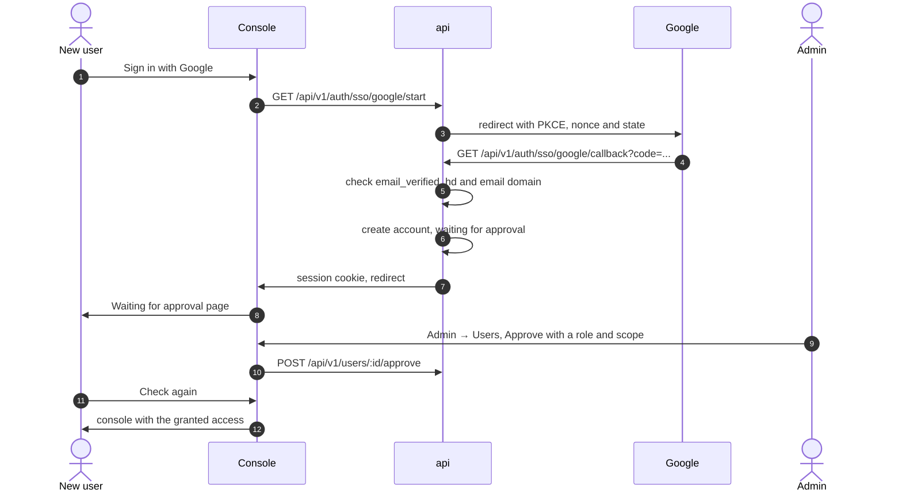

# Sign in with Google

An admin can connect the company's Google Workspace from the console, with
no environment variables and no redeploy. People in the allowed Workspace
domains then sign in with Google. By default, the first sign-in creates an
account that waits until an admin approves it and gives it a role.

!!! warning "Merged, not yet through QA"
    Google sign-in is in the api, console and worker on `main`, but it has
    not passed a QA cycle. See [Product status](../overview/product-status.md).

This page covers:

- [setting it up](#set-up-google-sign-in): the public address, the Google
  OAuth client, the console settings, Test and Turn on;
- [who can sign in](#who-can-sign-in) and how accounts are matched;
- [approving new accounts](#approve-new-accounts), and the
  [option to skip approval](#letting-people-in-without-approval);
- [connecting Google to an existing account](#connect-google-to-an-existing-account);
- [the worker message](#notify-admins-from-the-worker) for new accounts;
- [how it sits next to the env-var OIDC provider](#next-to-the-env-var-oidc-provider)
  and the break-glass admin.

The examples use `https://secrets.example.com` as the install's address and
`example.com` as the Workspace domain.

## How it works



## Before you start

You need:

- an account with a global `auth.sso.edit` grant and an enrolled second
  factor. The seeded `admin` role holds `auth.sso.edit`, so the bootstrap
  admin can do this right after the [first sign-in](bootstrap.md);
- a public `https` address for the install, the one people type in the
  browser;
- a Google Workspace and a Google Cloud project in it where you can create
  OAuth clients.

**Every change asks for a fresh second factor.** Saving the public address
or the waiting limit, creating, editing or removing Google, replacing the
client secret, Test, Turn on and Turn off all go through the step-up dialog
(`RequireFreshMFA`). Whoever holds `auth.sso.edit` decides who can sign in,
and the step-up means a stolen session cookie alone can't change these
settings.

## Set up Google sign-in

### 1. Set the public address

Redirect URIs are built from the install's configured public address, never
from the request's `Host` or `X-Forwarded-*` headers. A forged header can't
send the authorization code somewhere else. The address comes from one of
two places:

| Source | How | In the console |
|---|---|---|
| `SB_PUBLIC_URL` | Set it in the api's environment, for example in the chart's `secrets.existingSecret`. The worker reads the same Secret. | Shown read-only, with "Set by SB_PUBLIC_URL on this install" |
| The console | **Admin → Sign-in → Public address**. The field is prefilled from the address you are using. | Editable |

When `SB_PUBLIC_URL` is set it always wins, and `PUT /sso/settings` refuses
to change the address (`409 public_url_from_env`).

The address must be an absolute `https` URL with no user info, query or
fragment. A trailing slash is dropped. Plain `http` is accepted only for
`localhost` or a loopback address, and only when `SB_ENV=dev`. The api
refuses to start with an invalid `SB_PUBLIC_URL`. The console warns, without
blocking, when a saved address isn't `https` or looks internal.

Google can't be turned on until an address is set, and while none is set
the login page doesn't offer Google.

The **Public address** card also holds the **waiting limit**, the most
accounts that can wait for approval at once. It defaults to 50 and accepts
1 to 10,000. See [The waiting limit](#the-waiting-limit).

### 2. Create the OAuth client in Google Cloud Console

With the address saved, **Admin → Sign-in → Google → Set up Google** shows
the redirect URL to copy. It is always the public address plus
`/api/v1/auth/sso/google/callback`:

```text
https://secrets.example.com/api/v1/auth/sso/google/callback
```

In the Google Cloud project:

1. Set the OAuth consent screen's user type to **Internal**, so only
   accounts in your Workspace can use the client.
2. Create an **OAuth client ID** of application type **Web application**.
3. Add the redirect URL above under **Authorized redirect URIs**, exactly
   as the console shows it.
4. Copy the client ID and the client secret.

Secrets Bridge uses Google's fixed issuer (`https://accounts.google.com`)
and its discovery document, so you don't enter an issuer. It asks for the
`openid`, `email` and `profile` scopes.

### 3. Enter the client in the console

In the **Set up Google** drawer:

| Field | What to enter |
|---|---|
| Client ID | From the OAuth client. Required, at most 255 characters, no spaces. |
| Client secret | From the OAuth client. Saved encrypted and never shown again. |
| Workspace domains | One per line, for example `example.com`. At least one, at most 20. They are lowercased and de-duplicated. |
| New people | **Wait for approval** (the default) or **Let them in right away**. |
| Role for new people | Only with **Let them in right away**. Optional. See [Letting people in without approval](#letting-people-in-without-approval). |

The provider is saved **turned off**.

**The client secret is write-only.** It is envelope-encrypted with the
configured KMS (a fresh data key, AES-256-GCM), the same way TOTP secrets
are stored. No response returns it, only `client_secret_set: true`, and it
is never logged or put in audit metadata. The console shows it as "Saved",
with **Replace…** to set a new one. Replacing it is its own call,
`PUT /sso/providers/:id/secret`, audited as `sso_provider.secret_rotate`.
`PUT /sso/providers/:id` refuses a `client_secret` field with `400`.

### 4. Test, then turn it on

**Test** sends you through Google with your own account and back to
**Admin → Sign-in**. It runs every check a real sign-in runs, creates
nothing, issues no session, and works while Google is still off. The result
shows as "Google sign-in works." or as the reason it didn't pass, and only
the admin who ran it sees that reason.

**Turn on** needs a public address, a client secret and at least one
domain. If any is missing the api answers `409 provider_not_ready` with a
`missing` list, and the console names what to set. Once on, the login page
shows **Sign in with Google** above the password form.

Changes take effect on the next sign-in, without a restart: the OAuth client
is built from the saved settings on every round trip.

## Who can sign in

On every Google sign-in, including returning users, the api checks:

- the email is verified by Google (`email_verified`);
- the ID token's `hd` claim (the Workspace domain) is present and in the
  allowed domains;
- the email's domain is in the allowed domains as well.

`hd` is only present for Workspace accounts. A personal Google account with
an address in an allowed domain has no `hd`, so it is refused. Removing a
domain from the list refuses people in it from their next sign-in. When
exactly one domain is allowed, the api also passes it to Google as the `hd`
hint, so the account chooser offers only accounts in that Workspace.

**Accounts are matched by Google's issuer and subject, never by email.**
The binding lives in the `user_identities` table, unique on (issuer,
subject). The first sign-in of a Google identity:

- creates a new account when its email isn't used by any account here;
- is **refused** when the email already belongs to an account. That
  person signs in with their password and
  [connects Google](#connect-google-to-an-existing-account) instead. This
  stops a Google account with, say, the bootstrap admin's address from
  reaching the bootstrap admin's account.

The round trip itself uses PKCE (S256), a nonce and a single-use state
that lives 5 minutes and is bound to the browser by the `sb_sso_state`
cookie. Return paths must be on the same origin, as for the
[env-var OIDC provider](authentication.md#oidc-sign-in-slices-b-c-e).

**Every refused sign-in gets the same answer.** The browser goes to
`/login?error=sso`, and the login page says "You couldn't be signed in with
that account." whatever the reason. The page never tells an outsider which
emails have accounts. The reason goes to the audit log; see
[Troubleshooting](troubleshooting.md#google-sign-in-refused).

## Approve new accounts

With **Wait for approval** on, a new account starts waiting. Until it is
approved it can only read `GET /users/me` and sign out. Every other route
answers `403 account_pending_approval`, and the console sends the person to
a **Waiting for approval** page with **Check again** and **Sign out**. This
is enforced at session validation and at sign-in. If a waiting account signs in through the env-var OIDC provider,
its group mapping is skipped, so it gets no role from IdP groups either.

Admins who can approve see:

- a count on **Users** in the sidebar;
- a banner on **Overview** with a link while anyone is waiting;
- the **Waiting for approval** list on **Admin → Users**, longest wait
  first;
- optionally, a [webhook message from the worker](#notify-admins-from-the-worker).

Approving and declining need a **global** `user_role.edit`. A team-scoped
grant, or `team.edit`, is not enough.

**Approve…** picks a role and, optionally, limits it to a team or a project.
The api grants the role and clears the waiting flag in one transaction, so
a failed grant leaves the account waiting. The scope is checked with the
same rules as `POST /user-roles`: only `project_id`, `team_id`,
`environment`, `secret_ref_prefix` and `provider_type` are accepted, each a
non-empty string, IDs as UUIDs. A malformed scope is refused with `400`
instead of being widened. The person gets the access on their next
request, or after **Check again**.

**Decline…** disables a waiting account after a confirmation, and its
sessions end on their next use. Decline only works on waiting accounts
(`409 user_not_pending` otherwise), so it can't disable an active account
or the break-glass admin. A declined account keeps its waiting flag, so it
can't be approved or re-enabled from the console, and that Google account
can't sign in again.

### The waiting limit

At most 50 accounts can wait at once by default; change the limit on
**Admin → Sign-in → Public address**. Past it, new Google sign-ins are
refused with the same generic page until you approve or decline some.
Declined accounts don't count. Refusals at the limit are audited as
`user.pending_refused`, aggregated per 10-minute window: the first refusal
in a window writes one event, and the next window writes a summary with the
count and the first and last times. A burst of sign-ins can't fill the
append-only audit log.

### Letting people in without approval

With **Let them in right away**, a new account starts active. You can pick
a **Role for new people**, granted globally when the account is created.
Without one, the account starts with no role, and an admin grants one on
the Users page.

The default role must be non-privileged: every permission it holds must be
in `secret.list`, `secret.request` and `audit.read` (`audit.read` only
shows a user their own events). The api refuses anything else with
`400 default_role_privileged`, and a default role with approval on with
`400 default_role_needs_approval_off`. The seeded `developer` role doesn't
qualify, because it holds `secret.reveal.direct`. Create a role with only
those permissions if you want approval off.

The rule holds after the provider is saved too:

- widening a role that a provider uses as its default
  (`PUT /roles/:id/permissions`) is refused with `409 role_is_sso_default`,
  and deleting it with `409` until you choose another default;
- the role is checked again at every sign-in. If it no longer qualifies,
  the new account waits for approval like any other, and the api audits
  `sso_provider.default_role_refused`.

## Connect Google to an existing account

Existing accounts, including the bootstrap admin, are never linked by
email. The owner connects Google from their profile:

1. Sign in with the password.
2. Open the profile page and click **Connect Google**. It asks for a fresh
   second factor.
3. Choose the Google account. It must pass the [same checks](#who-can-sign-in)
   as a sign-in.
4. Back in the console, the profile shows the connected account.

Google must be turned on. The round trip is bound to the session that
started it: the callback parks the result in a one-time ticket that lives 2
minutes, and the console redeems it with `POST /auth/sso/google/finish`,
which only succeeds on that same session (otherwise `403
sso_ticket_refused`). A Google identity already connected to another
account is refused (`409 link_refused`, reason `identity_taken`), and the
profile says so. A link is audited as `user.identity_link`.

**Disconnect…** also needs a fresh second factor and is audited as
`user.identity_unlink`. After it, the owner signs in with their password
again.

**An account created by a Google sign-in can't disconnect Google.** It was
given a random password nobody knows, so Google is its only way in.
`DELETE /users/me/identities/google` answers `409 identity_required`, and
the profile explains why instead of offering **Disconnect…**.

## Notify admins from the worker

The worker's `users-pending` sweeper posts a message when accounts start
waiting. It needs `SB_WORKER_WEBHOOK_URL`, and isn't registered without it;
the console's count and banner still work.

| Variable | Default | Notes |
|---|---|---|
| `SB_WORKER_WEBHOOK_URL` | (unset) | Where to post. Required for this message. |
| `SB_WORKER_WEBHOOK_SLACK_FORMAT` | `false` | `true` posts `{"text": ...}` for a Slack incoming webhook. |
| `SB_WORKER_USERS_PENDING_INTERVAL` | `1m` | How often it runs, and so the most often admins hear about new accounts. At least `30s`, or the worker refuses to start. |
| `SB_PUBLIC_URL` | (unset) | Used for the link to Admin → Users. Unset, the address saved in the console is used. |

Each run posts **at most one message**. It covers the accounts that started
waiting since the last message: up to 10 by email, oldest first, then "and
N more", the total still waiting when older ones are left, and a link to
`<public address>/admin/users`:

```text
[info] 2 new accounts are waiting for approval
• sara@example.com
• omar@example.com
Approve or decline them in Admin → Users: https://secrets.example.com/admin/users
```

The message carries **emails only**, never display names, because a display
name comes from the person's Google account and can contain anything. It
goes to the webhook only. The worker logs counts, never who is waiting.
Each account is announced once. A failed post is retried on the next run,
together with anyone who arrived since. Declined accounts are left out.

## Next to the env-var OIDC provider

The [env-var OIDC provider](authentication.md#oidc-sign-in-slices-b-c-e)
(`SB_OIDC_ISSUER` and the other `SB_OIDC_*` variables) keeps working as
before. When both are configured, the login page shows two buttons, **Sign
in with Google** and **Sign in with single sign-on**, and each provider
handles its own sign-ins. The env-var provider still matches accounts by
verified email and doesn't create waiting accounts.

When `SB_OIDC_ISSUER` is already Google (`https://accounts.google.com`),
the console refuses to add Google (`409 env_provider_is_google`), the login
page doesn't offer the console provider, and a provider saved earlier can't
be turned on.

**Password sign-in and the break-glass admin are never turned off by these
settings.** No sign-in setting disables `POST /auth/login`, and decline
only touches waiting accounts. If Google is misconfigured or down, sign in
with the bootstrap admin's password and fix it under Admin → Sign-in.

## Audit events

| Action | When |
|---|---|
| `sso_provider.create`, `.update`, `.delete`, `.enable`, `.disable` | Google changed in the console. Old and new values of the domains, the approval setting and the default role. Never the secret, only whether one is set. |
| `sso_provider.secret_rotate` | The client secret replaced |
| `sso_settings.update` | The public address or the waiting limit changed, with old and new values |
| `sso_provider.test` | A Test round trip, `success` or `denied` with `error_kind` |
| `auth.sso.callback` | A Google sign-in or Connect Google round trip, `success` or `denied` with `error_kind` |
| `user.pending` | An account created waiting for approval |
| `user.sso_provision` | An account created active, with approval off |
| `user.approve`, `user_role.grant` | An admin approved an account, with the role and scope |
| `user.decline` | An admin declined an account |
| `user.pending_refused` | Sign-ins refused at the waiting limit, aggregated per 10 minutes |
| `sso_provider.default_role_refused` | A default role no longer qualified at sign-in, so the account waits |
| `user.identity_link`, `user.identity_unlink` | Google connected to or disconnected from an account |

None of them carries a token, code, ticket or secret.

## API

The routes are listed in the [HTTP API reference](../reference/api-endpoints.md#sign-in-with-google),
and the permissions in the [permissions catalog](../reference/permissions.md#authentication).
