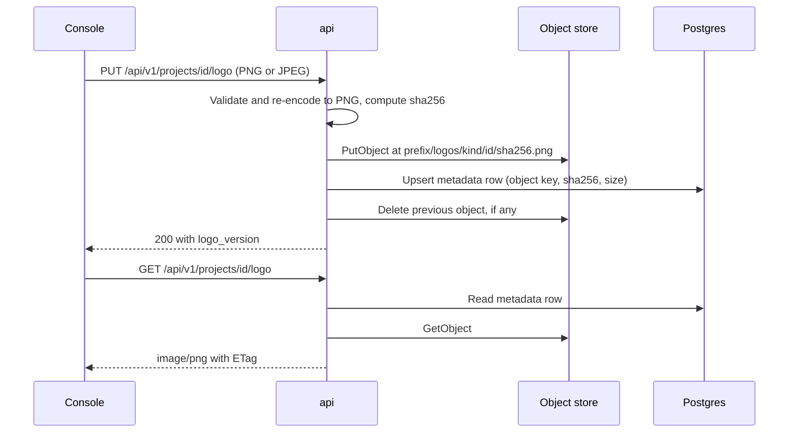
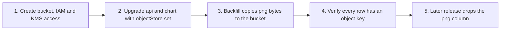

# Object storage

The api can keep media files in an S3 bucket or on any server that speaks
the S3 API, such as MinIO. Postgres keeps only the metadata for each file.

!!! warning "In progress"
    Object storage is being built in
    [api#253](https://github.com/secrets-bridge/api/issues/253) and
    [charts#39](https://github.com/secrets-bridge/charts/issues/39). It is
    not live yet. See [Product status](../overview/product-status.md).
    Details marked **Check the release notes** below are not settled and
    may change before release.

## What is stored there

Only media. Today that means the project and team logos served by
`GET /api/v1/projects/{id}/logo` and `GET /api/v1/teams/{id}/logo`. New
media fields added later use the same store.

Never stored in object storage:

- secret values, wrapped or unwrapped;
- tokens, credentials or wrap bodies;
- audit records. Audit events for logo changes record metadata only
  (sha256, byte length, dimensions), never image bytes or URLs.

### Object keys

Each object is keyed by the sha256 of its content:

```text
<prefix>/logos/<kind>/<entity-id>/<sha256>.png
```

| Part | Value |
|---|---|
| `<prefix>` | `SB_OBJECTSTORE_PREFIX` |
| `<kind>` | `projects` or `teams` |
| `<entity-id>` | The project or team id |
| `<sha256>` | Hash of the re-encoded PNG. It is also the `ETag` the api returns. |

Uploading the same image twice writes the same key, so writes are
idempotent. When a logo is replaced, the api deletes the old object after
the database row points at the new one.

!!! note "Check the release notes"
    The exact `<kind>` strings are set by the api implementation. Confirm
    them in the release notes before writing lifecycle rules or IAM
    conditions that match on them.

### How a logo moves through the system

The bucket stays private. The console never talks to it. Every read and
write goes through the api, so the existing authorization rules apply:
reading a project logo needs read scope on that project, a team logo has
the same visibility as the team, and uploading or removing a logo needs
the global `team.edit` permission.



If the object write fails, the database row is not changed. If the row
write fails, the api removes the object it just wrote. If a row points at
an object that is missing, the api returns `404` and logs the error.

## Configuration

The api reads these environment variables. The full list is in the
[Configuration reference](config.md#api).

| Env var | Notes |
|---|---|
| `SB_OBJECTSTORE_BUCKET` | Bucket name |
| `SB_OBJECTSTORE_REGION` | Bucket region, for example `us-east-1` |
| `SB_OBJECTSTORE_ENDPOINT` | Optional. Endpoint override for S3-compatible servers, for example `https://s3.example.com`. Leave unset for AWS S3. |
| `SB_OBJECTSTORE_PREFIX` | Key prefix inside the bucket, for example `secrets-bridge` |
| `SB_OBJECTSTORE_SSE` | `AES256` (SSE-S3) or `aws:kms` (SSE-KMS) |
| `SB_OBJECTSTORE_KMS_KEY_ID` | KMS key id, ARN or alias. Used with `SB_OBJECTSTORE_SSE=aws:kms`. |
| `SB_OBJECTSTORE_FORCE_PATH_STYLE` | `true` for servers that need path-style addressing, such as most MinIO setups |

Credentials come from the standard AWS SDK chain: IRSA, an instance role,
or `AWS_ACCESS_KEY_ID` / `AWS_SECRET_ACCESS_KEY` in the environment. This
is the same chain the `aws-kms` backend uses. There are no
`SB_OBJECTSTORE_*` variables for credentials.

The api fails at boot with an error when the object-storage settings are
present but invalid.

!!! note "Check the release notes"
    What the api does when object storage is not configured at all (refuse
    to boot, or run with logo uploads turned off) is not settled yet.

### Helm chart values

The `secrets-bridge` chart maps `objectStore.*` values to the
`SB_OBJECTSTORE_*` variables on the api:

| Value | Env var |
|---|---|
| `objectStore.enabled` | Turns the settings below on |
| `objectStore.bucket` | `SB_OBJECTSTORE_BUCKET` |
| `objectStore.region` | `SB_OBJECTSTORE_REGION` |
| `objectStore.endpoint` | `SB_OBJECTSTORE_ENDPOINT` |
| `objectStore.prefix` | `SB_OBJECTSTORE_PREFIX` |
| `objectStore.sse` | `SB_OBJECTSTORE_SSE` |
| `objectStore.kmsKeyId` | `SB_OBJECTSTORE_KMS_KEY_ID` |
| `objectStore.forcePathStyle` | `SB_OBJECTSTORE_FORCE_PATH_STYLE` |

The chart does not take credentials in values. Use IRSA through
`api.serviceAccount.annotations`, or point the chart at an existing
Secret that holds `AWS_ACCESS_KEY_ID` and `AWS_SECRET_ACCESS_KEY`.

The chart's render-time guards refuse an empty `bucket` when object
storage is required, and refuse a plain `http://` endpoint with
`env=production`. If NetworkPolicies are on, the api needs egress to the
S3 endpoint on port 443.

!!! note "Check the release notes"
    The value that names the existing credentials Secret, and the exact
    NetworkPolicy settings for S3 egress, are being finalized in
    [charts#39](https://github.com/secrets-bridge/charts/issues/39). Use the
    chart README for the released names.

## AWS S3 with IRSA

1. Create a bucket, for example `example-bucket`, in the same region as
   the cluster. Keep the defaults for Object Ownership (ACLs disabled) and
   Block Public Access (all four settings on).
2. Turn on default encryption. See [Encryption at rest](#encryption-at-rest).
3. Create an IAM role for the api ServiceAccount with a trust policy for
   your cluster's OIDC provider, and attach the
   [least-privilege policy](#least-privilege-iam-policy) below.
4. Annotate the api ServiceAccount and set the values:

```yaml
api:
  serviceAccount:
    annotations:
      eks.amazonaws.com/role-arn: arn:aws:iam::123456789012:role/secrets-bridge-api
objectStore:
  enabled: true
  bucket: example-bucket
  region: us-east-1
  prefix: secrets-bridge
  sse: aws:kms
  kmsKeyId: arn:aws:kms:us-east-1:123456789012:key/00000000-0000-0000-0000-000000000000
```

If the api role already has access for the `aws-kms` backend, you can add
the S3 policy to the same role.

To keep S3 traffic inside the VPC, add an S3 gateway endpoint to the
cluster's route tables. The api needs no extra setting for a gateway
endpoint.

## S3-compatible servers (MinIO)

For MinIO or another S3 API, set the endpoint and turn on path-style
addressing. Static credentials come from an existing Secret, never from
values.

```bash
kubectl -n secrets-bridge create secret generic secrets-bridge-objectstore \
  --from-literal=AWS_ACCESS_KEY_ID=<access-key> \
  --from-literal=AWS_SECRET_ACCESS_KEY=<secret-key>
```

```yaml
objectStore:
  enabled: true
  endpoint: https://s3.example.com
  forcePathStyle: true
  bucket: example-bucket
  region: us-east-1
  prefix: secrets-bridge
  sse: AES256
```

Then reference the Secret with the chart's existing-Secret value (see the
note under [Helm chart values](#helm-chart-values)). Deliver the Secret
with External Secrets, sealed-secrets or a similar tool.

Notes for MinIO:

- Create a MinIO user with a policy limited to the bucket and prefix, in
  the same shape as the IAM policy below. Do not use the root user.
- Use `https://`. The chart refuses a plain `http://` endpoint with
  `env=production`.
- `region` must match the region the server is configured with. MinIO
  uses `us-east-1` unless you set another one.
- `AES256` needs server-side encryption configured on the MinIO server
  (for example with MinIO KES). Without it, uploads that request SSE fail.

For local development, the api repository's `docker-compose.yml` runs a
MinIO service and creates the bucket. See
[Running locally with docker compose](docker-compose.md).

## Least-privilege IAM policy

Grant object access only under the prefix, and limit `s3:ListBucket` to
the same prefix. Replace `example-bucket` and `secrets-bridge` with your
bucket and `SB_OBJECTSTORE_PREFIX`.

```json
{
  "Version": "2012-10-17",
  "Statement": [
    {
      "Sid": "ObjectsUnderPrefix",
      "Effect": "Allow",
      "Action": [
        "s3:GetObject",
        "s3:PutObject",
        "s3:DeleteObject"
      ],
      "Resource": "arn:aws:s3:::example-bucket/secrets-bridge/*"
    },
    {
      "Sid": "ListPrefixOnly",
      "Effect": "Allow",
      "Action": "s3:ListBucket",
      "Resource": "arn:aws:s3:::example-bucket",
      "Condition": {
        "StringLike": {
          "s3:prefix": [
            "secrets-bridge/*"
          ]
        }
      }
    }
  ]
}
```

`s3:ListBucket` lets `HeadObject` return `404` instead of `403` for a
missing key, so the api can tell a missing logo from a permission error.

The policy does not grant `s3:PutObjectAcl`, bucket policy changes or
any access outside the prefix. The api does not need them.

## Encryption at rest

| Setting | `SB_OBJECTSTORE_SSE` | Key | When to use |
|---|---|---|---|
| SSE-S3 | `AES256` | Managed by S3 | Simple setups, S3-compatible servers |
| SSE-KMS | `aws:kms` | A KMS key you control (`SB_OBJECTSTORE_KMS_KEY_ID`) | When you need key policies, key rotation control or CloudTrail records of key use |

Also set the same default encryption on the bucket, so objects written by
other tools (for example a restore job) are encrypted too.

With SSE-KMS, the api role needs these KMS permissions on the key, in
addition to the S3 policy:

- `kms:GenerateDataKey` to write objects;
- `kms:Decrypt` to read them.

Add a statement like this to the key policy, or grant the same actions
in the api role's IAM policy if the key policy delegates to IAM:

```json
{
  "Sid": "AllowSecretsBridgeApiForS3",
  "Effect": "Allow",
  "Principal": {
    "AWS": "arn:aws:iam::123456789012:role/secrets-bridge-api"
  },
  "Action": [
    "kms:GenerateDataKey",
    "kms:Decrypt"
  ],
  "Resource": "*",
  "Condition": {
    "StringEquals": {
      "kms:ViaService": "s3.us-east-1.amazonaws.com"
    }
  }
}
```

The `kms:ViaService` condition limits use of the key to requests made
through S3. If you turn on S3 Bucket Keys, the number of KMS calls drops
and the policy above still applies.

You can use the same KMS key as the `aws-kms` backend, but a separate key
keeps media encryption apart from the key that protects wraps.

## Bucket settings

### Private bucket and Block Public Access

- Turn on all four Block Public Access settings on the bucket, and on the
  account if nothing else in it needs public buckets.
- Set Object Ownership to **Bucket owner enforced** so ACLs are disabled.
- Do not add a bucket policy that grants public or cross-account read.
  The api serves every image.
- Optionally add a bucket policy that denies requests without TLS
  (`aws:SecureTransport` is `false`).

### Versioning and lifecycle

Recommendations:

- **Turn on versioning.** A deleted or replaced logo can then be restored
  from a previous version.
- **Expire noncurrent versions** after a retention period that fits your
  recovery needs, for example 30 days. Keys are content hashes, so the
  api only ever rewrites a key with identical bytes. Noncurrent versions
  come from deletes.
- **Abort incomplete multipart uploads** after a short period, for example
  7 days.
- **Do not expire current objects** under the prefix. The api deletes
  objects it no longer needs, and an expired current object turns into a
  `404` for that logo.

Scope lifecycle rules to `SB_OBJECTSTORE_PREFIX` if the bucket holds other
data.

## Backups

Media is no longer part of Postgres snapshots. A database restore brings
back the metadata rows, which point at object keys, but not the images.

- Back up the bucket on its own, for example with versioning plus AWS
  Backup for S3, or replication to a second bucket.
- When you restore, restore the bucket and the database to about the same
  point in time. A row whose object is missing returns `404` for that
  logo. An object with no row is unused and can be removed.
- Losing media does not affect secrets, approvals or audit. Logos can be
  uploaded again.

## Upgrading: moving existing logos

Before object storage, logos were stored as `BYTEA` in the `png` column of
`project_logos` and `team_logos`. The move to object storage is done in
two steps, so existing logos keep working during the rollout.



1. **Prepare storage.** Create the bucket, the IAM policy and, for
   SSE-KMS, the key policy statement, as described above.
2. **Deploy.** Upgrade the chart and api together with `objectStore.*`
   set. Migration `0040` adds an `object_key` column to both tables. The
   `png` column stays, so logos that have not been copied yet still load.
3. **Backfill.** A one-time backfill copies the existing `png` bytes to
   the bucket and fills `object_key`.
4. **Verify.** Check that no row is left without an `object_key` and
   that logos load in the console.
5. **Drop the old column.** A later migration removes the `png` column.
   Take a database backup before you upgrade to that release, because the
   old bytes are gone after it runs.

!!! note "Check the release notes"
    These details are still being decided in
    [api#253](https://github.com/secrets-bridge/api/issues/253):

    - how the backfill runs (automatically at boot, through the worker, or
      as a separate command), and how to see that it has finished;
    - whether new uploads during the rollout also write the `png` column;
    - which release drops the `png` column, and the query to confirm the
      backfill is complete before that upgrade;
    - whether rolling back to an api version from before step 2 is safe
      once logos have been uploaded to object storage.
