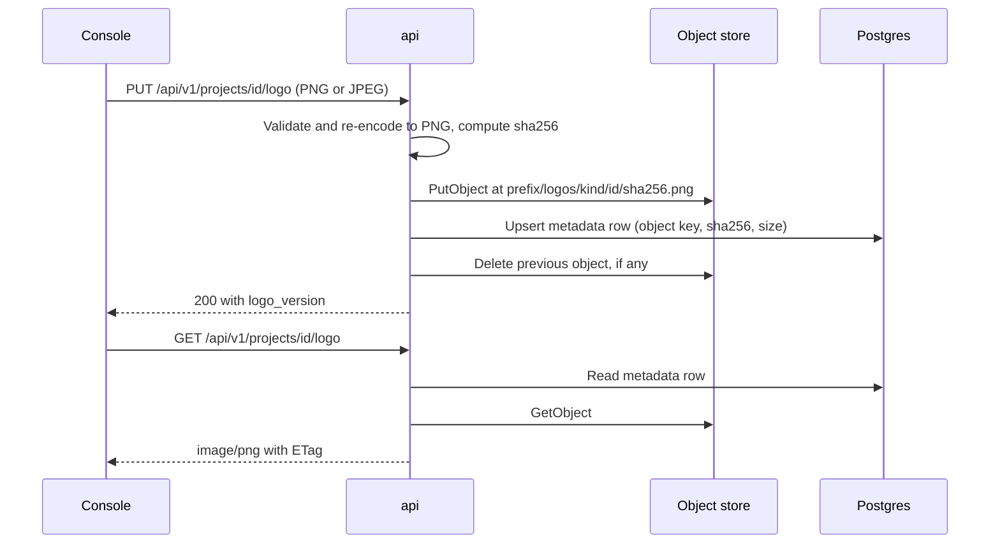
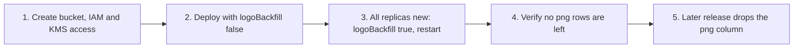

# Object storage

The api can keep media files in an S3 bucket or on any server that speaks
the S3 API, such as MinIO. Postgres keeps only the metadata for each file.

!!! warning "In progress"
    Object storage is implemented in
    [api#255](https://github.com/secrets-bridge/api/pull/255) and the chart
    values in [charts#40](https://github.com/secrets-bridge/charts/pull/40)
    and [charts#42](https://github.com/secrets-bridge/charts/pull/42). It
    has not passed QA yet. See [Product status](../overview/product-status.md).

## What is stored there

Only media. Today that means the project and team logos served by
`GET /api/v1/projects/{id}/logo` and `GET /api/v1/teams/{id}/logo`. New
media fields added later use the same store.

Never stored in object storage:

- secret values, wrapped or unwrapped;
- tokens, credentials or wrap bodies;
- audit records. Audit events for logo changes record metadata only
  (sha256, byte length, dimensions), never image bytes or URLs.

### Object keys

Each object is keyed by the sha256 of its content:

```text
<prefix>/logos/<kind>/<entity-id>/<sha256>.png
```

| Part | Value |
|---|---|
| `<prefix>` | `SB_OBJECTSTORE_PREFIX` |
| `<kind>` | `project` or `team` (singular, lower case) |
| `<entity-id>` | The project or team id |
| `<sha256>` | Hash of the re-encoded PNG. It is also the `ETag` the api returns. |

For example, with `SB_OBJECTSTORE_PREFIX=secrets-bridge` a project logo
lives at `secrets-bridge/logos/project/<project-id>/<sha256>.png`. Without
a prefix the key starts at `logos/`. The api trims slashes at either end
of the prefix.

Uploading the same image twice maps to the same key, so writes are
idempotent. When a logo is replaced, the api deletes the old object after
the database row points at the new one. The row stores the full key, so
changing `SB_OBJECTSTORE_PREFIX` later does not move existing logos: they
stay at their old keys.

### How a logo moves through the system

The bucket stays private. The console never talks to it. Every read and
write goes through the api, so the existing authorization rules apply:
reading a project logo needs read scope on that project, a team logo has
the same visibility as the team, and uploading or removing a logo needs
the global `team.edit` permission.



If the object write fails, the database row is not changed and the api
returns `503 logo storage is unavailable`. If the row write fails, the api
removes the object it just wrote, unless the current row already uses that
same key, and returns `500 internal error`. If deleting the old object
fails, the object is left behind and the api logs a warning; no row points
at it.

On reads, the api answers `If-None-Match` from the row without reading the
object. A row that still holds its image in the `png` column (before the
backfill, or written by an old replica during a rollout) is served from
those bytes with the same headers and `ETag`. If a row points at an object
that is missing, the api returns `404` and logs an error that names the
key; the key is not in the response body.

The api never sets an ACL on an object and does not issue presigned URLs.

## Configuration

The api reads these environment variables. The full list is in the
[Configuration reference](config.md#api).

| Env var | Notes |
|---|---|
| Env var | Default | Notes |
|---|---|---|
| `SB_OBJECTSTORE_BUCKET` | unset | Bucket name. Unset, with no other `SB_OBJECTSTORE_*` set, means object storage is off. |
| `SB_OBJECTSTORE_REGION` | unset | Bucket region, for example `us-east-1`. Required when the bucket is set. |
| `SB_OBJECTSTORE_ENDPOINT` | unset | Endpoint override for S3-compatible servers or a VPC endpoint, for example `https://s3.example.com`. Plain `http://` is accepted only with `SB_ENV=dev`. Leave unset for AWS S3. |
| `SB_OBJECTSTORE_FORCE_PATH_STYLE` | `false` | `true` or `false`. `true` for servers that need path-style addressing, such as MinIO. |
| `SB_OBJECTSTORE_PREFIX` | unset | Key prefix inside the bucket, for example `secrets-bridge`. Slashes at either end are trimmed. Empty, `.` or `..` segments are refused. |
| `SB_OBJECTSTORE_SSE` | unset | Unset or empty sends no SSE header, so the bucket's default encryption applies. Otherwise exactly `AES256` (SSE-S3) or `aws:kms` (SSE-KMS). Case-sensitive. |
| `SB_OBJECTSTORE_KMS_KEY_ID` | unset | KMS key id, ARN or alias. Required with `SB_OBJECTSTORE_SSE=aws:kms`, and refused with any other SSE mode. |
| `SB_OBJECTSTORE_LOGO_BACKFILL` | `true` | Run the logo backfill at api start. Set `false` for the first step of a rolling upgrade. See [Upgrading: moving existing logos](#upgrading-moving-existing-logos). |

Credentials come from the standard AWS SDK chain: IRSA, an instance role,
or `AWS_ACCESS_KEY_ID` / `AWS_SECRET_ACCESS_KEY` in the environment. This
is the same chain the `aws-kms` backend uses. There are no
`SB_OBJECTSTORE_*` variables for credentials.

### Boot behaviour

| State | What the api does |
|---|---|
| Not configured (no `SB_OBJECTSTORE_*` set) | Boots normally. `PUT` and `DELETE` on a logo return `503 logo storage is not configured`. Logos still stored in Postgres keep being served. The api never falls back to writing media to Postgres. If inline logos exist, the boot logs a warning with their count. |
| Misconfigured | Refuses to boot with an error. This covers any `SB_OBJECTSTORE_*` setting without a bucket, a bucket without a region, an unknown SSE value, `aws:kms` without a key id, a key id with another SSE mode, a malformed endpoint or prefix, a plain `http://` endpoint when `SB_ENV` is not `dev`, and a `SB_OBJECTSTORE_FORCE_PATH_STYLE` that is not `true` or `false`. |
| Configured, bucket unreachable | Refuses to boot. The api calls `HeadBucket` at start and gives up after 15 seconds. A denied `HeadBucket` (see the [IAM policy](#least-privilege-iam-policy)) fails the same way. |
| Configured and reachable | Logs `object storage ready`, writes and reads logos in the bucket, and starts the backfill unless `SB_OBJECTSTORE_LOGO_BACKFILL=false`. |

When the bucket is reachable at boot but fails later, logo requests that
need it return `503 logo storage is unavailable`. The rest of the api
keeps working.

### Helm chart values

The `secrets-bridge` chart maps `objectStore.*` values to the
`SB_OBJECTSTORE_*` variables on the api:

| Value | Default | Env var on the api |
|---|---|---|
| `objectStore.enabled` | `false` | Turns the settings below on. Off renders no `SB_OBJECTSTORE_*` at all. |
| `objectStore.bucket` | `""` | `SB_OBJECTSTORE_BUCKET` (required when enabled) |
| `objectStore.region` | `""` | `SB_OBJECTSTORE_REGION` (required when enabled) |
| `objectStore.endpoint` | `""` | `SB_OBJECTSTORE_ENDPOINT` |
| `objectStore.prefix` | `""` | `SB_OBJECTSTORE_PREFIX` |
| `objectStore.sse` | `AES256` | `SB_OBJECTSTORE_SSE`. `""` renders no variable, so no SSE header is sent. |
| `objectStore.kmsKeyId` | `""` | `SB_OBJECTSTORE_KMS_KEY_ID` (only with `sse: aws:kms`) |
| `objectStore.forcePathStyle` | `false` | `SB_OBJECTSTORE_FORCE_PATH_STYLE`, always rendered as `"true"` or `"false"` |
| `objectStore.logoBackfill` | `true` | `SB_OBJECTSTORE_LOGO_BACKFILL`, always rendered as `"true"` or `"false"` |
| `objectStore.credentials.existingSecret` | `""` | Name of a Secret with static keys. When set, the api gets `AWS_ACCESS_KEY_ID` and `AWS_SECRET_ACCESS_KEY` through `secretKeyRef`. |
| `objectStore.credentials.accessKeyIdKey` | `AWS_ACCESS_KEY_ID` | Key in that Secret for the access key id |
| `objectStore.credentials.secretAccessKeyKey` | `AWS_SECRET_ACCESS_KEY` | Key in that Secret for the secret access key |
| `api.networkPolicy.egress.objectStore.enabled` | `true` | Adds a TCP egress rule to the object store when `objectStore.enabled` |
| `api.networkPolicy.egress.objectStore.to` | `[]` | NetworkPolicy peers that narrow the rule. Empty allows the port to any destination. |

The chart's default for `sse` is `AES256`, while the api on its own sends
no SSE header when `SB_OBJECTSTORE_SSE` is unset. Only the api gets these
variables; the worker does not read media.

The chart does not take credentials in values. On AWS, use IRSA through
`api.serviceAccount.annotations`. For an S3-compatible server, use
`objectStore.credentials.existingSecret`. Static keys cannot be combined
with `kms.backend=aws-kms`, because the SDK prefers them over IRSA and the
KMS client would sign with them.

The chart refuses to render when object storage is enabled and `bucket`
or `region` is empty, `sse` is not `AES256`, `aws:kms` or empty,
`sse: aws:kms` has no `kmsKeyId`, `kmsKeyId` is set with another `sse`,
the endpoint is not `http(s)://host[:port]`, the endpoint is plain
`http://` with `env=production`, the prefix has an empty, `.` or `..`
segment, `logoBackfill` is not `true` or `false`, or static keys are
combined with `kms.backend=aws-kms`.

The egress port comes from `objectStore.endpoint`: its explicit port, else
443 for `https` and 80 for `http`, and 443 when no endpoint is set (AWS
S3). To manage the rule yourself, set
`api.networkPolicy.egress.objectStore.enabled: false` and add it to
`api.networkPolicy.egress.extraRules`.

## AWS S3 with IRSA

1. Create a bucket, for example `example-bucket`, in the same region as
   the cluster. Keep the defaults for Object Ownership (ACLs disabled) and
   Block Public Access (all four settings on).
2. Turn on default encryption. See [Encryption at rest](#encryption-at-rest).
3. Create an IAM role for the api ServiceAccount with a trust policy for
   your cluster's OIDC provider, and attach the
   [least-privilege policy](#least-privilege-iam-policy) below.
4. Annotate the api ServiceAccount and set the values:

```yaml
api:
  serviceAccount:
    annotations:
      eks.amazonaws.com/role-arn: arn:aws:iam::123456789012:role/secrets-bridge-api
objectStore:
  enabled: true
  bucket: example-bucket
  region: us-east-1
  prefix: secrets-bridge
  sse: aws:kms
  kmsKeyId: arn:aws:kms:us-east-1:123456789012:key/00000000-0000-0000-0000-000000000000
```

If the api role already has access for the `aws-kms` backend, you can add
the S3 policy to the same role.

To keep S3 traffic inside the VPC, add an S3 gateway endpoint to the
cluster's route tables. The api needs no extra setting for a gateway
endpoint.

## S3-compatible servers (MinIO)

For MinIO or another S3 API, set the endpoint and turn on path-style
addressing. Static credentials come from an existing Secret, never from
values.

Read the keys at silent prompts (paste each, then Enter) so they never
reach a command line, the shell history or the process list. This works
in bash and zsh:

```bash
read -rs SB_S3_KEY_ID
read -rs SB_S3_SECRET
kubectl -n secrets-bridge create secret generic secrets-bridge-objectstore \
  --from-file=AWS_ACCESS_KEY_ID=<(printf '%s' "$SB_S3_KEY_ID") \
  --from-file=AWS_SECRET_ACCESS_KEY=<(printf '%s' "$SB_S3_SECRET")
unset SB_S3_KEY_ID SB_S3_SECRET
```

```yaml
objectStore:
  enabled: true
  endpoint: https://s3.example.com
  forcePathStyle: true
  bucket: example-bucket
  region: us-east-1
  prefix: secrets-bridge
  sse: ""                  # no SSE header; see the notes below
  credentials:
    existingSecret: secrets-bridge-objectstore
api:
  networkPolicy:
    egress:
      objectStore:
        to:
          - namespaceSelector:
              matchLabels:
                kubernetes.io/metadata.name: minio
```

The keys in the Secret above match the default
`credentials.accessKeyIdKey` and `credentials.secretAccessKeyKey`, so
those don't need to be set. Deliver the Secret with External Secrets,
sealed-secrets or a similar tool. The `to` block is only needed when
MinIO runs in the cluster and you want to narrow the egress rule.

Notes for MinIO:

- Create a MinIO user with a policy limited to the bucket and prefix, in
  the same shape as the IAM policy below. Do not use the root user.
- Use `https://`. The chart refuses a plain `http://` endpoint with
  `env=production`, and the api refuses it at boot unless `SB_ENV=dev`,
  including when the settings come from `secrets.existingSecret`.
- `region` must match the region the server is configured with. MinIO
  uses `us-east-1` unless you set another one.
- `sse: AES256` needs server-side encryption configured on the MinIO
  server (for example with MinIO KES). Without it, uploads that request
  SSE fail, so use `sse: ""` and let the server's own settings apply.

For local development, the api repository's `docker-compose.yml` runs a
MinIO service and creates the bucket. See
[Running locally with docker compose](docker-compose.md).

## Least-privilege IAM policy

Grant object access only under the prefix, and `s3:ListBucket` on the
bucket itself. Replace `example-bucket` and `secrets-bridge` with your
bucket and `SB_OBJECTSTORE_PREFIX`. Without a prefix, use
`arn:aws:s3:::example-bucket/logos/*` for the object statement.

```json
{
  "Version": "2012-10-17",
  "Statement": [
    {
      "Sid": "ObjectsUnderPrefix",
      "Effect": "Allow",
      "Action": [
        "s3:GetObject",
        "s3:PutObject",
        "s3:DeleteObject"
      ],
      "Resource": "arn:aws:s3:::example-bucket/secrets-bridge/*"
    },
    {
      "Sid": "BucketCheck",
      "Effect": "Allow",
      "Action": "s3:ListBucket",
      "Resource": "arn:aws:s3:::example-bucket"
    }
  ]
}
```

`s3:ListBucket` is needed for two things:

- **The boot check.** The api calls `HeadBucket` at start, and S3
  authorizes `HeadBucket` with `s3:ListBucket` on the bucket. A
  `HeadBucket` request carries no prefix, so do not add an `s3:prefix`
  condition to this statement: with the condition, `HeadBucket` is denied
  and the api refuses to boot.
- **Missing keys.** With `s3:ListBucket`, `HeadObject` and `GetObject`
  return `404` instead of `403` for a key that doesn't exist, so the api
  can tell a missing logo from a permission error.

The api itself never lists objects.

The policy does not grant `s3:PutObjectAcl`, bucket policy changes or
any access outside the prefix. The api does not need them.

## Encryption at rest

| Setting | `SB_OBJECTSTORE_SSE` | Key | When to use |
|---|---|---|---|
| SSE-S3 | `AES256` | Managed by S3 | Simple setups, S3-compatible servers |
| SSE-KMS | `aws:kms` | A KMS key you control (`SB_OBJECTSTORE_KMS_KEY_ID`) | When you need key policies, key rotation control or CloudTrail records of key use |

Also set the same default encryption on the bucket, so objects written by
other tools (for example a restore job) are encrypted too.

With SSE-KMS, the api role needs these KMS permissions on the key, in
addition to the S3 policy:

- `kms:GenerateDataKey` to write objects;
- `kms:Decrypt` to read them.

Add a statement like this to the key policy, or grant the same actions
in the api role's IAM policy if the key policy delegates to IAM:

```json
{
  "Sid": "AllowSecretsBridgeApiForS3",
  "Effect": "Allow",
  "Principal": {
    "AWS": "arn:aws:iam::123456789012:role/secrets-bridge-api"
  },
  "Action": [
    "kms:GenerateDataKey",
    "kms:Decrypt"
  ],
  "Resource": "*",
  "Condition": {
    "StringEquals": {
      "kms:ViaService": "s3.us-east-1.amazonaws.com"
    }
  }
}
```

The `kms:ViaService` condition limits use of the key to requests made
through S3. If you turn on S3 Bucket Keys, the number of KMS calls drops
and the policy above still applies.

You can use the same KMS key as the `aws-kms` backend, but a separate key
keeps media encryption apart from the key that protects wraps.

## Bucket settings

### Private bucket and Block Public Access

- Turn on all four Block Public Access settings on the bucket, and on the
  account if nothing else in it needs public buckets.
- Set Object Ownership to **Bucket owner enforced** so ACLs are disabled.
- Do not add a bucket policy that grants public or cross-account read.
  The api serves every image.
- Optionally add a bucket policy that denies requests without TLS
  (`aws:SecureTransport` is `false`).

### Versioning and lifecycle

Recommendations:

- **Turn on versioning.** A deleted or replaced logo can then be restored
  from a previous version.
- **Expire noncurrent versions** after a retention period that fits your
  recovery needs, for example 30 days. Keys are content hashes, so the
  api only ever rewrites a key with identical bytes. Noncurrent versions
  come from deletes.
- **Abort incomplete multipart uploads** after a short period, for example
  7 days.
- **Do not expire current objects** under the prefix. The api deletes
  objects it no longer needs, and an expired current object turns into a
  `404` for that logo.

Scope lifecycle rules to `SB_OBJECTSTORE_PREFIX` if the bucket holds other
data.

## Backups

Media is no longer part of Postgres snapshots. A database restore brings
back the metadata rows, which point at object keys, but not the images.

- Back up the bucket on its own, for example with versioning plus AWS
  Backup for S3, or replication to a second bucket.
- When you restore, restore the bucket and the database to about the same
  point in time. A row whose object is missing returns `404` for that
  logo. An object with no row is unused and can be removed.
- Losing media does not affect secrets, approvals or audit. Logos can be
  uploaded again.

## Upgrading: moving existing logos

Before object storage, logos were stored as `BYTEA` in the `png` column of
`project_logos` and `team_logos`.

### Migration 0040

Migration `0040` changes both tables:

- adds `object_key`, nullable, set by every new upload and by the backfill;
- adds `byte_length`, nullable, the stored PNG's size, so the delete audit
  can report it without reading the object;
- makes `png` nullable. New uploads write `png = NULL`;
- adds a CHECK that every row has `png` or `object_key`.

The `png` column stays for now. A later migration drops it (and the CHECK
that references it) once deployments have run the backfill.

### The backfill

The backfill runs inside the api, at start, in the background. Boot does
not wait for it, because logos still in `png` are served until they move.

- It runs on one replica at a time, under the Redis lock
  `objectstore:logo-backfill`, which it renews while it runs. A replica
  that finds the lock held skips the backfill.
- It pages through rows that still have `png`, checks that the bytes match
  the recorded sha256, writes the object, and then clears `png` and sets
  `object_key` and `byte_length` in one locked, conditional update. The
  update only applies if the row still holds the same image inline.
- A row whose bytes don't match its sha256 is left inline and logged,
  because moving it would change its `ETag`.
- It is idempotent. A second run finds nothing to move, and
  content-addressed keys make a repeated write harmless.
- It also moves rows that old replicas write during a rolling upgrade, the
  next time it runs.
- It writes no audit events, since the logo did not change.
- If it stops early (an error or its 30-minute limit), it logs
  `logo backfill stopped early; will resume at next start` and continues
  on the next api start.

Set `SB_OBJECTSTORE_LOGO_BACKFILL=false` (chart value
`objectStore.logoBackfill: false`) to switch it off. The api then logs
`logo backfill switched off`.

### Rollout



1. **Prepare storage.** Create the bucket, the IAM policy and, for
   SSE-KMS, the key policy statement, as described above.
2. **Deploy with the backfill off.** Upgrade the chart and api together
   with `objectStore.*` set and `objectStore.logoBackfill: false`
   (`SB_OBJECTSTORE_LOGO_BACKFILL=false`). Migration `0040` runs. Old
   replicas keep reading and writing `png`. New replicas write new logos
   to the bucket and serve both kinds. Until the rollout finishes, an old
   replica serves an empty image for a logo uploaded through a new
   replica.
3. **Turn the backfill on.** Once every replica runs the new version, set
   `objectStore.logoBackfill: true` (the default) and restart the api. A
   chart upgrade that changes the value restarts the pods. The backfill
   moves every inline row, including any that old replicas wrote during
   step 2.
4. **Verify.** Look for the `logo backfill done` log line, which reports
   `moved`, `skipped` and `failed` counts, or check that both queries
   return 0:

    ```sql
    SELECT count(*) FROM project_logos WHERE png IS NOT NULL;
    SELECT count(*) FROM team_logos WHERE png IS NOT NULL;
    ```

    A non-zero count after the backfill means rows were skipped (digest
    mismatch) or failed; the api logs each one. When there is nothing left
    to move, the api logs nothing at the default level.
5. **Drop the old column.** A later migration removes the `png` column.
   Run the queries above before you upgrade to that release, and take a
   database backup first, because the old bytes are gone after it runs.

With a single api replica, or when the short window in step 2 doesn't
matter, deploy with the default (`logoBackfill: true`) and skip step 2.

### Rolling back

- Rolling the api image back to a version from before object storage
  leaves the database at migration `0040`. Rows that were moved, or
  uploaded through a new replica, have `png = NULL`, and the old version
  serves an empty image for them.
- The `0040` down migration deletes the rows that live only in object
  storage, because their bytes cannot be restored into Postgres. Those
  logos have to be uploaded again. The objects stay in the bucket.
