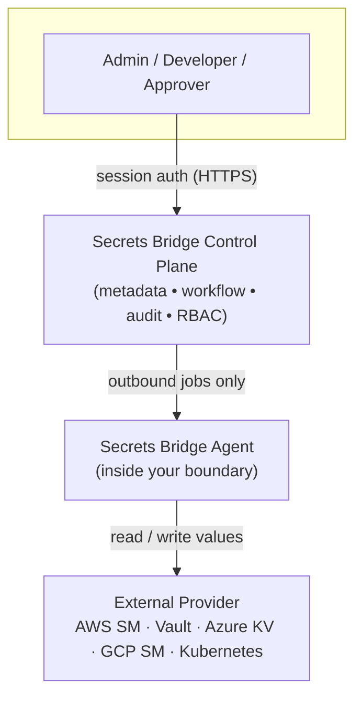

# Product status

This page is the map of what exists today, what has been QA-certified, what's
actively being built, and what's still on the roadmap. Nothing below is
aspirational unless it sits under **Roadmap**.

!!! info "What Secrets Bridge is"
    Secrets Bridge is a **unified secrets control plane** for governing secrets
    across external providers **without storing secret values in the control
    plane**.

    It **does not replace** HashiCorp Vault, AWS Secrets Manager, Azure Key
    Vault, GCP Secret Manager, or Kubernetes External Secrets. It governs
    **access, workflows, approvals, audit, and agent execution** around them.
    The values stay in your provider.

## Implemented features

Everything in this section is built and running.

| Feature | What it does |
|---|---|
| **Provider connections** | Manage external secret-provider connections and bind them to projects / environments. |
| **Agent onboarding** | Secure, outbound-only agent enrollment using **one-time enrollment tokens** and a **persistent agent identity** bound to one provider connection. |
| **Direct reveal** | Controlled non-prod secret reveal with **MFA step-up**, **TTL**, **single-shot wraps**, and a **server-anchored countdown**. |
| **Prod protection** | Direct reveal is **hard-blocked for prod** environments and the refusal is audited (metadata-only). |
| **Cross-team secret request flow** | Requester submits destination keys → value provider fills values → approver verifies → agent executes the provider write. |
| **Destination key enforcement** | Destination keys are validated at the **submit, fill, and execute** boundaries. |
| **Metadata-only audit trail** | Records actions, IDs, statuses, reasons, and timestamps; **never** plaintext values, tokens, or wrap bodies. |
| **Agent fleet visibility** | Admin / provider agent list, `provider_connection_id` binding, active / stale / revoked status, revoke flow, and heartbeat. |
| **Security model** | No secret values in Postgres, Redis, audit logs, browser storage, or control-plane logs. |

## QA-certified

The following flows have passed a focused QA cycle and are tracked as a
release / demo candidate. "PASS" means verified end-to-end, not merely merged.

| Certification | Status |
|---|---|
| Project access (RBAC + environment scoping) | ✅ PASS |
| Direct reveal end-to-end + TTL | ✅ PASS |
| Prod reveal refusal | ✅ PASS |
| Cross-team backend / API lifecycle | ✅ PASS |
| Cross-team UI drawer submit | ✅ PASS |
| Approver verify-panel context | ✅ PASS |
| Plaintext-leakage sweep | ✅ PASS |
| Agent Onboarding API | ✅ PASS / CLOSED |

## In progress

Being built now; not yet live or certified. Do not depend on these yet.

- **Agent enrollment rollout**: the enrollment flow and its Helm packaging are
  built; rolling it onto a live agent is gated on a controlled rollout.
- **Richer agent fleet dashboard (UI)**: the agent management API exists; the
  full fleet UI view is next.
- **Object storage for media**: project and team logos move from Postgres to
  a private S3 or S3-compatible bucket, served through the api with the
  existing authorization. Secret values never go to object storage.
  Implemented in the api and the chart, not yet through QA. See
  [Object storage](../operations/object-storage.md).
- **Signed releases**: every image and chart is signed with cosign by the
  workflow that built it, and images carry an SBOM and build provenance.
  All repos release together under one shared version; the first release
  has not been tagged yet. See
  [Verifying images and charts](../operations/verifying-releases.md).
- **Sign in with Google, with admin approval**: an admin connects a Google
  Workspace from the console. Accounts are bound by Google's issuer and
  subject, the `hd` claim must be in the allowed domains, and new accounts
  wait for an admin to approve them with a role and scope. Existing
  accounts connect Google from their profile. The worker can post one
  webhook message per run about waiting accounts. Merged in the api,
  console and worker, not yet through QA. See
  [Sign in with Google](../operations/google-sign-in.md).
- **Gateway, Release 1 (Argo CD)**: an optional, outbound-only, read-only
  component that runs in your boundary and reports Argo CD rollout state as
  metadata. Merged: the Gateway binary (Argo CD connector only, signed image),
  its Helm chart (no RBAC, no service-account token, egress-only
  NetworkPolicy) and the control-plane registry (enrollment, heartbeat,
  catalog, connector approval, bindings, revoke, `gateway.*` permissions).
  Not merged: observation tasks and evidence
  ([api#294](https://github.com/secrets-bridge/api/issues/294)), their
  sweepers ([worker#38](https://github.com/secrets-bridge/worker/issues/38)),
  the console page and the request-page display
  ([ui#163](https://github.com/secrets-bridge/ui/issues/163)), and the cutover
  that makes the Gateway the only Argo CD integration
  ([gateway#13](https://github.com/secrets-bridge/gateway/issues/13)). Until
  then a Gateway enrolls and reports its catalog but receives no observation
  tasks, and Argo CD state on a request comes from the control plane's poller
  (`SB_GITOPS_ENABLED`). Argo CD `Healthy` and `Synced` are operational state,
  never proof that a secret reached a workload. See
  [Gateway](../components/gateway.md).

## Live vs Roadmap

### Live / implemented

- AWS Secrets Manager provider connection
- Outbound agent (execution inside your boundary)
- Direct reveal (non-prod, MFA-gated, single-shot)
- Cross-team request → fill → approve → execute workflow
- Metadata-only audit trail
- Provider-bound agent onboarding (one-time enrollment tokens)
- Agent revoke / list / status
- Non-prod reveal protection
- Prod reveal refusal (audited)

### Roadmap / coming later

*Listed here because they are **not** live yet. Do not read these as shipped.*

- Azure Key Vault provider
- GCP Secret Manager provider
- HashiCorp Vault advanced flows
- Deeper Kubernetes External Secrets integration
- Flux integration
- Gateway Release 2: External Secrets Operator sync and Deployment rollout
  observation (in the gateway code, off by default and not supported for
  production)
- Signed Gateway evidence ([gateway#7](https://github.com/secrets-bridge/gateway/issues/7)),
  required before Gateway evidence is used as compliance evidence
- Agent connection-scoped job claim
- Richer agent fleet dashboard

## Security model at a glance

- The **agent is outbound-only**: it opens connections to the control plane and
  to its local provider; it never accepts inbound connections.
- The agent **accepts no inbound connections** for control-plane or user
  traffic. Its only listener serves health probes and metrics; the Helm
  chart binds it on the pod IP for kubelet and its NetworkPolicy denies all
  ingress.
- The agent has **no Postgres and no Redis** dependency, and **no Kubernetes API
  access** to read or write Secrets.
- The **control plane stores metadata only**, never plaintext values.
- **Secrets remain in the provider.** Secrets Bridge governs access around them.
- Values move only through **controlled, wrapped, single-shot** flows
  (KMS-wrapped envelopes, consumed exactly once, short TTL).
- **Audit is metadata-only**: actions, IDs, statuses, reasons, timestamps; no
  values, tokens, or wrap bodies.

See the [full architecture](architecture.md) and the
[threat model](threat-model.md) for how each boundary is enforced.

## The guarantees we hold

- **Outbound-only agent**: no inbound listener apart from the probe and
  metrics port, no cluster-API dependency.
- **Metadata-only audit**: append-only at the schema layer (Postgres triggers).
- **No plaintext persistence**: not in Postgres, Redis, logs, or the browser.
- **MFA-gated reveal**: non-prod reveals require an MFA step-up.
- **Prod reveal hard-block**: refused and audited, not merely discouraged.
- **One-time enrollment tokens**: hash-only, short-TTL, returned once, spent once.
- **Provider-bound agents**: an enrolled agent is bound to a single provider
  connection.
- **Revocation**: an agent can be revoked; its heartbeats and job polling stop
  being accepted immediately.
