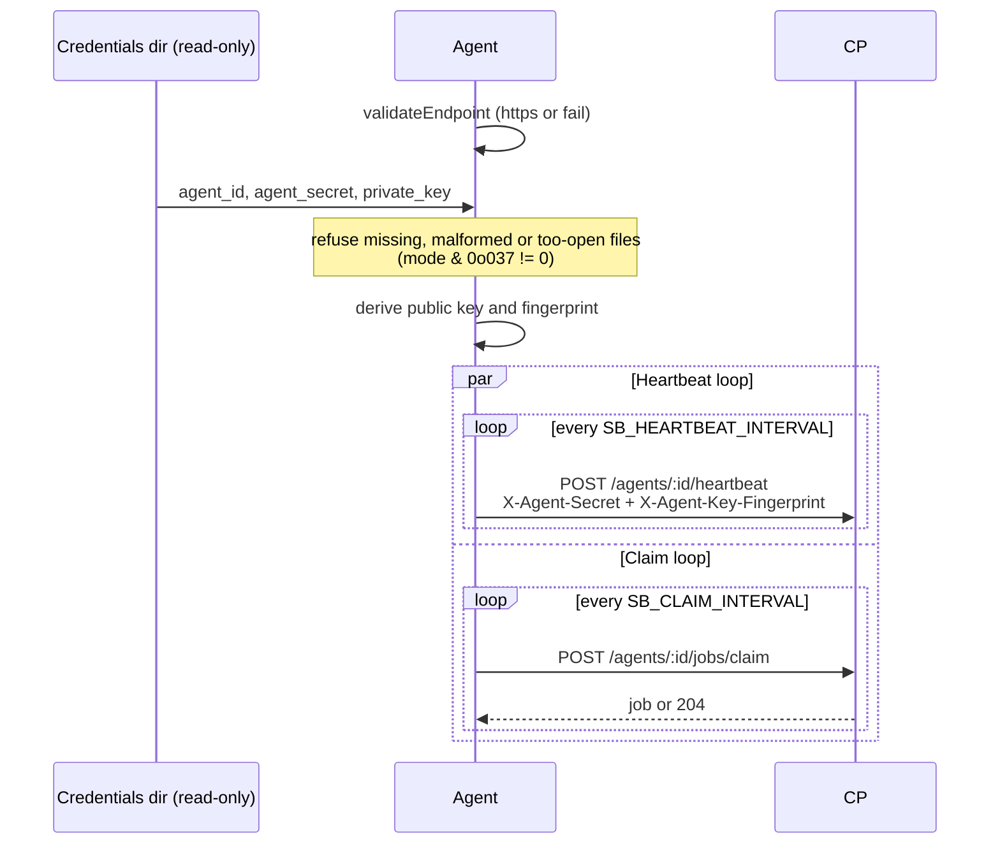

# Agent

Repo: [`secrets-bridge/agent`](https://github.com/secrets-bridge/agent)
· Stack: Go 1.25 stdlib `net/http` (no Fiber) +
[hashicorp/vault/api](https://github.com/hashicorp/vault) +
[aws-sdk-go-v2/service/secretsmanager](https://github.com/aws/aws-sdk-go-v2)
· Container: `golang:1.25-alpine` → `distroless/static:nonroot`

The execution tier. Runs inside the target account / cluster.
Holds provider credentials for its own boundary only; the Control
Plane never sees them.

## Hard rules enforced by CI

| Rule | How |
|---|---|
| No database driver | CI greps `go.sum` for `pgx`, `lib/pq`, `mysql`, `mongo-driver`; fails on hit |
| No Redis client | CI greps `go.sum` for `redis/go-redis`, `gomodule/redigo`; fails on hit |
| No inbound listener except probes | The only listener serves `/healthz`, `/readyz` and `/metrics` on `SB_LOCAL_ADDR`. The binary defaults to `127.0.0.1:8090`. The `agent` Helm chart binds `0.0.0.0:8090` because kubelet probes come from the node, creates no Service for it, and its default NetworkPolicy denies all ingress to the pod. |
| Read-only credentials, no durable state | The agent reads `agent_id`, `agent_secret` and `private_key` from `SB_AGENT_CREDENTIALS_DIR`, refuses a file with group write or any bit for others (`mode & 0o037 != 0`), and writes no file, PVC or Kubernetes Secret |
| TLS required to the CP | `validateEndpoint` refuses `http://` unless `SB_INSECURE_TRANSPORT=true` |
| Plaintext zeroed after one use | `client.Zero([]byte)` is called via `defer` on every value-bearing slice |

## Boot sequence

The agent is stateless. Its credential and its X25519 wire-encryption key are
created before it runs, by `secrets-bridge-agent enroll` on an operator
workstation, and reach the pod through a read-only Secret. See
[Agent onboarding](../operations/agent-onboarding.md).

The agent never generates a key at runtime, never enrolls at start and never
registers a public key: the key is bound at enrollment. When the control plane
answers `409 agent_key_mismatch`, the loaded key is not the bound one, usually
after a rotation the pod hasn't picked up yet. A wrap whose
`recipient_key_fingerprint` is not the agent's own is refused before it is
opened.

!!! note "Heartbeat response shape"
    A **bodyless** heartbeat returns an empty **204**, the shape existing
    agents rely on. A heartbeat with an optional JSON body
    (`status` / `agent_version` / `capabilities`) returns **200**
    `{status, server_time, next_heartbeat_seconds}` and records the reported
    fields; the first heartbeat also transitions an `enrolled` agent to
    `active`. See the [HTTP API reference](../reference/api-endpoints.md#agents).

## Configuration

| Env var | Required | Default | Notes |
|---|---|---|---|
| `SB_CP_ENDPOINT` | yes | - | `https://api.secrets-bridge.example` |
| `SB_AGENT_CREDENTIALS_DIR` | no | `/etc/secrets-bridge/agent` | Read-only directory with the files `agent_id`, `agent_secret` and `private_key` (base64 of 32 bytes). Every file is required. The `agent` chart mounts `identity.existingSecret` here |
| `SB_CLUSTER_NAME` | yes for discovery jobs | - | Stamped on every discovered secret |
| `SB_HEARTBEAT_INTERVAL` | no | `30s` | Bounded by api's stale-after window |
| `SB_CLAIM_INTERVAL` | no | `5s` | Claim cadence |
| `SB_CLAIM_CONCURRENCY` | no | `4` | Worker pool size; non-blocking semaphore |
| `SB_INSECURE_TRANSPORT` | no | `false` | Dev only: allows `http://` to the CP ([insecure switches](../operations/config.md#insecure-switches-dev-only)) |
| `SB_CP_CA_FILE` | no | - | Pin a private CA (replaces system roots) |
| **Provider creds** (per resolver) | yes | - | See [Providers supported](../reference/providers.md) |

There is no environment variable for the credential or the key. The full list,
including the provider settings, is in the
[configuration reference](../operations/config.md#agent).

!!! warning "Direct mint is a dev-only break-glass"
    The direct mint (`POST /api/v1/agents`) is refused with
    `403 direct_agent_mint_disabled` unless the api runs with
    `SB_ALLOW_DIRECT_AGENT_MINT=true`, and it requires a public key like
    enrollment does. Use it for dev and tests only. Onboard agents with an
    enrollment token; see [Agent onboarding](../operations/agent-onboarding.md).

## Executors that ship today

| Job type | Executor | What it does |
|---|---|---|
| `patch` | `PatchExecutor` | Fetches wraps → `GetValue` (existing bundle) → merge → `PutValue` → mark consumed. Idempotent re-runs (untouched keys survive). |
| `read` | `ReadExecutor` | Fetches one bundle → selective `target_keys` split → `POST /agents/:id/wraps` per key → zero plaintext after each post |
| `discover` | `DiscoverExecutor` | `ListMetadata(scope)` → preserve native tags verbatim into the CP's `labels` jsonb (Vault `custom_metadata`, AWS Tags, etc.) |

## Provider resolvers

The agent dispatches by `payload.target_provider_type` via
`ResolverByType`. Today:

| Type | Status | Auth |
|---|---|---|
| `vault` | ✅ ships | Token (`SB_VAULT_TOKEN`) or Kubernetes (`SB_VAULT_KUBERNETES_ROLE`) |
| `aws-sm` | ✅ ships | Standard AWS SDK chain (IRSA / instance role / `AWS_*` env) |
| `gcp-sm` | placeholder | Stub returns `NotConfiguredResolver` |
| `azure-kv` | placeholder | Stub returns `NotConfiguredResolver` |

Every resolver refuses credential-shaped keys in the
`target_provider_config` (e.g. `awsSecretAccessKey`, `token`,
`sessionToken`) so a future api bug can't accidentally ship a
credential to the agent over the wire.
