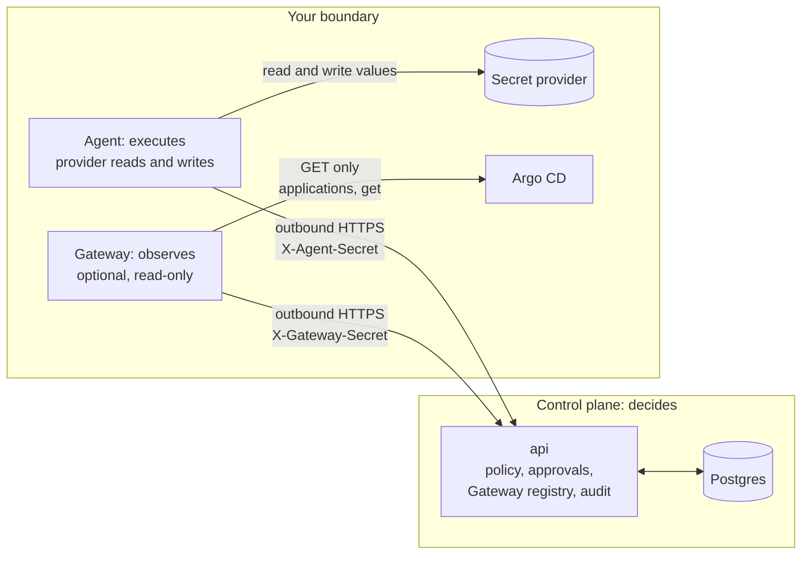
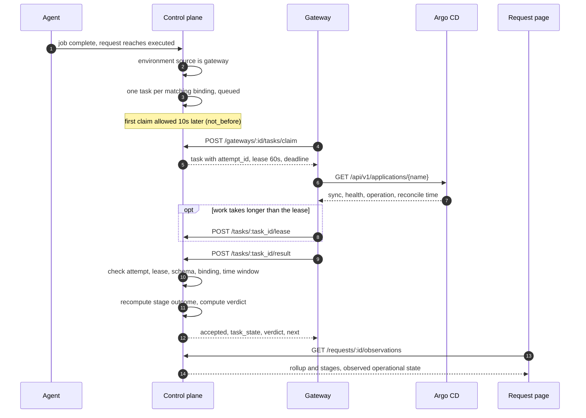

# Gateway

Repo: [`secrets-bridge/gateway`](https://github.com/secrets-bridge/gateway)
· Stack: Go 1.26, stdlib `net/http`, `log/slog`, Prometheus client
· Container: `golang:1.26-alpine` → `distroless/static:nonroot`, published as
`ghcr.io/secrets-bridge/gateway`, signed with cosign and shipped with an SBOM and
build provenance ([verifying releases](../operations/verifying-releases.md))
· Chart: `oci://ghcr.io/secrets-bridge/charts/secrets-bridge-gateway`

The control plane decides, the agent executes, and the Gateway observes. A
Gateway runs inside your security boundary, reads the state of the Argo CD
Applications you list in its local configuration, and reports that state to the
control plane as metadata. It never changes anything, and it is optional.

!!! warning "Release 1 is in progress"
    The Gateway binary, its Helm chart, the control-plane registry and the
    observation path (tasks, leases, results, evidence, verdicts, the worker
    sweepers and the console pages) are merged. Release 1 has not passed QA.

    The Gateway is the only Secrets Bridge component that talks to Argo CD.
    The control plane holds no Argo CD credentials and has no Argo CD client.
    Installs that used the old control-plane poller follow the
    [Gateway cutover](../operations/gateway-cutover.md) runbook.

## Where it sits

The agent and the Gateway each open their own outbound HTTPS connection to the
control plane. There is no connection between them in either direction, and the
agent does not depend on the Gateway. The control plane never connects into
your network on the Gateway path.

## What it is

| Property | What it means in the code |
|---|---|
| Optional | Governance and execution work without a Gateway. By design, a request with no Gateway observing it shows as unverified, never as failed. |
| Outbound only | The only listener is `/healthz`, `/readyz` and `/metrics` on a loopback address (`127.0.0.1:8091` by default). A non-loopback address, including `localhost`, is refused at boot. |
| Read-only | Argo CD is read through a GET-only transport. The control-plane client can reach only the Gateway endpoints. No sync, rollback, refresh or patch is possible. |
| Metadata only | It reports sync status and revision, health, the last operation phase and the reconcile time. It never decodes Helm values, condition messages or health messages, and it reads no Kubernetes Secrets. |
| Bound connectors only | Connectors and targets come from a local file. The control plane names only a connector id and a target id. It cannot point the Gateway at a new host, project or Application. |
| Stateless | No database, no Redis, no volume. Several replicas share one Gateway identity. |

## What it is not

Argo CD `Healthy` and `Synced`, or a finished sync, are operational state. They
are not proof that a new secret value reached a running workload: a secret
change does not change Git, so an Application can be healthy and synced while
its pods still hold the old value. The Argo CD connector reports at most
`observed` with confidence `low`, attaches the caveat `argocd_health_not_proof`
to every observation that is not an error. The control plane never turns it
into a `verified` verdict: a task that saw only Argo CD `Healthy` and `Synced`
ends `unverified` with the reason `context_only`.

A Gateway that is offline, not deployed or not yet bound means the observation
is `pending`, and `timed_out` once the deadline passes. It never means the
deployment is healthy, and it never fails the request. There is no `failed`
verdict. Execution and approvals do not wait for it.

The Gateway is not an execution path. It does not call the agent, receive
values or wraps, or hold provider credentials.

## Release 1 scope

Release 1 is Argo CD rollout-state observation only
([gateway#12](https://github.com/secrets-bridge/gateway/issues/12)).

- The supported connector kind is `argocd`. It reads one Application by name
  with `GET /api/v1/applications/{name}` (with `?appNamespace=` when the
  target sets one), checks its token at boot with
  `GET /api/v1/session/userinfo`, and asks Argo CD's can-i API
  (`GET /api/v1/account/can-i/...`) that its token holds no write or other
  dangerous right. See
  [Argo CD privilege checks](../operations/gateway.md#argo-cd-privilege-checks).
- An Application's `metadata.uid` is its identity. A deleted and recreated
  Application under the same name gets an `error` observation with code
  `target_identity_changed`, never the new object's state. Evidence carries a
  scoped digest of the uid, never the uid. See
  [Application identity](../operations/gateway.md#application-identity).
- With only `argocd` connectors, the Gateway reads no Kubernetes API. It builds
  no Kubernetes client, needs no service-account token and no RBAC, and runs
  no Kubernetes self-check.
- The `eso` (External Secrets Operator) and `rollout` (Deployment rollout)
  connectors are Release 2. Their code is in the repo, but the Gateway refuses
  a connectors file that names them unless `SB_GATEWAY_ENABLE_R2_CONNECTORS=true`
  is set. That switch is not supported for production, and the Gateway logs a
  WARN at boot while it is on. The Helm chart does not render these kinds and
  never sets the switch.

What the Argo CD connector proposes for the stage `argocd_context` (the
control plane recomputes every outcome from the reported facts):

| Outcome | When |
|---|---|
| `observed`, confidence `low` | The Application is `Healthy` and `Synced`, with no operation or a `Succeeded` one, and was reconciled after the change |
| `not_observed` | Anything else, including `Progressing`, `Degraded`, `OutOfSync`, a failed operation, or state reconciled at or before the change. `Degraded` is context, not a failure of the secret change |
| `unverifiable` | The Application is outside the AppProjects allowed in the local configuration. No status is reported |
| `error` | Argo CD cannot be read. A fixed error code, never a message |

## Observation flow

Each environment has an observation source: `gateway` or `none` (the
default). When a change reaches `executed`, the control plane reads that source
once. For `gateway` it creates Gateway tasks; for `none` nothing observes the
change. There is no fallback to any other observer.

1. **Task.** A patch or cross-team request that reaches `executed` in an
   environment whose source is `gateway` gets one task for each enabled
   binding that covers its secret scope, where the Gateway is not revoked or
   disabled, the Argo CD connector is approved and the bound target is still
   advertised. Release 1 tasks carry one stage, `argocd_context`. The first
   claim is allowed 10 seconds after `executed`. The deadline is the binding's
   `observation_timeout_seconds` (default 1800), raised to cover the target's
   advertised refresh interval and progress deadline plus 5 minutes, and never
   more than 24 hours. With no matching binding, no task is created and the
   request shows "No observation configured".
2. **Claim.** The Gateway claims for itself only. The task is chosen by the
   authenticated Gateway id, never by anything in the body. A claim leases one
   task to one replica with a new `attempt_id` and a 60-second lease (capped
   at the deadline). Each replica holds at most one task, and the Gateway at
   most `max_inflight_tasks` (default 20). Nothing to claim answers `204`
   with `Retry-After: 5`.
3. **Lease.** The Gateway renews the lease while it works, or releases the
   task early with a reason (`shutdown`, `over_capacity`,
   `connector_unavailable`). A release is never a failure. A lease that runs
   out puts the task back in the queue, and the old `attempt_id` can no longer
   renew, release or post a result.
4. **Result.** The result is accepted only for the attempt the control plane
   dispatched to that Gateway, while its lease is live and before the
   deadline. The evidence must name the connector and target in the task, that
   connector must be approved and belong to the Gateway, the binding must still
   be live in the request's own environment and project, and the reported
   Application must be the object the target advertises. The schema is closed:
   unknown or duplicate keys are refused. Timestamps must fall inside the
   attempt, allowing for clock skew. A repeated result with the same body
   returns the stored answer (`duplicate`); a different body for the same
   attempt is a conflict.
5. **Verdict.** The control plane recomputes the stage outcome from the
   reported facts and does not take the Gateway's word for it. Evidence, the
   task state, the verdict and the audit events are written in one
   transaction. A stage that is not yet `observed` puts the task back in the
   queue with a backoff of 15, 30, 60 and then 120 seconds until the deadline.

What the verdicts mean in Release 1:

| Verdict | Reason | When |
|---|---|---|
| `pending` | | The task is open (`queued` or `leased`) |
| `unverified` | `context_only` | Argo CD was `Healthy` and `Synced`, idle or `Succeeded`, and reconciled after the change. This is observed operational state, so the verdict stays unverified |
| `unverified` | `no_stage_observed` | The stage ended `unverifiable`, for example an Application outside the allowed AppProjects |
| `unverified` | `gateway_errors` | Five Gateway-reported errors or refused attempts. The task is `dead` |
| `unverified` | `superseded_by_later_write`, `source_changed`, `binding_removed` | A later change to the same secret, a change of the environment's source away from `gateway`, or a deleted binding cancelled the open task |
| `timed_out` | `gateway_unavailable` | The deadline passed and the Gateway was not seen since the task was created, or is not `active` |
| `timed_out` | `deadline_reached` | The deadline passed while the Gateway was up, for example while Argo CD stayed `Progressing` or `OutOfSync` |

`verified` and `partially_observed` exist in the schema for the Release 2
stages (`eso_sync`, `workload_rollout`). A Release 1 task never reaches them.
There is no `failed` verdict, so a Gateway that is offline or late leaves the
request `pending` and then `timed_out`, never failed.

Revoking or disabling a Gateway moves its leased tasks back to `queued` and
refuses the old attempts. A disabled Gateway can be enabled again; a revoked
one cannot. Tasks it can no longer claim end `timed_out` at their deadline.

## Security model

The Gateway fails closed. Where it cannot prove a rule holds, it refuses to
start, stops claiming, or stays not ready.

| Rule | How it holds |
|---|---|
| GET only to Argo CD | Each Argo CD client is pinned to the scheme and host of its `base_url` and allows GET only to exact paths: one Application by name, `session/userinfo`, the can-i question for each probe it asks, and the application list with exactly one allowed `projects` value and a fixed `fields` projection. Nothing in Release 1 calls the list. Every other method, path and query key is refused before the request leaves the process. `resource-tree`, `managed-resources`, `manifests` and the `exec`, `logs` and other stream paths are blocked even though Argo CD's `applications, get` permission allows some of them, and so is `?refresh=`, which would make Argo CD patch the Application. Redirects are refused, proxy variables are ignored, and an Application response is capped at 2 MiB. |
| Least-privilege Argo CD account | The token needs `applications, get` on each allowed `<project>/*` and nothing else. It is mounted as a file and re-read when it rotates. At boot and every 5 minutes the Gateway asks can-i, for each allowed AppProject and each static target it has read, whether the token may sync, change or delete Applications, exec, read logs, write ApplicationSets or change the AppProject. A `yes` refuses the start, or stops a running Gateway, with no override. Grants on resource actions (`action/...`) are not visible to can-i and are left to the integrator's policy review. On Argo CD 2.x, `server.rbac.log.enforce.enable: "true"` is required. See [the minimal policy](../operations/gateway.md#the-minimal-policy). |
| No Secrets access, ever | Release 1 has no Kubernetes access at all. For the Release 2 Kubernetes connectors, a boot self-check refuses to start if the service account can use any verb on `secrets`, or any write verb on a resource a connector reads. A failed review call also refuses the boot. There is no override. The check repeats every 5 minutes and stops the Gateway if a grant appears. |
| Writes only to the control plane | The control-plane client refuses any method or path other than the Gateway endpoints, uses no proxy and never follows redirects. Enrollment refuses any URL that is not `https`. |
| Credential at rest | The control plane stores a SHA-256 hash of the Gateway secret and compares it in constant time. On the Gateway side the identity is a read-only file. A file that other users can read, or that its group can write, is refused at boot. |
| Revocation | After a revoke, the next heartbeat or catalog upload gets `401`. The Gateway stops claiming and stays up and not ready, with the reason in its log, so the pod does not restart-loop. |
| Separate identity | Gateways have their own tables, header and middleware. An agent credential cannot authenticate as a Gateway, and a Gateway credential cannot reach agent routes. |

Gateway evidence is customer-side attestation: whoever controls a Gateway can
report false state for their own requests. The design accepts that for Release 1
by labelling evidence "observed by Gateway X". Signed evidence
([gateway#7](https://github.com/secrets-bridge/gateway/issues/7)) must ship
before Gateway evidence is presented as compliance evidence.

## Runtime behaviour

- A replica is ready when the control plane has accepted a recent heartbeat
  and the catalog, and every connector self-check passes.
- Claiming pauses while no heartbeat has been accepted within
  `SB_GATEWAY_CP_UNREACHABLE_AFTER` (default `2m`), the catalog is not
  accepted, or a connector is unverified. It resumes once all three hold again.
- A `401` or an unsupported contract version stops claiming and leaves the
  process up and not ready.
- `gateway healthcheck` is the client for the exec probes, since the image has
  no shell or curl and the local server listens on loopback only. It sends one
  GET to `/readyz` (or `/healthz` with `--live`) and exits 0 on a 200.

## Further reading

- [Install and enroll a Gateway](../operations/gateway.md)
- [Gateway configuration](../operations/config.md#gateway)
- [ADR 0001: Gateway as an outbound-only observation plane](https://github.com/secrets-bridge/gateway/blob/main/docs/adr/0001-gateway-observation-plane.md)
- [Gateway threat model](https://github.com/secrets-bridge/gateway/blob/main/docs/design/threat-model.md)
- [Chart README](https://github.com/secrets-bridge/charts/blob/main/gateway/README.md)
