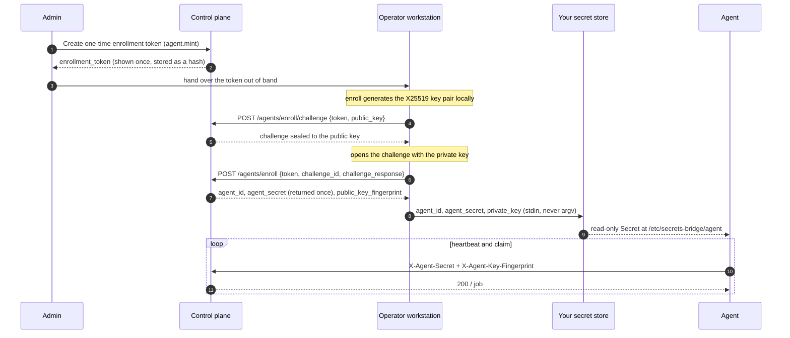
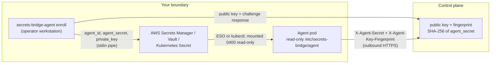

# Agent onboarding

An agent runs inside your boundary (a Kubernetes cluster, a VPC, an account)
and talks outbound only, to the control plane and to its local provider. It is
stateless: it reads its identity from a read-only Secret and never writes a
file, a PVC or a Kubernetes Secret.

Onboarding has four steps:

1. An admin creates a one-time enrollment token in the console.
2. An operator runs `secrets-bridge-agent enroll` on a trusted workstation
   inside your boundary. The command generates the agent's X25519 key pair
   locally and exchanges the token for the agent credential.
3. The operator stores the result in AWS Secrets Manager, Vault or a
   Kubernetes Secret.
4. The agent is deployed with the `agent` Helm chart and
   `identity.existingSecret` pointing at that Secret.

!!! note "First-release requirement"
    This flow is a requirement for the first release
    ([skills#116](https://github.com/secrets-bridge/skills/issues/116)). It
    replaces the earlier enrollment at pod start with a PVC, which is removed.
    It is in progress, not live: see [Product status](../overview/product-status.md).

## The flow



The control plane checks the enrollment token without spending it, seals a
random challenge to the submitted public key, and only creates the agent when
the operator returns the decrypted challenge. That proves the enrolling client
holds the private key. The token is consumed in the same transaction that
creates the agent, and the agent is bound to the token's provider connection.

## Key custody

| Material | Generated by | Held by | The control plane keeps |
|---|---|---|---|
| X25519 private key (`private_key`) | `secrets-bridge-agent enroll`, on your workstation | Your secret store and the agent pod | Nothing |
| X25519 public key | Derived from the private key | Sent at enrollment | The public key and its fingerprint (`sha256:` plus hex) |
| Agent credential (`agent_id`, `agent_secret`) | The control plane, returned once | Your secret store and the agent pod | `agent_id` and the SHA-256 of `agent_secret` |
| Enrollment token | The control plane | The admin, briefly | A hash, until it is spent or expires |



The X25519 key is a wire-encryption key. The control plane seals the values it
sends to the agent (for example, a patch value) to this key, so only the agent
can open them. It is not a TLS client certificate and plays no part in TLS: the
agent still verifies the control plane's certificate, and it authenticates with
`agent_secret`. The private key never leaves your boundary, and nothing in the
console or the API can show it.

Every request the agent makes carries `X-Agent-Key-Fingerprint`. The control
plane compares it with the key bound at enrollment, and the agent refuses a
sealed value whose recipient fingerprint is not its own. There is no API call
that replaces an agent's public key in normal operation; a key changes only
through the audited [rotation](#rotate-the-wire-key) below.

### Where secrets must never go

Keep the enrollment token, `agent_secret` and `private_key` out of:

- Helm values, `--set` flags and Argo CD or Flux application specs;
- shell arguments and shell history (read the token at a silent prompt and pass
  it on stdin, as shown below);
- Git, including a generated Secret manifest (`enroll --format k8s-secret` is
  for piping into
  `kubectl apply --server-side --field-manager=secrets-bridge-agent -f -`,
  never for committing);
- the `kubectl.kubernetes.io/last-applied-configuration` annotation (see the
  warning below);
- CI logs and job output;
- the browser, chat messages and tickets.

!!! warning "Apply the agent Secret server-side"
    Client-side `kubectl apply -f -` stores the whole object it applies,
    including the plaintext `agent_secret` and `private_key` from
    `stringData`, in the `kubectl.kubernetes.io/last-applied-configuration`
    annotation. That copy sits outside `.data`, where tools that treat
    metadata as non-sensitive can expose it. The same happens with
    `kubectl create secret ... --dry-run=client -o yaml | kubectl apply -f -`.
    Use `kubectl apply --server-side`, which keeps no such copy, or
    `kubectl create secret generic --from-env-file=/dev/stdin`. To check a
    Secret, run
    `kubectl -n secrets-bridge get secret secrets-bridge-agent-identity -o jsonpath=''`:
    it must not list `last-applied-configuration`.

`enroll` writes nothing secret to stderr or to logs. It may print the
`agent_id` and the key fingerprint to stderr.

## Step 1: create an enrollment token

In the console, an admin with `agent.mint` creates a one-time enrollment token
for the provider connection the agent will serve. The token is tied to that
connection, and optionally to an expected cluster name and provider type. It
expires after 15 minutes by default and works once. Scripts can call
`POST /api/v1/provider-connections/:id/agent-enrollment-token` instead; see
[Enrolling your first agent](bootstrap.md#enrolling-your-first-agent).

## Step 2: enroll from your workstation

Run `secrets-bridge-agent enroll` (the agent binary, as a subcommand) on a
trusted machine inside your boundary. It needs HTTPS access to the control
plane.

| Flag | Meaning |
|---|---|
| `--cp-endpoint` | The control plane URL. `https://` only, with the same TLS options as the agent runtime |
| `--token-file ` | The enrollment token, from a file or from stdin (`-`). There is no `--token` flag |
| `--name`, `--provider-type` | Required. The agent's name and provider type (`aws-sm`, `vault`). The provider type must match the token's expected value when it has one |
| `--cluster-name`, `--region` | Reported at enrollment. The cluster name must match the token's expected value when it has one |
| `--output ` | Where the bundle goes. A file is created with mode `0600` and refused if it exists. `-` is stdout |
| `--format json\|env\|k8s-secret` | Bundle format, `json` by default. `env` is `key=value` lines for `kubectl create secret generic --from-env-file`; `k8s-secret` is a Secret manifest for `kubectl apply --server-side --field-manager=secrets-bridge-agent -f -` (never client-side apply) |
| `--secret-name` | Name of the Secret in the `k8s-secret` format. Default `secrets-bridge-agent-identity` |

The bundle has `agent_id`, `agent_secret`, `private_key` and
`public_key_fingerprint`. The agent ignores `public_key_fingerprint`, and the
chart mounts only the other three keys, so a Secret with all four is fine. Pipe it straight into your secret store, as in step 3,
so it never lands on disk or in the terminal. Each example reads the token at a
silent prompt first:

```bash
read -rsp 'Enrollment token: ' SB_ENROLL_TOKEN; echo
```

and runs `unset SB_ENROLL_TOKEN` at the end. `printf` is a shell builtin, so the
token does not show up in the process list.

## Step 3: store the credential

Pick one store. The agent only reads the Kubernetes Secret, so External Secrets
Operator (ESO) is one way to fill that Secret, not a runtime dependency.

=== "AWS Secrets Manager"

    Create the secret first with your infrastructure code (empty, with the tags
    and KMS key you want). Then write the bundle to it:

    ```bash
    printf '%s' "$SB_ENROLL_TOKEN" \
      | secrets-bridge-agent enroll --cp-endpoint https://secrets-bridge.example.com \
          --token-file - --name prod-eu-agent --cluster-name prod-eu --provider-type aws-sm \
          --region us-east-1 --format json --output - \
      | aws secretsmanager put-secret-value \
          --secret-id arn:aws:secretsmanager:us-east-1:123456789012:secret:secrets-bridge/agents/prod-eu \
          --secret-string file:///dev/stdin
    unset SB_ENROLL_TOKEN
    ```

    Then sync it into the cluster with an ESO `ExternalSecret` that copies the
    `agent_id`, `agent_secret` and `private_key` properties. The chart repo has
    a tested example in
    [`agent/examples/eso-aws-secrets-manager`](https://github.com/secrets-bridge/charts/tree/main/agent/examples/eso-aws-secrets-manager).

=== "Vault"

    ```bash
    printf '%s' "$SB_ENROLL_TOKEN" \
      | secrets-bridge-agent enroll --cp-endpoint https://secrets-bridge.example.com \
          --token-file - --name prod-eu-agent --cluster-name prod-eu --provider-type vault \
          --format json --output - \
      | vault kv put -mount=kv secrets-bridge/agents/prod-eu -
    unset SB_ENROLL_TOKEN
    ```

    `vault kv put  -` reads the JSON object from stdin. Sync it with an
    ESO `ExternalSecret`; see
    [`agent/examples/eso-vault`](https://github.com/secrets-bridge/charts/tree/main/agent/examples/eso-vault).

=== "Kubernetes Secret"

    ```bash
    kubectl create namespace secrets-bridge
    printf '%s' "$SB_ENROLL_TOKEN" \
      | secrets-bridge-agent enroll --cp-endpoint https://secrets-bridge.example.com \
          --token-file - --name prod-eu-agent --cluster-name prod-eu --provider-type vault \
          --format env --output - \
      | kubectl -n secrets-bridge create secret generic secrets-bridge-agent-identity \
          --from-env-file=/dev/stdin
    unset SB_ENROLL_TOKEN
    ```

    The same script is in
    [`agent/examples/kubectl-secret`](https://github.com/secrets-bridge/charts/tree/main/agent/examples/kubectl-secret).
    `secrets-bridge-agent-identity` is the documented name and the default of
    `--secret-name`. Restrict `get` on Secrets in that namespace to the people
    who run the agent.

If the pipe fails after the control plane answered (for example, the secret
store refused the write), the bundle is lost and the token is spent. Revoke the
half-created agent and start again with a new token.

### Least-privilege write access for whoever runs enroll

The person or pipeline that runs `enroll` needs to write one entry, and nothing
else.

AWS Secrets Manager, for an existing secret (the `-??????` matches the random
suffix AWS adds to the ARN):

```json
{
  "Version": "2012-10-17",
  "Statement": [
    {
      "Sid": "WriteOneAgentCredential",
      "Effect": "Allow",
      "Action": "secretsmanager:PutSecretValue",
      "Resource": "arn:aws:secretsmanager:us-east-1:123456789012:secret:secrets-bridge/agents/prod-eu-??????"
    }
  ]
}
```

When the secret uses a customer managed KMS key, also allow
`kms:GenerateDataKey` and `kms:Encrypt` on that key, with the condition
`kms:ViaService = secretsmanager.us-east-1.amazonaws.com`. The writer needs no
`GetSecretValue`. ESO reads with its own role, which needs
`secretsmanager:GetSecretValue` on the same ARN (and `kms:Decrypt` through
Secrets Manager), and nothing else.

Vault, KV version 2 mounted at `kv`:

```hcl
# Writer: the operator who runs enroll.
path "kv/data/secrets-bridge/agents/prod-eu" {
  capabilities = ["create", "update"]
}
```

```hcl
# Reader: the ESO role that syncs the Secret.
path "kv/data/secrets-bridge/agents/prod-eu" {
  capabilities = ["read"]
}
```

## Step 4: deploy the agent

```bash
helm install secrets-bridge-agent oci://ghcr.io/secrets-bridge/charts/secrets-bridge-agent \
  --version <chart-version> \
  --namespace secrets-bridge \
  --set clusterName=prod-eu \
  --set cp.endpoint=https://secrets-bridge.example.com \
  --set image.digest=sha256:<agent-digest> \
  --set identity.existingSecret=secrets-bridge-agent-identity \
  --set providers.vault.enabled=true \
  --set providers.vault.addr=https://vault.example.com \
  --set providers.vault.kubernetesRole=secrets-bridge-agent
```

`identity.existingSecret` names the Secret, never its contents, so these values
are safe to commit. The chart:

- mounts the Secret read-only at `/etc/secrets-bridge/agent` with
  `defaultMode: 0400`, and sets `SB_AGENT_CREDENTIALS_DIR` to that path;
- maps the keys `agent_id`, `agent_secret` and `private_key` to files of the
  same name (`identity.keys.*` maps other key names);
- renders no PVC, no writable volume and no Role or RoleBinding;
- refuses the removed settings (`identity.mode`, `identity.persistence`,
  `enrollment.*` and others) at render time, naming the key.

Secret volume files are owned by root. The chart requires
`podSecurityContext.fsGroup` (default `65532`), which gives them the agent's
group, and kubelet then adds the group read bit, so the files show up in the pod
as `0440 root:65532`. Without `fsGroup` they stay `0400 root:root` and the
non-root agent can't read them. The agent accepts owner and group read, and
refuses a file with group write or any permission for others
(`mode & 0o037 != 0`).

At start the agent loads the three files, derives the public key and its
fingerprint, and sends the fingerprint with every request. It fails closed: a
missing, empty or malformed file, or a file that is too open, stops it before it
contacts the control plane. It never generates a key and never falls back to an
ephemeral one.

To check the result, compare the fingerprint `enroll` printed with the one the
console shows for the agent. The agent turns `active` on its first heartbeat.

## Restarts and reschedules

A restart or a move to another node reads the same Secret. The agent keeps no
local state, so nothing is lost and no token is needed. Because two pods can run
briefly during a rolling update with the same identity, set
`strategy.type: Recreate` in the chart if you want no overlap.

## Rotate the wire key

Rotation replaces the X25519 key and keeps `agent_id` and `agent_secret`.

1. An admin requests the rotation in the console, or with
   `POST /api/v1/admin/agents/:id/key-rotation`. This needs `agent.mint` and a
   fresh second factor. The answer is a one-time rotation token that expires
   after 15 minutes. The request is audited as `agent.key_rotation.requested`.
2. On the workstation, with the current credential available as a read-only
   directory, run:

    ```bash
    printf '%s' "$SB_ROTATION_TOKEN" \
      | secrets-bridge-agent rotate-key --cp-endpoint https://secrets-bridge.example.com \
          --credentials-dir /path/to/current/credentials \
          --rotation-token-file - --format json --output - \
      | aws secretsmanager put-secret-value \
          --secret-id arn:aws:secretsmanager:us-east-1:123456789012:secret:secrets-bridge/agents/prod-eu \
          --secret-string file:///dev/stdin
    unset SB_ROTATION_TOKEN
    ```

    `rotate-key` generates the new key locally and runs the same challenge as
    enrollment, sealed to the new key. The control plane then binds the new key,
    increments `public_key_version` and audits `agent.key.rotated` with the old
    and new fingerprints. Write to Vault the same way as in step 3.

    `kubectl create secret` refuses a Secret that exists, so update a
    Kubernetes Secret in place with a server-side apply:

    ```bash
    printf '%s' "$SB_ROTATION_TOKEN" \
      | secrets-bridge-agent rotate-key --cp-endpoint https://secrets-bridge.example.com \
          --credentials-dir /path/to/current/credentials \
          --rotation-token-file - --format k8s-secret --output - \
      | kubectl -n secrets-bridge apply --server-side \
          --field-manager=secrets-bridge-agent --force-conflicts -f -
    unset SB_ROTATION_TOKEN
    ```

    `--force-conflicts` takes over the fields that `kubectl create secret` (or
    another field manager) set at enrollment; without it the apply stops with
    a conflict. A server-side apply over a Secret that an earlier client-side
    apply wrote also drops the old `last-applied-configuration` annotation.
3. Restart the agent once the Kubernetes Secret has the new key: wait for ESO
   to sync it (or force a sync), then `kubectl rollout restart` the Deployment.
   With `reloader.enabled=true` (the chart default) and
   [stakater/reloader](https://github.com/stakater/Reloader) installed, the
   restart happens on its own.

Between step 2 and the restart, the running agent still holds the old key and
gets `409 agent_key_mismatch`. Nothing is lost: wraps are sealed when the agent
fetches them, so queued work is sealed to the new key once the restarted agent
picks it up.

## Revoke an agent

1. Revoke the agent in the console (or `POST /api/v1/admin/agents/:id/revoke`
   with a reason, needs `agent.revoke`). Its next heartbeat or claim is refused,
   and any open rotation tokens and challenges for it stop working.
2. Uninstall the chart or scale the Deployment to zero.
3. Delete the Kubernetes Secret and the entry in AWS Secrets Manager or Vault.
4. For a replacement, start again at step 1 with a new enrollment token.

An unused enrollment token can be revoked on its own with
`POST /api/v1/agent-enrollment-tokens/:id/revoke`.

## Gateway parity

The [Gateway](gateway.md) runs the same way at the storage level: it is
stateless, and it reads `gateway_id`, `gateway_secret` and, when a connector has
discovery on, the optional `snapshot_key` from read-only Kubernetes Secrets. It
has no X25519 key and no PVC, and it keeps its own enrollment token and scopes,
separate from agents.

## Safety properties

- One-time enrollment tokens: hashed at rest, short TTL, single use, bound to
  one provider connection.
- Proof of possession: an agent is created only when the enrolling client opens
  a challenge sealed to the key it submitted.
- The control plane stores the public key and a hash of `agent_secret`, never
  the private key or the plaintext secret.
- No key substitution: a key changes only through the audited rotation flow.
- Outbound only: no inbound ports, and no Postgres, Redis or Kubernetes API
  dependency.
- Metadata-only audit: `agent.enroll.challenge`, `agent.enroll` (success or
  denied, with the fingerprint and provider connection), `agent.key.mismatch`,
  `agent.key_rotation.requested`, `agent.key.rotated` and `agent.revoked` record
  IDs, fingerprints and reasons, never a token, secret, key or challenge.
- Direct mint (`POST /api/v1/agents`) is a dev and test switch, off unless
  `SB_ALLOW_DIRECT_AGENT_MINT=true`, and it also requires a public key.

When something fails, see [Troubleshooting: agent](troubleshooting.md#agent).
For the API contract, see [HTTP API endpoints](../reference/api-endpoints.md#agents);
for the agent's settings, the [agent component reference](../components/agent.md).
