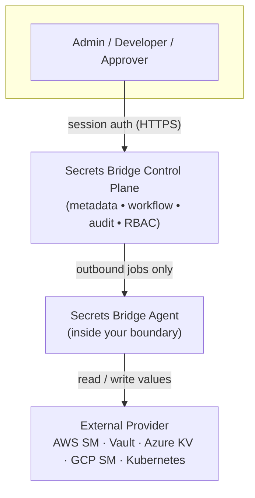

# Product status

This page is the map of what exists today, what has been QA-certified, what's
actively being built, and what's still on the roadmap. Nothing below is
aspirational unless it sits under **Roadmap**.

!!! info "What Secrets Bridge is"
    Secrets Bridge is a **unified secrets control plane** for governing secrets
    across external providers **without storing secret values in the control
    plane**.

    It **does not replace** HashiCorp Vault, AWS Secrets Manager, Azure Key
    Vault, GCP Secret Manager, or Kubernetes External Secrets. It governs
    **access, workflows, approvals, audit, and agent execution** around them.
    The values stay in your provider.

## Implemented features

Everything in this section is built and running.

| Feature | What it does |
|---|---|
| **Provider connections** | Manage external secret-provider connections and bind them to projects / environments. |
| **Agent onboarding** | Outbound-only agent enrollment with **one-time enrollment tokens** bound to one provider connection. The enrollment at pod start with a PVC is being replaced before the first release by the operator-side flow listed under [In progress](#in-progress). |
| **Direct reveal** | Controlled non-prod secret reveal with **MFA step-up**, **TTL**, **single-shot wraps**, and a **server-anchored countdown**. |
| **Prod protection** | Direct reveal is **hard-blocked for prod** environments and the refusal is audited (metadata-only). |
| **Cross-team secret request flow** | Requester submits destination keys → value provider fills values → approver verifies → agent executes the provider write. |
| **Destination key enforcement** | Destination keys are validated at the **submit, fill, and execute** boundaries. |
| **Metadata-only audit trail** | Records actions, IDs, statuses, reasons, and timestamps; **never** plaintext values, tokens, or wrap bodies. |
| **Agent fleet visibility** | Admin / provider agent list, `provider_connection_id` binding, active / stale / revoked status, revoke flow, and heartbeat. |
| **Security model** | No secret values in Postgres, Redis, audit logs, browser storage, or control-plane logs. |

## QA-certified

The following flows have passed a focused QA cycle and are tracked as a
release / demo candidate. "PASS" means verified end-to-end, not merely merged.

| Certification | Status |
|---|---|
| Project access (RBAC + environment scoping) | ✅ PASS |
| Direct reveal end-to-end + TTL | ✅ PASS |
| Prod reveal refusal | ✅ PASS |
| Cross-team backend / API lifecycle | ✅ PASS |
| Cross-team UI drawer submit | ✅ PASS |
| Approver verify-panel context | ✅ PASS |
| Plaintext-leakage sweep | ✅ PASS |
| Agent Onboarding API (earlier single-step enrollment; the two-step flow under In progress has not been through QA) | ✅ PASS / CLOSED |

## In progress

Being built now; not yet live or certified. Do not depend on these yet.

- **Stateless agent with a customer-owned key** (first-release requirement,
  [skills#116](https://github.com/secrets-bridge/skills/issues/116)): an
  operator runs `secrets-bridge-agent enroll` inside their boundary, which
  generates the X25519 wire-encryption key locally, proves possession
  through a sealed challenge and receives `agent_id` and `agent_secret` once.
  The bundle goes to AWS Secrets Manager, Vault or a Kubernetes Secret; the
  agent reads it from a read-only Secret (`identity.existingSecret`, mounted
  `0400` at `/etc/secrets-bridge/agent`) and writes nothing. The control plane
  stores only the public key and a hash of the secret. Every agent request
  carries its key fingerprint, there is no public-key overwrite route, and the
  key rotates through an audited flow with a fresh second factor. The PVC and
  enrollment at pod start are removed with no compatibility mode. Being built
  across the api, agent, console and chart; not merged, not through QA. See
  [Agent onboarding](../operations/agent-onboarding.md).
- **Richer agent fleet dashboard (UI)**: the agent management API exists; the
  full fleet UI view is next.
- **Object storage for media**: project and team logos move from Postgres to
  a private S3 or S3-compatible bucket, served through the api with the
  existing authorization. Secret values never go to object storage.
  Implemented in the api and the chart, not yet through QA. See
  [Object storage](../operations/object-storage.md).
- **Signed releases**: every image and chart is signed with cosign by the
  workflow that built it, and images carry an SBOM and build provenance.
  All repos release together under one shared version; the first release
  has not been tagged yet. See
  [Verifying images and charts](../operations/verifying-releases.md).
- **Sign in with Google, with admin approval**: an admin connects a Google
  Workspace from the console. Accounts are bound by Google's issuer and
  subject, the `hd` claim must be in the allowed domains, and new accounts
  wait for an admin to approve them with a role and scope. Existing
  accounts connect Google from their profile. The worker can post one
  webhook message per run about waiting accounts. Merged in the api,
  console and worker, not yet through QA. See
  [Sign in with Google](../operations/google-sign-in.md).
- **Gateway, Release 1 (Argo CD)**: an optional, outbound-only, read-only
  component that runs in your boundary and reports Argo CD rollout state as
  metadata. Merged, not yet through QA:
    - the Gateway binary (Argo CD connector only, signed image) and its Helm
      chart (no RBAC, no service-account token, egress-only NetworkPolicy);
    - the Argo CD privilege probe: at boot and at every recheck (5 minutes
      by default) the Gateway asks Argo CD's can-i, for each allowed
      AppProject and each static target it has read, whether its token can
      write, exec, read logs, write ApplicationSets or change the AppProject,
      and refuses to run on any `yes`. A read probe (`applications get` on
      `*/*`) reports the connector `degraded` when the token can read every
      AppProject. An Argo CD outage at boot makes the pod crash-loop, and the
      refusal names the failed check. Resource-action grants are not visible
      to can-i and stay the integrator's policy review.
      See [Argo CD privilege checks](../operations/gateway.md#argo-cd-privilege-checks);
    - Application identity: the Gateway pins each target's `metadata.uid`
      (optionally fixed in the values as `applications[].uid`), answers
      `target_identity_changed` when it changes, and sends only a scoped
      digest of it, in evidence and in its catalog. The control plane pins
      the first digest for each target; a different one suspends the
      target's bindings until a platform admin re-confirms it. See
      [Application identity](../operations/gateway.md#application-identity);
    - the control-plane registry: enrollment, heartbeat, catalog, connector
      approval, bindings, disable, enable, revoke and the `gateway.*`
      permissions;
    - observation tasks: a change that reaches `executed` in an environment
      whose observation source is `gateway` gets a task per binding, which the
      Gateway claims, leases and answers with metadata-only evidence that the
      control plane checks against the task's target before it computes the
      verdict. Tasks are not dispatched for a connector that a replica
      reported `over_privileged` in the last 10 minutes;
    - the per-environment observation source (`gateway` or `none`, the
      default) and the request's evidence at
      `GET /requests/:id/observations`;
    - the worker sweepers for leases, deadlines, stale Gateways and old
      replica rows (`SB_WORKER_GATEWAY_SWEEPERS_ENABLED`);
    - the console: Admin → Gateways, the Observation column on a project's
      environments, and the Argo CD panel on the request page.

    - the cutover ([gateway#13](https://github.com/secrets-bridge/gateway/issues/13)):
      the Gateway is the only component that talks to Argo CD. The control
      plane's Argo CD poller, its endpoint and app-mapping routes and the
      stored Argo CD tokens are removed, along with the console's
      Integrations pages. `GET /requests/:id/gitops` serves the old poller
      rows as read-only history, shown on the request page as context only.
      See
      [Gateway cutover](../operations/gateway-cutover.md).

    Argo CD `Healthy` and `Synced` are operational state, never proof that a
    secret reached a workload: a Release 1 task ends `unverified`
    (`context_only`), never `verified`, and a Gateway that is offline or late
    leaves it `pending` and then `timed_out`, never failed. See
    [Gateway](../components/gateway.md).

## Live vs Roadmap

### Live / implemented

- AWS Secrets Manager provider connection
- Outbound agent (execution inside your boundary)
- Direct reveal (non-prod, MFA-gated, single-shot)
- Cross-team request → fill → approve → execute workflow
- Metadata-only audit trail
- Provider-bound agent onboarding (one-time enrollment tokens). The stateless, customer-key flow that replaces enrollment at pod start is in progress
- Agent revoke / list / status
- Non-prod reveal protection
- Prod reveal refusal (audited)

### Retired

- Control-plane Argo CD observation (the worker's GitOps poller,
  `SB_GITOPS_ENABLED`, Argo CD endpoints and app mappings). Argo CD state now
  comes only from a [Gateway](../components/gateway.md). Old observations stay
  readable as history, labelled context only.

### Roadmap / coming later

*Listed here because they are **not** live yet. Do not read these as shipped.*

- Azure Key Vault provider
- GCP Secret Manager provider
- HashiCorp Vault advanced flows
- Deeper Kubernetes External Secrets integration
- Flux integration
- Gateway Release 2: External Secrets Operator sync and Deployment rollout
  observation (in the gateway code, off by default and not supported for
  production)
- Gateway Argo CD discovery and AppProject-scoped bindings (ADR 0002,
  [gateway#25](https://github.com/secrets-bridge/gateway/issues/25)): the
  Gateway would list the Applications in its allowed AppProjects, and a
  binding would cover a project instead of one named target. The transport
  rule for the list read exists; discovery itself is not built
- Signed Gateway evidence ([gateway#7](https://github.com/secrets-bridge/gateway/issues/7)),
  required before Gateway evidence is used as compliance evidence
- Agent connection-scoped job claim
- Richer agent fleet dashboard

## Security model at a glance

- The **agent is outbound-only**: it opens connections to the control plane and
  to its local provider; it never accepts inbound connections.
- The agent **accepts no inbound connections** for control-plane or user
  traffic. Its only listener serves health probes and metrics; the Helm
  chart binds it on the pod IP for kubelet and its NetworkPolicy denies all
  ingress.
- The agent has **no Postgres and no Redis** dependency, and **no Kubernetes API
  access** to read or write Secrets. With the in-progress stateless flow it
  also keeps no durable state and reads its credential and key from a
  read-only Secret.
- The **control plane stores metadata only**, never plaintext values.
- **Secrets remain in the provider.** Secrets Bridge governs access around them.
- Values move only through **controlled, wrapped, single-shot** flows
  (KMS-wrapped envelopes, consumed exactly once, short TTL).
- **Audit is metadata-only**: actions, IDs, statuses, reasons, timestamps; no
  values, tokens, or wrap bodies.

See the [full architecture](architecture.md) and the
[threat model](threat-model.md) for how each boundary is enforced.

## The guarantees we hold

- **Outbound-only agent**: no inbound listener apart from the probe and
  metrics port, no cluster-API dependency.
- **Metadata-only audit**: append-only at the schema layer (Postgres triggers).
- **No plaintext persistence**: not in Postgres, Redis, logs, or the browser.
- **MFA-gated reveal**: non-prod reveals require an MFA step-up.
- **Prod reveal hard-block**: refused and audited, not merely discouraged.
- **One-time enrollment tokens**: hash-only, short-TTL, returned once, spent once.
- **Provider-bound agents**: an enrolled agent is bound to a single provider
  connection.
- **Revocation**: an agent can be revoked; its heartbeats and job polling stop
  being accepted immediately.
